# 第1章 微服务介绍

# 1、环境问题
> 1、JDK1.8【必须保证】
>
> 2、IDEA 是否能用【能用即可】
>
> 3、MySQL【能用即可】
>
> 4、Maven【能用即可】
>

## **系统架构演变**
随着互联网的发展，网站应用的规模也在不断的扩大，进而导致系统架构也在不断的进行变化。   

从互联网早起到现在，系统架构大体经历了下面几个过程: 单体应用架构--->垂直应用架构--->分布

式架构--->SOA架构--->微服务架构，当然还有悄然兴起的Service Mesh(服务网格化)。

接下来我们就来了解一下每种系统架构是什么样子的，以及各有什么优缺点。

### **1.1  单体应用架构**
互联网早期，一般的网站应用流量较小，只需一个应用，将所有功能代码都部署在一起就可以，这样可以减少开发、部署和维护的成本。

比如说一个电商系统，里面会包含很多用户管理，商品管理，订单管理，物流管理等等很多模块，  我们会把它们做成一个web项目，然后部署到一台tomcat服务器上。

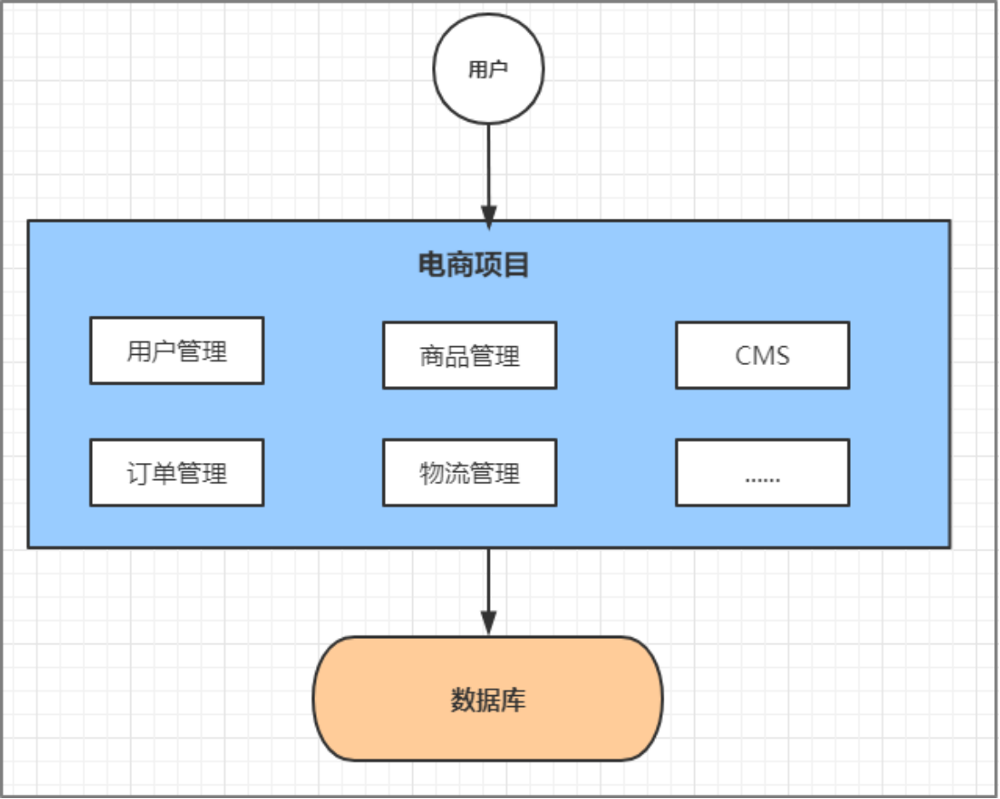

##### **优点：**
+ 项目架构简单，小型项目的话，开发成本低项目
+ 部署在一个节点上，维护方便

##### **缺点：**
+ 全部功能集成在一个工程中，对于大型项目来讲不易开发和维护
+ 项目模块之间紧密耦合，单点容错率低
+ 无法针对不同模块进行针对性优化和水平扩展

### **1.2  垂直应用架构**
随着访问量的逐渐增大，单一应用只能依靠增加节点来应对，但是这时候会发现并不是所有的模块  都会有比较大的访问量.

还是以上面的电商为例子，用户访问量的增加可能影响的只是用户和订单模块，但是对消息模块的影响就比较小. 那么此时我们希望只多增加几个订单模块，而不增加消息模块. 此时单体应用就做不到了，垂直应用就应运而生了.

所谓的垂直应用架构，就是将原来的一个应用拆成互不相干的几个应用，以提升效率。比如我们可  以将上面电商的单体应用拆分成:

+ 电商系统(用户管理商品管理订单管理) 
+ 后台系统(用户管理订单管理客户管理) 
+ CMS系统(广告管理营销管理)

这样拆分完毕之后，一旦用户访问量变大，只需要增加电商系统的节点就可以了，而无需增加后台和CMS的节点。

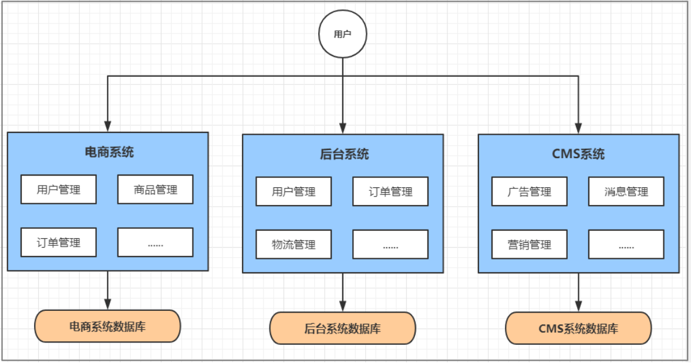

##### **优点：**
+ 系统拆分实现了流量分担，解决了并发问题，而且可以针对不同模块进行优化和水平扩展
+ 一个系统的问题不会影响到其他系统，提高容错率

##### **缺点：**
+ 系统之间相互独立，无法进行相互调用系统之间相互独立，会有重复的开发任务

### 1.3 分布式架构
当垂直应用越来越多，重复的业务代码就会越来越多。这时候，我们就思考可不可以将重复的代码抽取出来，做成统一的业务层作为独立的服务，然后由前端控制层调用不同的业务层服务呢？

这就产生了新的分布式系统架构。它将把工程拆分成表现层和服务层两个部分，服务层中包含业务  逻辑。表现层只需要处理和页面的交互，业务逻辑都是调用服务层的服务来实现。

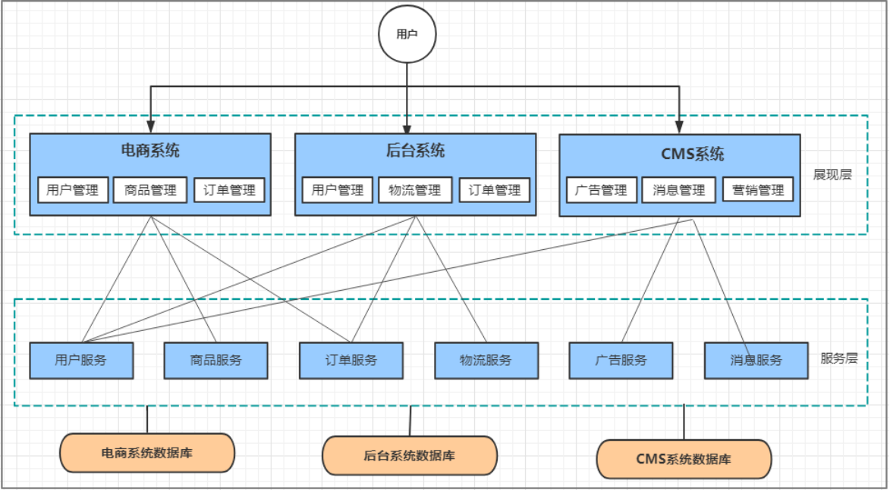

**优点**：

+ 抽取公共的功能为服务层，提高代码复用性

**缺点**：

+ 系统间耦合度变高，调用关系错综复杂，难以维护

### 1.4 SOA架构
在分布式架构下，当服务越来越多，容量的评估，小服务资源的浪费等问题逐渐显现，此时需增加  一个调度中心对集群进行实时管理。此时，用于资源调度和治理中心(SOA Service Oriented Architecture，面向服务的架构)是关键。

##### **优点****:**
+ 使用注册中心解决了服务间调用关系的自动调节

**缺点:**

+ 服务间会有依赖关系，一旦某个环节出错会影响较大( 服务雪崩)
+ 服务关心复杂，运维、测试部署困难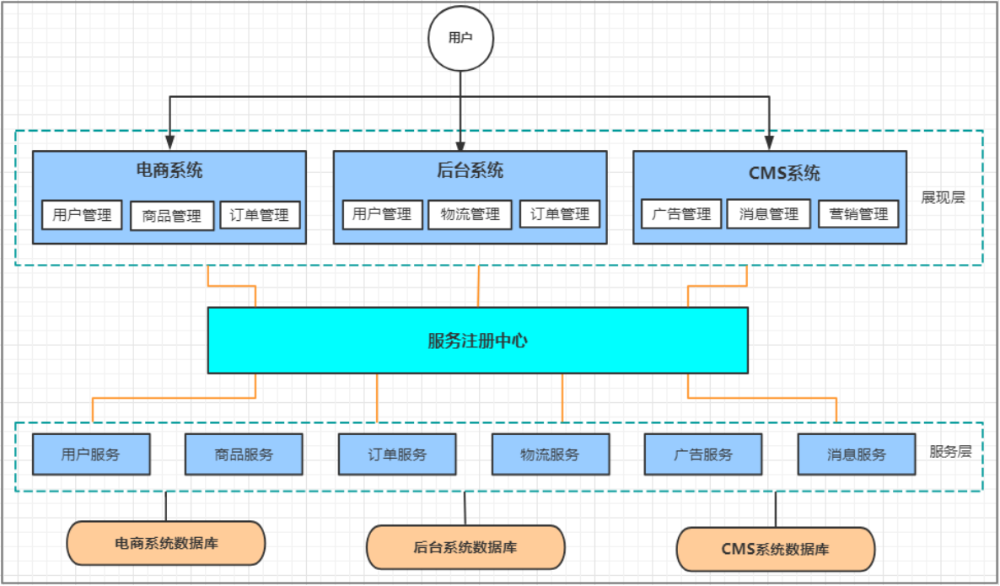

### **1.5 微服务架构**
微服务架构在某种程度上是面向服务的架构SOA继续发展的下一步，它更加强调服务的"彻底拆分"。

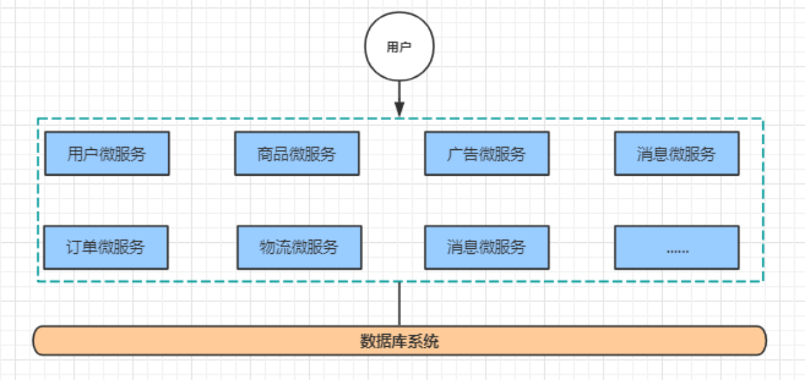

**优点**：

+ 服务原子化拆分，独立打包、部署和升级，保证每个微服务清晰的任务划分，利于扩展
+ 微服务之间采用Restful等轻量级http协议相互调用

**缺点**：

+ 分布式系统开发的技术成本高（容错、分布式事务等）

## 微服务架构介绍
微服务架构，简单的说就是将单体应用进一步拆分，拆分成更小的服务，每个服务都是一个可以独立运行的项目。

### **微服务架构的常见问题**
一旦采用微服务系统架构，就势必会遇到这样几个问题：

+ 这么多小服务，如何管理他们？(服务治理注册中心[服务注册发现剔除]) 
+ 这么多小服务，他们之间如何通讯？(**restful **rpc)
+ 这么多小服务，客户端怎么访问他们？(网关)
+ 这么多小服务，一旦出现问题了，应该如何自处理？(容错) 
+ 这么多小服务，一旦出现问题了，应该如何排错? (链路追踪)

对于上面的问题，是任何一个微服务设计者都不能绕过去的，因此大部分的微服务产品都针对每一个问题提供了相应的组件来解决它们。

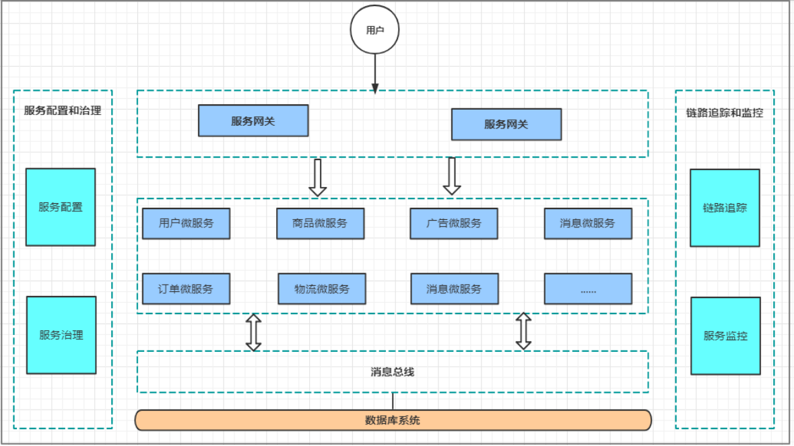

### **微服务架构的常见概念**
#### 服务治理
服务治理就是进行服务的自动化管理，其核心是服务的自动注册与发现。

**服务注册**：服务实例将自身服务信息注册到注册中心。

**服务发现**：服务实例通过注册中心，获取到注册到其中的服务实例的信息，通过这些信息去请求它们提  供的服务。

**服务剔除**：服务注册中心将出问题的服务自动剔除到可用列表之外，使其不会被调用到。

#### 服务调用
在微服务架构中，通常存在多个服务之间的远程调用的需求。目前主流的远程调用技术有基于

HTTP的RESTful接口以及基于TCP的RPC协议。

+ **REST**(Representational State Transfer)

这是一种HTTP调用的格式，更标准，更通用，无论哪种语言都支持http协议

+ **RPC**（Remote Promote Call）

一种进程间通信方式。允许像调用本地服务一样调用远程服务。RPC框架的主要目标就是让远程服  务调用更简单、透明。RPC框架负责屏蔽底层的传输方式、序列化方式和通信细节。开发人员在使  用的时候只需要了解谁在什么位置提供了什么样的远程服务接口即可，并不需要关心底层通信细节  和调用过程。

**区别与联系**

| **比较项** | **RESTful** | **RPC** |
| :--- | :--- | :--- |
| 通讯协议 | HTTP | 一般使用TCP |
| 性能 | 略低 | 较高 |
| 灵活度 | 高 | 低 |
| 应用 | 微服务架构 | SOA架构 |

#### 2.2.3 服务网关
随着微服务的不断增多，不同的微服务一般会有不同的网络地址，而外部客户端可能需要调用多个  服务的接口才能完成一个业务需求，如果让客户端直接与各个微服务通信可能出现：

+ 客户端需要调用不同的url地址，增加难度
+ 在一定的场景下，存在跨域请求的问题
+ 每个微服务都需要进行单独的身份认证

针对这些问题，API网关顺势而生。

API网关直面意思是将所有API调用统一接入到API网关层，由网关层统一接入和输出。一个网关的    基本功能有：统一接入、安全防护、协议适配、流量管控、长短链接支持、容错能力。有了网关之后，  各个API服务提供团队可以专注于自己的的业务逻辑处理，而API网关更专注于安全、流量、路由等问题。

#### 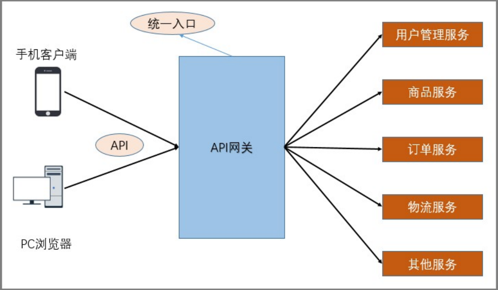
#### **2.2.4 服务容错**
在微服务当中，一个请求经常会涉及到调用几个服务，如果其中某个服务不可用，没有做服务容错的话，极有可能会造成一连串的服务不可用，这就是雪崩效应。

我们没法预防雪崩效应的发生，只能尽可能去做好容错。服务容错的三个核心思想是：

+ 不被外界环境影响
+ 不被上游请求压垮
+ 不被下游响应拖垮

#### 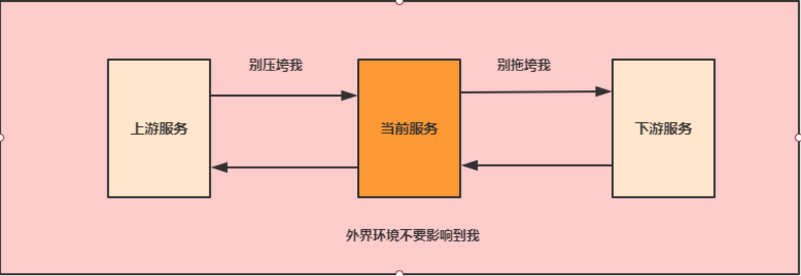
#### 2.2.5 链路追踪  

随着微服务架构的流行，服务按照不同的维度进行拆分，一次请求往往需要涉及到多个服务。互联  网应用构建在不同的软件模块集上，这些软件模块，有可能是由不同的团队开发、可能使用不同的编程  语言来实现、有可能布在了几千台服务器，横跨多个不同的数据中心。因此，就需要对一次请求涉及的  多个服务链路进行日志记录，性能监控即链路追踪。

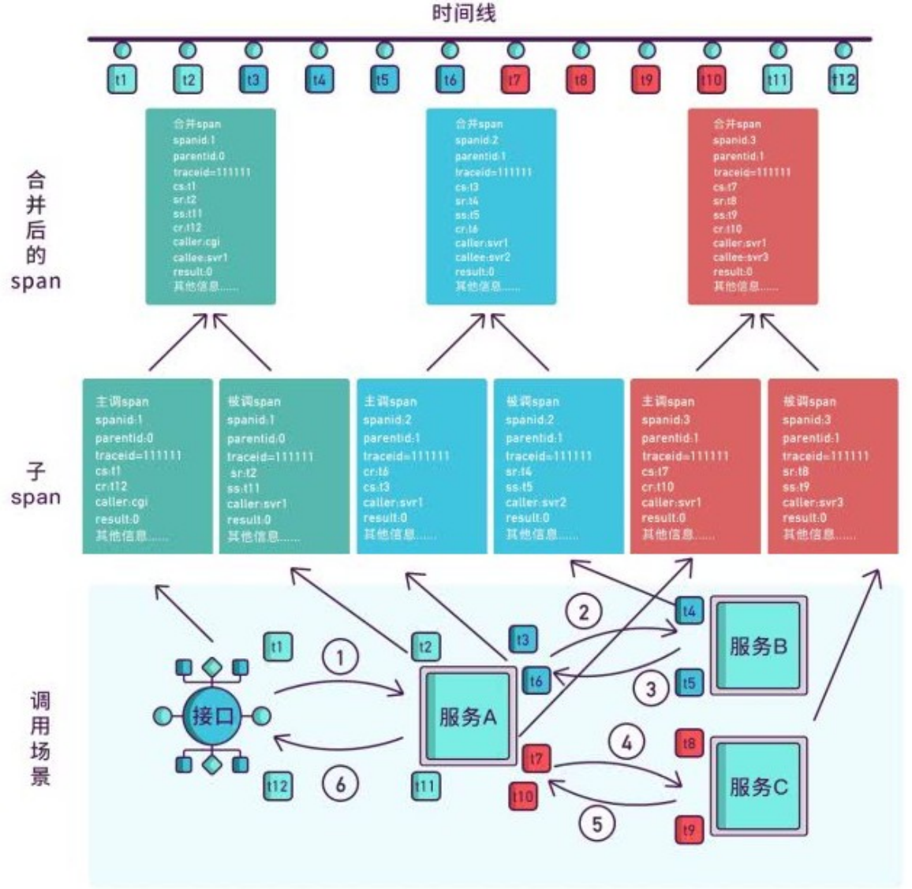

## 微服务架构的常见解决方案
### ServiceComb
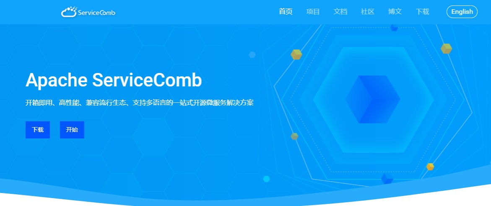

Apache ServiceComb，前身是华为云的微服务引擎CSE (Cloud Service  Engine)  云服务，是全球首个Apache微服务顶级项目。它提供了一站式的微服务开源解决方案，致力于帮助企业、用户和开发   者将企业应用轻松微服务化上云，并实现对微服务应用的高效运维管理。

### SpringCloud
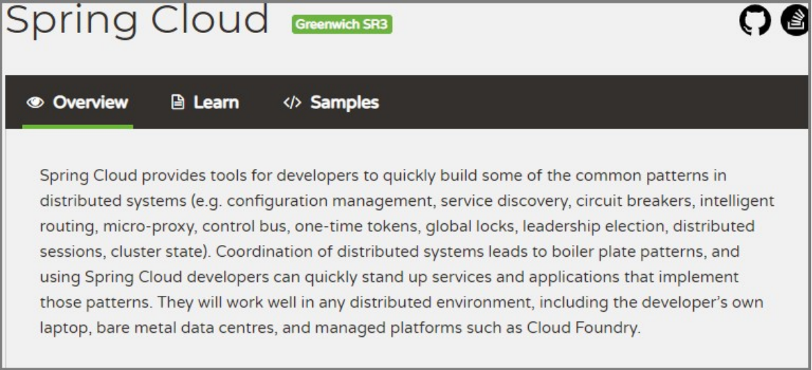

Spring Cloud是一系列框架的集合。它利用Spring Boot的开发便利性巧妙地简化了分布式系统基础设施的开发，如服务发现注册、配置中心、消息总线、负载均衡、断路器、数据监控等，都可以用Spring Boot的开发风格做到一键启动和部署。

Spring Cloud并没有重复制造轮子，它只是将目前各家公司开发的比较成熟、经得起实际考验的服务框架组合起来，通过Spring Boot风格进行再封装屏蔽掉了复杂的配置和实现原理，最终给开发者留出了一套简单易懂、易部署和易维护的分布式系统开发工具包。

### SpringCloud Alibaba
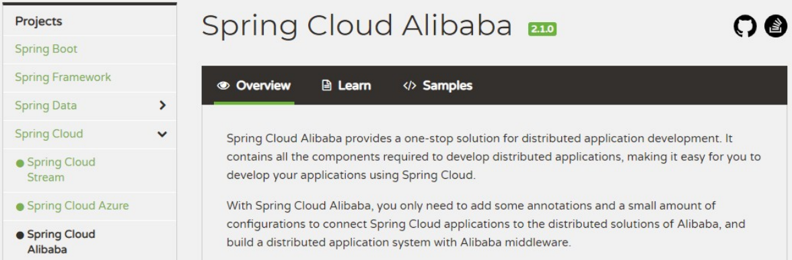

Spring Cloud Alibaba 致力于提供微服务开发的一站式解决方案。此项目包含开发分布式应用微服务的必需组件，方便开发者通过Spring Cloud 编程模型轻松使用这些组件来开发分布式应用服务。

依托Spring Cloud Alibaba，您只需要添加一些注解和少量配置，就可以将Spring Cloud 应用接入阿里微服务解决方案，通过阿里中间件来迅速搭建分布式应用系统。【阿里巴巴、蚂蚁金服（阿里系）】

####  主要功能
**服务限流降级**：默认支持WebServlet、WebFlux，OpenFeign、RestTemplate、Spring Cloud Gateway，Zuul，Dubbo 和RocketMQ 限流降级功能的接入，可以在运行时通过控制台实时修改限流降级规则，还支持查看限流降级Metrics 监控。

**服务注册与发现**：适配Spring Cloud 服务注册与发现标准，默认集成了Ribbon 的支持。

**分布式配置管理**：支持分布式系统中的外部化配置，配置更改时自动刷新。    **消息驱动能力**：基于Spring Cloud Stream 为微服务应用构建消息驱动能力。

**分布式事务**：使用@GlobalTransactional 注解，高效并且对业务零侵入地解决分布式事务问题。**阿里云对象存储**：阿里云提供的海量、安全、低成本、高可靠的云存储服务。支持在任何应用、任  何时间、任何地点存储和访问任意类型的数据。

**分布式任务调度**：提供秒级、精准、高可靠、高可用的定时（基于Cron  表达式）任务调度服务。同时提供分布式的任务执行模型，如网格任务。网格任务支持海量子任务均匀分配到所有Worker（schedulerx-client）上执行。

**阿里云短信服务**：覆盖全球的短信服务，友好、高效、智能的互联化通讯能力，帮助企业迅速搭建  客户触达通道。

#### 组件
**Sentinel**：把流量作为切入点，从流量控制、熔断降级、系统负载保护等多个维度保护服务的稳  定性。

**Nacos**：一个更易于构建云原生应用的动态服务发现、配置管理和服务管理平台。**RocketMQ**：一款开源的分布式消息系统，基于高可用分布式集群技术，提供低延时的、高可靠  的消息发布与订阅服务。

**Dubbo**：Apache Dubbo™ 是一款高性能Java RPC 框架。

**Seata**：阿里巴巴开源产品，一个易于使用的高性能微服务分布式事务解决方案。

**Alibaba Cloud ACM**：一款在分布式架构环境中对应用配置进行集中管理和推送的应用配置中心产品。

**Alibaba Cloud OSS**: 阿里云对象存储服务（Object Storage Service，简称OSS），是阿里云提供的海量、安全、低成本、高可靠的云存储服务。您可以在任何应用、任何时间、任何地点存储和  访问任意类型的数据。

**Alibaba Cloud SchedulerX**:  阿里中间件团队开发的一款分布式任务调度产品，提供秒级、精准、高可靠、高可用的定时（基于Cron 表达式）任务调度服务。

**Alibaba Cloud SMS**: 覆盖全球的短信服务，友好、高效、智能的互联化通讯能力，帮助企业迅速搭建客户触达通道。

  

> 更新: 2025-10-27 15:12:06  
> 原文: <https://www.yuque.com/yayawei-srv9p/pf4se6/qza3uq2ebhftqgmt>