# 第2章 微服务项目搭建

<font style="color:rgb(51,51,51);">我们本次是使用的电商项目中的商品、订单、用户为案例进行讲解。</font>

## **<font style="color:rgb(51,51,51);">案例准备</font>**
### <font style="color:rgb(51,51,51);">技术选型</font>
<font style="color:rgb(51,51,51);">maven</font><font style="color:rgb(51,51,51);">：</font><font style="color:rgb(51,51,51);">3.3.9</font>

<font style="color:rgb(51,51,51);">数据库：</font><font style="color:rgb(51,51,51);">MySQL 5.7</font>

<font style="color:rgb(51,51,51);">持久层:  Mybatis</font>

<font style="color:rgb(51,51,51);">其他: SpringCloud Alibaba 技术栈</font>

### **<font style="color:rgb(51,51,51);">模块设计</font>**
<font style="color:rgb(51,51,51);">springcloud-alibaba </font><font style="color:rgb(51,51,51);">父工程</font>

<font style="color:rgb(51,51,51);">shop-common 公共模块【实体类】</font>

<font style="color:rgb(51,51,51);">shop-user 用户微服务【端口: 807x】</font>

<font style="color:rgb(51,51,51);">shop-product 商品微服务【端口: 808x】</font>

<font style="color:rgb(51,51,51);">shop-order 订单微服务【端口: 809x】</font>

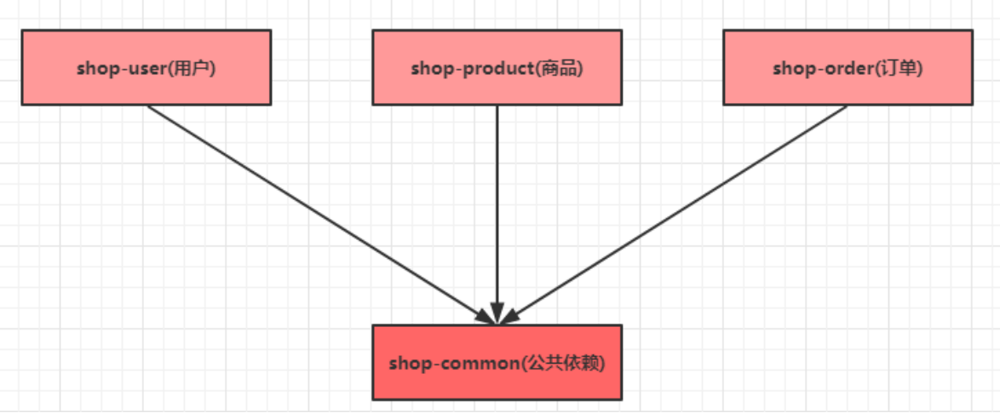

### **<font style="color:rgb(51,51,51);">微服务调用</font>**
<font style="color:rgb(51,51,51);">在微服务架构中，最常见的场景就是微服务之间的相互调用。我们以电商系统中常见的</font>**<font style="color:rgb(51,51,51);">用户下单</font>**<font style="color:rgb(51,51,51);">为</font><font style="color:rgb(51,51,51);">  </font><font style="color:rgb(51,51,51);">例来演示微服务的调用：客户向订单微服务发起一个下单的请求，在进行保存订单之前需要调用商品微</font><font style="color:rgb(51,51,51);">  </font><font style="color:rgb(51,51,51);">服务查询商品的信息。</font>

<font style="color:rgb(51,51,51);">我们一般把服务的主动调用方称为</font>**<font style="color:rgb(51,51,51);">服务消费者</font>**<font style="color:rgb(51,51,51);">，把服务的被调用方称为</font>**<font style="color:rgb(51,51,51);">服务提供者</font>**<font style="color:rgb(51,51,51);">。</font>

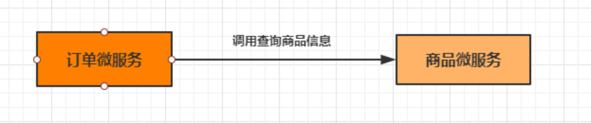

<font style="color:rgb(51,51,51);">在这种场景下，订单微服务就是一个服务消费者，商品微服务就是一个服务提供者。</font>

## <font style="color:rgb(51, 51, 51);">创建父工程</font>
### <font style="color:rgb(51, 51, 51);">新建一个maven工程</font>
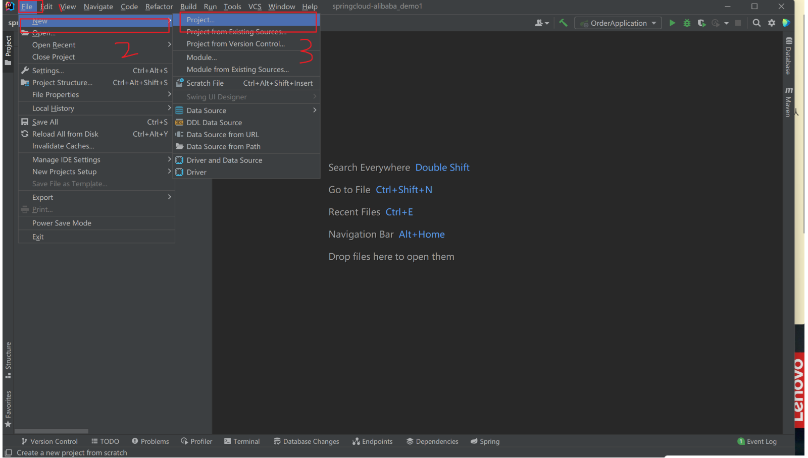

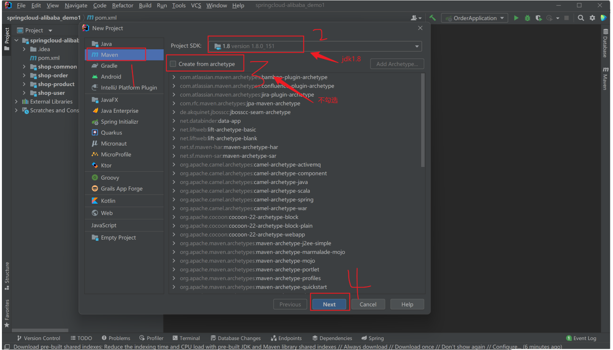

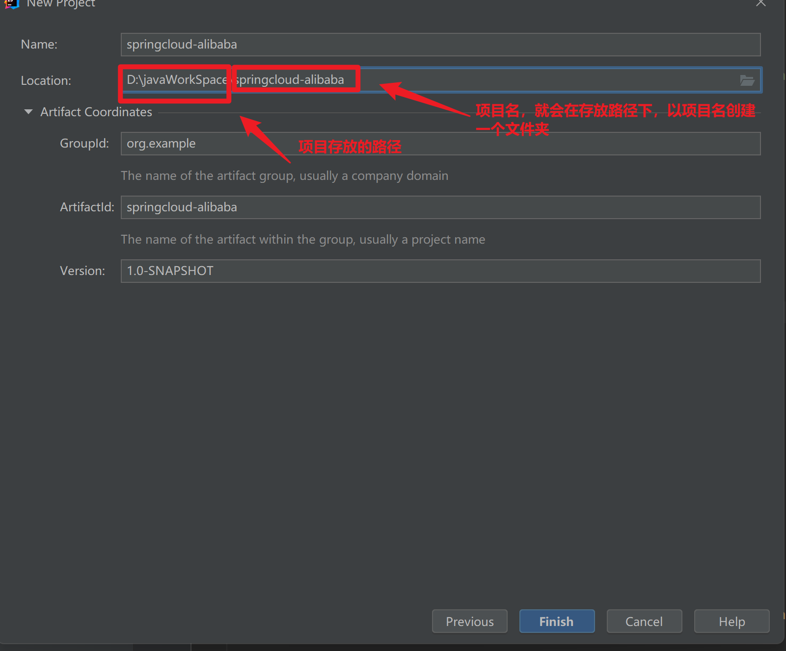

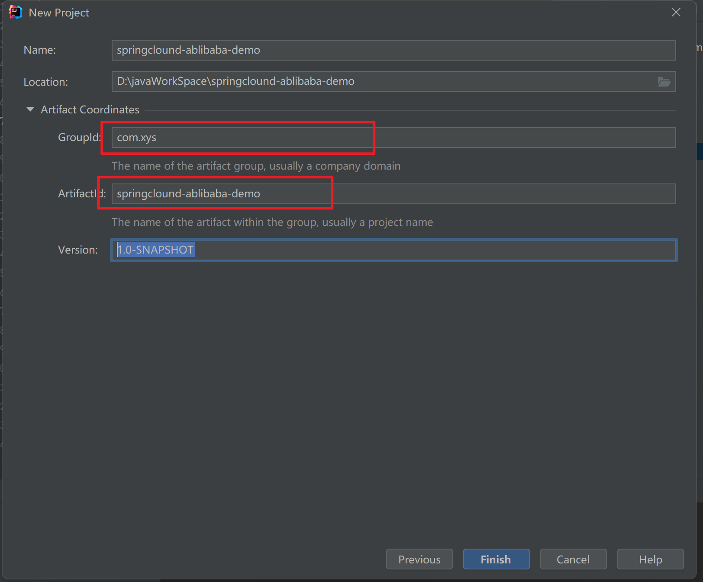

### <font style="color:rgb(51, 51, 51);">由于父工程不写代码可以将src删除</font>
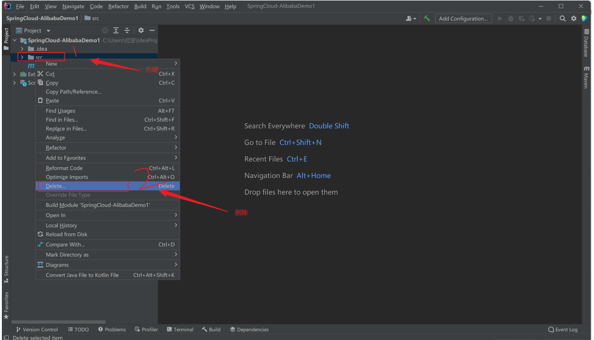

### <font style="color:rgb(51, 51, 51);">在pom.xml文件中添加以下内容，主要是指定SpringBoot父工程和依赖版本锁定</font>
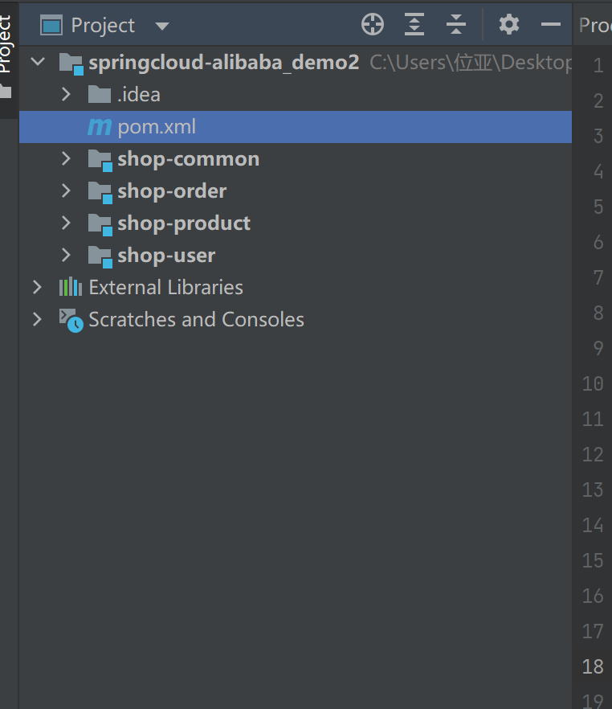

```xml
<?xml version="1.0" encoding="UTF-8"?>
<project xmlns="http://maven.apache.org/POM/4.0.0"
  xmlns:xsi="http://www.w3.org/2001/XMLSchema-instance"
  xsi:schemaLocation="http://maven.apache.org/POM/4.0.0 http://maven.apache.org/xsd/maven-4.0.0.xsd">
  <modelVersion>4.0.0</modelVersion>

  <groupId>com.xys</groupId>
  <artifactId>SpringCloud-AlibabaDemo1</artifactId>
  <packaging>pom</packaging>
  <version>1.0-SNAPSHOT</version>
  <modules>
    <module>shop-common</module>
    <module>shop-user</module>
    <module>shop-product</module>
    <module>shop-order</module>
  </modules>

  <!--父工程-->
  <parent>
    <groupId>org.springframework.boot</groupId>
    <artifactId>spring-boot-starter-parent</artifactId>
    <version>2.1.3.RELEASE</version>
  </parent>

  <!--依赖版本的锁定-->
  <properties>
    <java.version>1.8</java.version>
    <project.build.sourceEncoding>UTF-8</project.build.sourceEncoding>
    <project.reporting.outputEncoding>UTF-8</project.reporting.outputEncoding>
    <spring-cloud.version>Greenwich.RELEASE</spring-cloud.version>
    <spring-cloud-alibaba.version>2.1.0.RELEASE</spring-cloud-alibaba.version>
  </properties>

  <dependencyManagement>
    <dependencies>
      <dependency>
        <groupId>org.springframework.cloud</groupId>
        <artifactId>spring-cloud-dependencies</artifactId>
        <version>${spring-cloud.version}</version>
        <type>pom</type>
        <scope>import</scope>
      </dependency>
      <dependency>
        <groupId>com.alibaba.cloud</groupId>
        <artifactId>spring-cloud-alibaba-dependencies</artifactId>
        <version>${spring-cloud-alibaba.version}</version>
        <type>pom</type>
        <scope>import</scope>
      </dependency>
    </dependencies>
  </dependencyManagement>
</project>
```

## <font style="color:rgb(51, 51, 51);">配置maven</font>
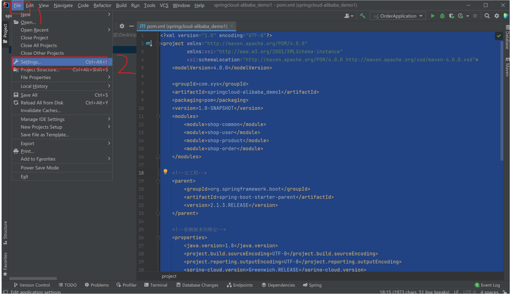

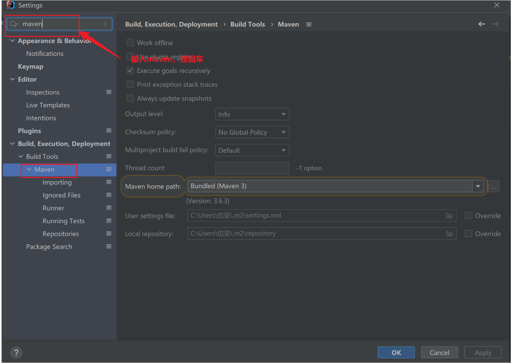

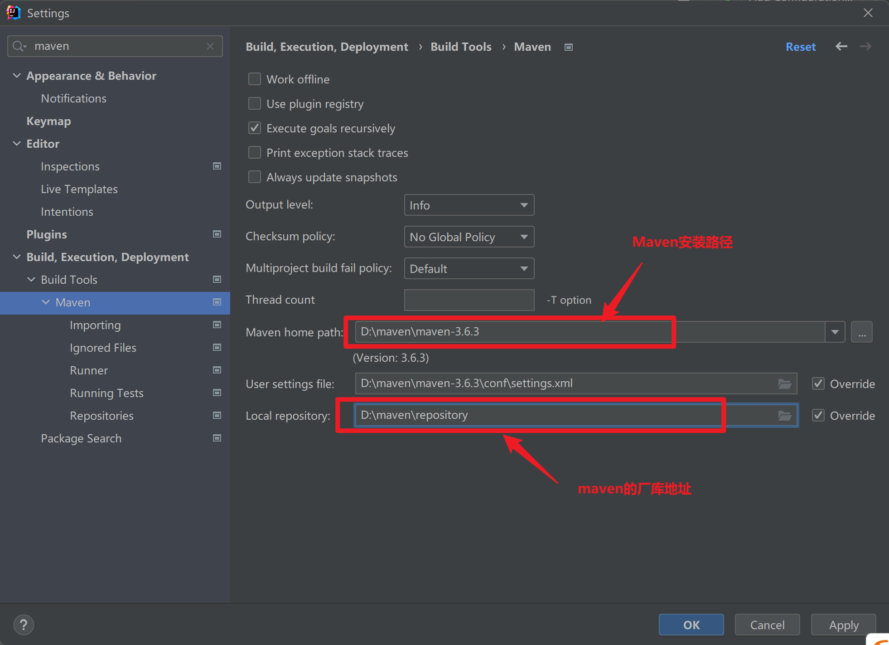

## <font style="color:rgb(51, 51, 51);">创建基础模块</font>
### <font style="color:rgb(51, 51, 51);">创建 shop-common模块</font>
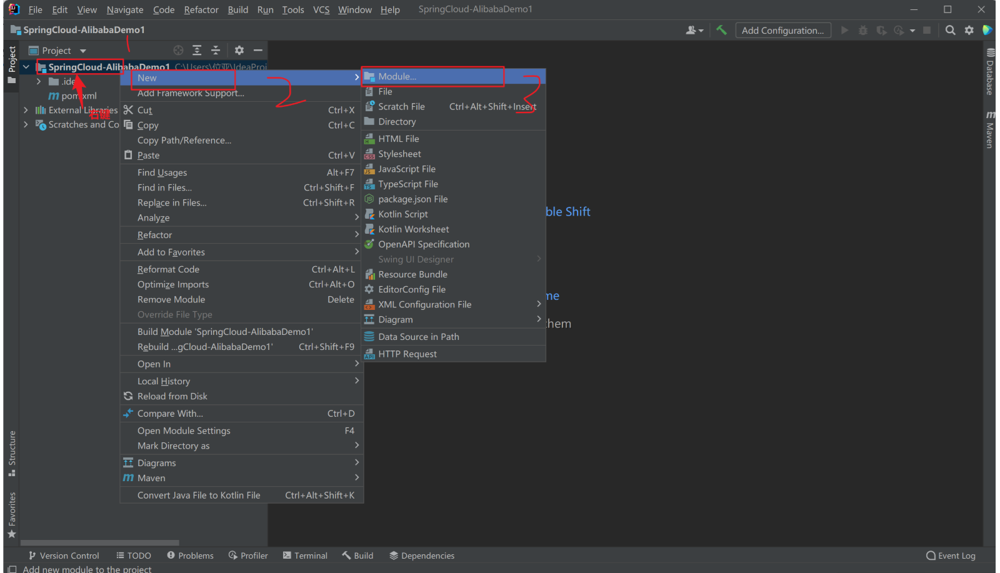

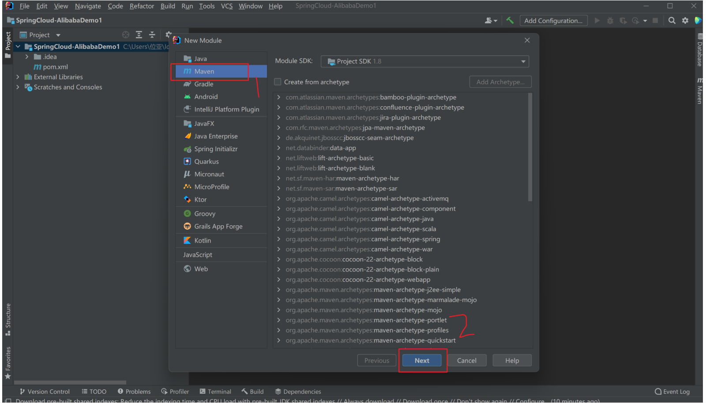

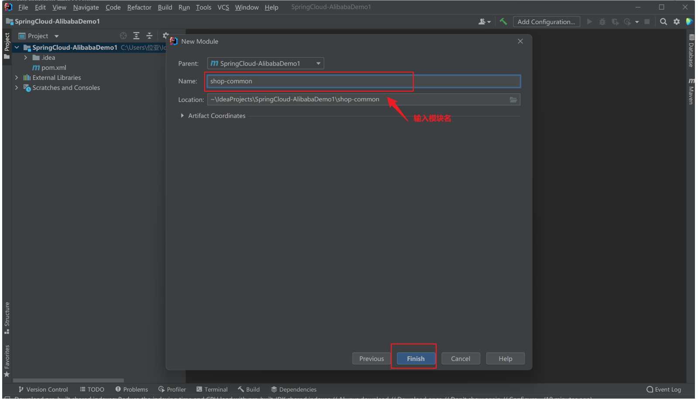

### <font style="color:rgb(51, 51, 51);">在pom.xml文件中添加依赖</font>
```xml
<?xml version="1.0" encoding="UTF-8"?>
<project xmlns="http://maven.apache.org/POM/4.0.0"
  xmlns:xsi="http://www.w3.org/2001/XMLSchema-instance"
  xsi:schemaLocation="http://maven.apache.org/POM/4.0.0 http://maven.apache.org/xsd/maven-4.0.0.xsd">
  <parent>
    <artifactId>SpringCloud-AlibabaDemo1</artifactId>
    <groupId>com.xys</groupId>
    <version>1.0-SNAPSHOT</version>
  </parent>
  <modelVersion>4.0.0</modelVersion>

  <artifactId>shop-common</artifactId>
  <!--依赖-->
  <dependencies>
    <dependency>
      <groupId>org.projectlombok</groupId>
      <artifactId>lombok</artifactId>
    </dependency>
    <dependency>
      <groupId>com.alibaba</groupId>
      <artifactId>fastjson</artifactId>
      <version>1.2.56</version>
    </dependency>
    <!--mysql驱动-->
    <dependency>
      <groupId>mysql</groupId>
      <artifactId>mysql-connector-java</artifactId>
      <version>5.1.6</version>
    </dependency>
    <!--mybatis依赖-->
    <dependency>
      <groupId>org.mybatis.spring.boot</groupId>
      <artifactId>mybatis-spring-boot-starter</artifactId>
      <version>2.1.0</version>
    </dependency>
  </dependencies>


</project>
```

### <font style="color:rgb(51, 51, 51);">创建实体类</font>
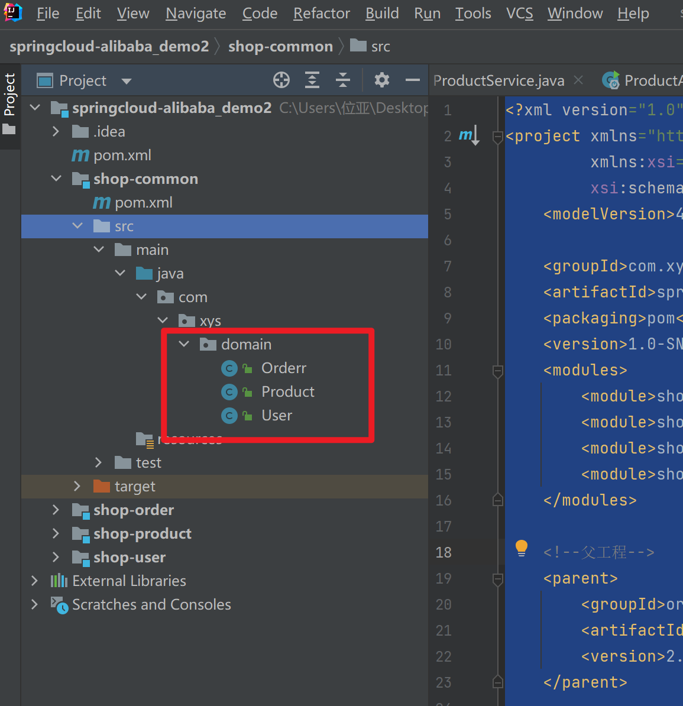

```java
//用户
@Data
public class User { 
    private Integer uid;//主键
    private String username;//用户名
    private String password;//密码 private String telephone;//手机号
}
```

```java
//商品
@Data
public class Product { 
    private Integer pid;//主键
    private String pname;//商品名称 private Double pprice;//商品价格 private Integer stock;//库存
}
```

```java
@Data
public class Orderr { 
    private Long oid;//订单id

    private Integer uid;//用户id private String username;//用户名
    private Integer pid;//商品id private String pname;//商品名称 private Double pprice;//商品单价

    private Integer number;//购买数量
}
```

## <font style="color:rgb(51, 51, 51);">创建用户微服务</font>
### <font style="color:rgb(51, 51, 51);">步骤:</font>
> + <font style="color:rgb(51, 51, 51);">创建模块 导入依赖</font>
> + <font style="color:rgb(51, 51, 51);">创建SpringBoot主类</font>
> + <font style="color:rgb(51, 51, 51);">加入配置文件</font>
> + <font style="color:rgb(51, 51, 51);">创建必要的接口和实现类(controller service dao)</font>
>

### <font style="color:rgb(51, 51, 51);">新建一个 shop-user 模块，然后进行下面操作</font>
### <font style="color:rgb(51, 51, 51);"> 创建pom.xml</font>
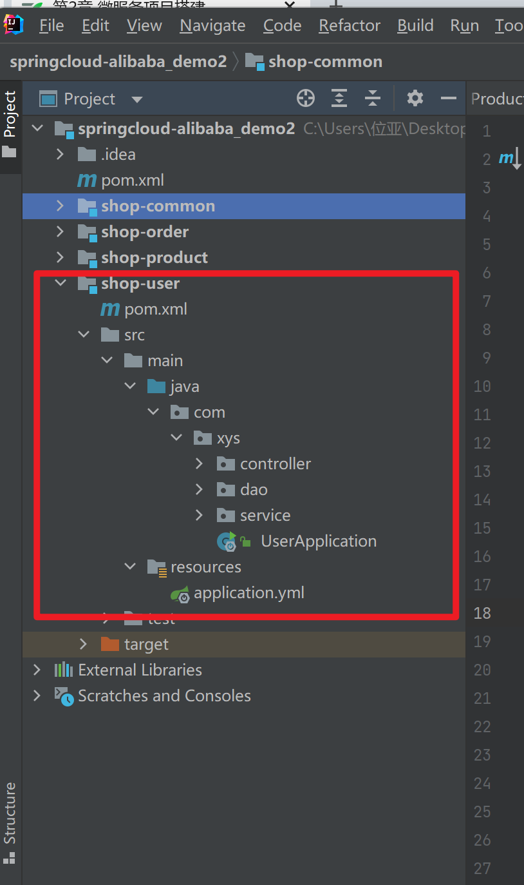

```xml
<?xml version="1.0" encoding="UTF-8"?>
<project xmlns="http://maven.apache.org/POM/4.0.0"
  xmlns:xsi="http://www.w3.org/2001/XMLSchema-instance"
  xsi:schemaLocation="http://maven.apache.org/POM/4.0.0 http://maven.apache.org/xsd/maven-4.0.0.xsd">
  <parent>
    <artifactId>SpringCloud-AlibabaDemo1</artifactId>
    <groupId>com.xys</groupId>
    <version>1.0-SNAPSHOT</version>
  </parent>
  <modelVersion>4.0.0</modelVersion>

  <artifactId>shop-user</artifactId>
  <dependencies>
    <!--spring-web-->
    <dependency>
      <groupId>org.springframework.boot</groupId>
      <artifactId>spring-boot-starter-web</artifactId>
    </dependency>
    <!--shop-common-->
    <dependency>
      <groupId>com.xys</groupId>
      <artifactId>shop-common</artifactId>
      <version>1.0-SNAPSHOT</version>
    </dependency>


  </dependencies>


</project>
```

### <font style="color:rgb(51, 51, 51);">编写主类</font>
```java
@SpringBootApplication
public class UserApplication {
    public static void main(String[] args) {
        SpringApplication.run(UserApplication.class, args);
    }
}
```

### <font style="color:rgb(51, 51, 51);"> 创建配置文件</font>
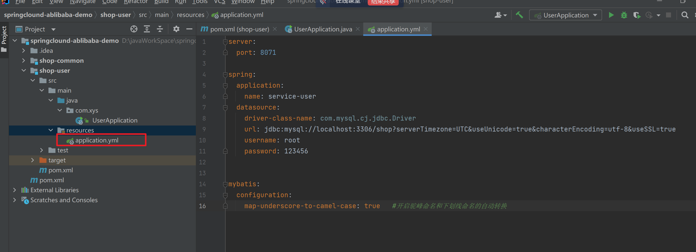

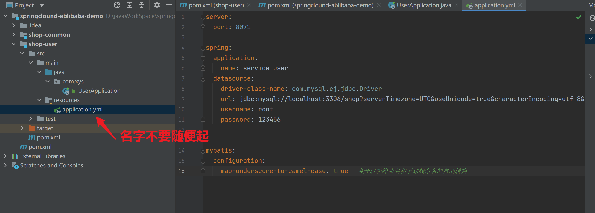

```yaml
server:
  port: 8071

spring:
  application:
    name: service-user
  datasource:
    driver-class-name: com.mysql.cj.jdbc.Driver
    url: jdbc:mysql://localhost:3306/shop?serverTimezone=UTC&useUnicode=true&characterEncoding=utf-8&useSSL=true
    username: root
    password: 123456


mybatis:
  configuration:
    map-underscore-to-camel-case: true   #开启驼峰命名和下划线命名的自动转换
```

## <font style="color:rgb(51, 51, 51);">创建商品微服务</font>
### <font style="color:rgb(51, 51, 51);">创建一个名为 shop_product 的模块，并添加springboot依赖</font>
```xml
<?xml version="1.0" encoding="UTF-8"?>
<project xmlns="http://maven.apache.org/POM/4.0.0"
  xmlns:xsi="http://www.w3.org/2001/XMLSchema-instance"
  xsi:schemaLocation="http://maven.apache.org/POM/4.0.0 http://maven.apache.org/xsd/maven-4.0.0.xsd">
  <parent>
    <artifactId>SpringCloud-AlibabaDemo1</artifactId>
    <groupId>com.xys</groupId>
    <version>1.0-SNAPSHOT</version>
  </parent>
  <modelVersion>4.0.0</modelVersion>

  <artifactId>shop-product</artifactId>
  <dependencies>
    <!--spring-web-->
    <dependency>
      <groupId>org.springframework.boot</groupId>
      <artifactId>spring-boot-starter-web</artifactId>
    </dependency>
    <!--shop-common-->
    <dependency>
      <groupId>com.xys</groupId>
      <artifactId>shop-common</artifactId>
      <version>1.0-SNAPSHOT</version>
    </dependency>

    <dependency>
      <groupId>org.springframework.boot</groupId>
      <artifactId>spring-boot-autoconfigure</artifactId>
    </dependency>

  </dependencies>


</project>
```

### <font style="color:rgb(51, 51, 51);">创建工程的主类</font>
```java
package com.xys;

import org.mybatis.spring.annotation.MapperScan;
import org.springframework.boot.SpringApplication;
import org.springframework.boot.autoconfigure.SpringBootApplication;

@SpringBootApplication
@MapperScan("com.xys.dao")
public class ProductApplication {
    public static void main(String[] args) {
        SpringApplication.run(ProductApplication.class);
    }
}
```

### <font style="color:rgb(51, 51, 51);">创建配置文件application.yml</font>
```yaml
server:
  port: 8081
spring:
  application:
    name: service-product
  datasource:
    driver-class-name: com.mysql.cj.jdbc.Driver
    url: jdbc:mysql://localhost:3306/shop?serverTimezone=UTC&useUnicode=true&characterEncoding=utf-8&useSSL=true
    username: root
    password: 123456


mybatis:
  configuration:
    map-underscore-to-camel-case: true   #开启驼峰命名和下划线命名的自动转换
```

### <font style="color:rgb(51, 51, 51);">创建ProductDao接口</font>
```java
package com.xys.dao;

import com.xys.domain.Product;
import org.apache.ibatis.annotations.Mapper;
import org.apache.ibatis.annotations.Select;

@Mapper
public interface ProductMapper {
    //根据pid查询商品
    @Select("select pid,pname,pprice,stock from product where pid = #{pid}")
    Product findById(Integer pid);
}
```

### <font style="color:rgb(51, 51, 51);">创建ProductService接口和实现类</font>
```java
package com.xys.service.Impl;

import com.xys.dao.ProductMapper;
import com.xys.domain.Product;
import com.xys.service.ProductService;
import org.springframework.beans.factory.annotation.Autowired;
import org.springframework.stereotype.Service;

@Service
public class ProductServiceImpl implements ProductService {
    @Autowired
    private ProductMapper productMapper;
    @Override
    public Product findByPid(Integer pid) {

        return productMapper.findById(pid);
    }
}
```

### <font style="color:rgb(51, 51, 51);">创建Controller</font>
```java
package com.xys.controller;

import com.alibaba.fastjson.JSON;
import com.xys.domain.Product;
import com.xys.service.ProductService;
import lombok.extern.slf4j.Slf4j;
import org.springframework.beans.factory.annotation.Autowired;
import org.springframework.web.bind.annotation.PathVariable;
import org.springframework.web.bind.annotation.RequestMapping;
import org.springframework.web.bind.annotation.RestController;

@RestController
@Slf4j
public class ProductController {
    @Autowired
    private ProductService productService;
    //商品信息查询
    @RequestMapping("/product/{pid}")
    public Product product(@PathVariable("pid") Integer pid){
        log.info("接下来要进行{}号商品信息的查询",pid);
        Product product = productService.findByPid(pid);
        log.info("商品信息查询成功，内容为{}", JSON.toJSONString(product));
        return product;
    }
}
```

### <font style="color:rgb(51, 51, 51);">启动工程，通过浏览器访问服务 </font>[<font style="color:rgb(65, 131, 196);">http://localhost:8081/product/1</font>](http://localhost:8081/product/1)
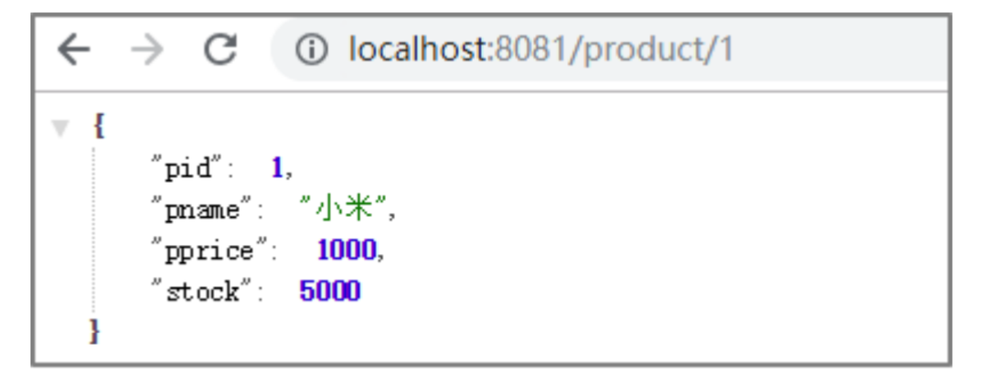

## <font style="color:rgb(51, 51, 51);">创建订单微服务</font>
### <font style="color:rgb(51, 51, 51);"> 创建一个名为 shop-order 的模块,并添加springboot依赖</font>
```xml
<?xml version="1.0" encoding="UTF-8"?>
<project xmlns="http://maven.apache.org/POM/4.0.0"
  xmlns:xsi="http://www.w3.org/2001/XMLSchema-instance"
  xsi:schemaLocation="http://maven.apache.org/POM/4.0.0 http://maven.apache.org/xsd/maven-4.0.0.xsd">
  <parent>
    <artifactId>SpringCloud-AlibabaDemo1</artifactId>
    <groupId>com.xys</groupId>
    <version>1.0-SNAPSHOT</version>
  </parent>
  <modelVersion>4.0.0</modelVersion>

  <artifactId>shop-order</artifactId>

  <dependencies>
    <!--spring-web-->
    <dependency>
      <groupId>org.springframework.boot</groupId>
      <artifactId>spring-boot-starter-web</artifactId>
    </dependency>
    <!--shop-common-->
    <dependency>
      <groupId>com.xys</groupId>
      <artifactId>shop-common</artifactId>
      <version>1.0-SNAPSHOT</version>
    </dependency>

    <dependency>
      <groupId>org.springframework.boot</groupId>
      <artifactId>spring-boot-autoconfigure</artifactId>
    </dependency>

  </dependencies>

</project>
```

### <font style="color:rgb(51, 51, 51);"> 创建工程的主类</font>
```java
package com.xys;


import org.springframework.boot.SpringApplication;
import org.springframework.boot.autoconfigure.SpringBootApplication;
import org.springframework.context.annotation.Bean;
import org.springframework.web.client.RestTemplate;

@SpringBootApplication
public class OrderApplication {
    public static void main(String[] args) {
        SpringApplication.run(OrderApplication.class);
    }
}
```

### <font style="color:rgb(51, 51, 51);">创建配置文件application.yml</font>
```yaml
server:
  port: 8091
spring:
  application:
    name: service-order
  datasource:
    driver-class-name: com.mysql.cj.jdbc.Driver
    url: jdbc:mysql://localhost:3306/shop?serverTimezone=UTC&useUnicode=true&characterEncoding=utf-8&useSSL=true
    username: root
    password: 123456

mybatis:
  configuration:
    map-underscore-to-camel-case: true   #开启驼峰命名和下划线命名的自动转换
```

### <font style="color:rgb(51, 51, 51);">创建OrderDao接口</font>
```java
package com.xys.dao;

import com.xys.domain.Orderr;
import org.apache.ibatis.annotations.Insert;
import org.apache.ibatis.annotations.Mapper;

@Mapper
public interface OrderMapper {
    @Insert("insert into orderr(uid,username,pid,pname,pprice,number)" +
            " value(#{uid},#{username},#{pid},#{pname},#{pprice},#{number})")
    void save(Orderr order);
}
```

### <font style="color:rgb(51, 51, 51);">创建OrderService接口和实现类</font>
```java
package com.xys.service.Impl;

import com.xys.dao.OrderMapper;
import com.xys.domain.Orderr;
import com.xys.service.OrderService;
import org.springframework.beans.factory.annotation.Autowired;
import org.springframework.stereotype.Service;

@Service
public class OrderServiceImpl implements OrderService {
    @Autowired
    private OrderMapper orderMapper;
    @Override
    public void createOrder(Orderr order) {
        orderMapper.save(order);
    }
}
```

### <font style="color:rgb(51, 51, 51);">创建RestTemplate</font>
```java
package com.xys;


import org.springframework.boot.SpringApplication;
import org.springframework.boot.autoconfigure.SpringBootApplication;
import org.springframework.context.annotation.Bean;
import org.springframework.web.client.RestTemplate;

@SpringBootApplication
public class OrderApplication {
    public static void main(String[] args) {
        SpringApplication.run(OrderApplication.class);
    }
    @Bean
    public RestTemplate restTemplate(){
        return new RestTemplate();
    }
}
```

### <font style="color:rgb(51, 51, 51);">创建Controller</font>
```java
package com.xys.controller;

import com.alibaba.fastjson.JSON;
import com.xys.domain.Orderr;
import com.xys.domain.Product;
import com.xys.service.OrderService;
import lombok.extern.slf4j.Slf4j;
import org.springframework.beans.factory.annotation.Autowired;
import org.springframework.web.bind.annotation.PathVariable;
import org.springframework.web.bind.annotation.RequestMapping;
import org.springframework.web.bind.annotation.RestController;
import org.springframework.web.client.RestTemplate;

@RestController
@Slf4j
public class OrderController {
    @Autowired
    private RestTemplate restTemplate;
    @Autowired
    private OrderService orderService;
    /**
     * 下单
     */
    @RequestMapping("/order/prod/{pid}")
    public Orderr order(@PathVariable("pid") Integer pid) {
        log.info("接收到{}号商品的下单请求，接下来调用商品微服务查询此商品信息",pid);
        //调用商品微服务，查询商品信息
        Product product = restTemplate.getForObject("http://localhost:8081/product/" + pid, Product.class);
        log.info("查询到{}号商品的信息，内容是：{}",pid, JSON.toJSONString(product));

        //下单(创建订单)
        Orderr order = new Orderr();
        order.setUid(1);
        order.setUsername("测试用户");
        order.setPid(pid);
        order.setPname(product.getPname());
        order.setPprice(product.getPprice());
        order.setNumber(1);
        log.info("创建订单成功，订单信息为：{}",JSON.toJSONString(order));
        orderService.createOrder(order);
        return order;
    }


}
```

### <font style="color:rgb(51, 51, 51);">启动工程,通过浏览器访问服务进行测试 </font>[<font style="color:rgb(65, 131, 196);">http://localhost:8091/order/prod/1</font>](http://localhost:8091/order/prod/1)
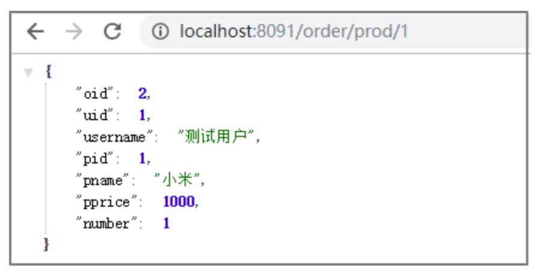


> 更新: 2025-09-09 10:31:53  
> 原文: <https://www.yuque.com/yayawei-srv9p/pf4se6/pkc5dkfick3slq1g>