08# 第3章 nacos实战入门

## **<font style="color:rgb(51,51,51);">服务治理介绍</font>**
### <font style="color:rgb(51,51,51);">先来思考一个问题</font>
<font style="color:rgb(51,51,51);">通过上一章的操作，我们已经可以实现微服务之间的调用。但是我们把服务提供者的网络地址</font>

<font style="color:rgb(51,51,51);">（</font><font style="color:rgb(51,51,51);">ip</font><font style="color:rgb(51,51,51);">，端口）等硬编码到了代码中，这种做法存在许多问题：</font>

+ <font style="color:rgb(51,51,51);">一旦服务提供者地址变化，就需要手工修改代码</font>
+ <font style="color:rgb(51,51,51);">一旦是多个服务提供者，无法实现负载均衡功能</font>
+ <font style="color:rgb(51,51,51);">一旦服务变得越来越多，人工维护调用关系困难</font>

<font style="color:rgb(51,51,51);">那么应该怎么解决呢，这时候就需要通过注册中心动态的实现</font>**<font style="color:rgb(51,51,51);">服务治理</font>**<font style="color:rgb(51,51,51);">。</font>

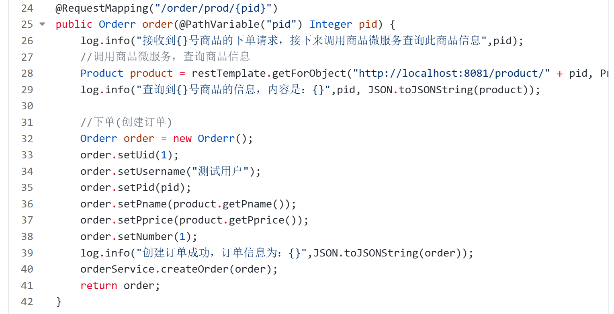

### <font style="color:rgb(51,51,51);">什么是服务治理</font>
<font style="color:rgb(51,51,51);">服务治理是微服务架构中最核心最基本的模块。用于实现各个微服务的</font>**<font style="color:rgb(51,51,51);">自动化注册与发现</font>**<font style="color:rgb(51,51,51);">。</font>

+ **<font style="color:rgb(51,51,51);">服务注册：</font>**<font style="color:rgb(51,51,51);">在服务治理框架中，都会构建一个注册中心，每个服务单元向注册中心登记自己提供服  务的详细信息。并在注册中心形成一张服务的清单，服务注册中心需要以心跳的方式去监测清单中  的服务是否可用，如果不可用，需要在服务清单中剔除不可用的服务。</font>
+ **<font style="color:rgb(51,51,51);">服务发现：</font>**<font style="color:rgb(51,51,51);">服务调用方向服务注册中心咨询服务，并获取所有服务的实例清单，实现对具体服务实  例的访问。</font>

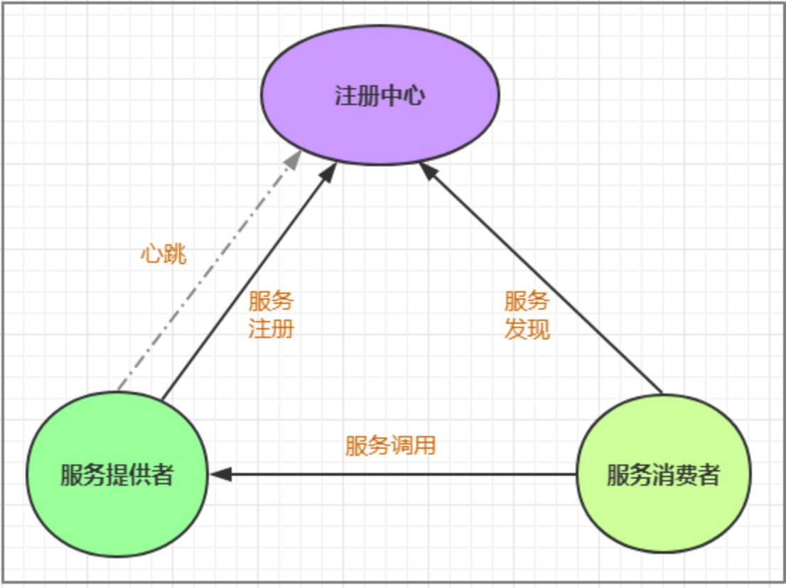

<font style="color:rgb(51,51,51);">通过上面的调用图会发现，除了微服务，还有一个组件是</font>**<font style="color:rgb(51,51,51);">服务注册中心</font>**<font style="color:rgb(51,51,51);">，它是微服务架构非常重要</font><font style="color:rgb(51,51,51);">  </font><font style="color:rgb(51,51,51);">的一个组件，在微服务架构里主要起到了协调者的一个作用。注册中心一般包含如下几个功能：</font>

<font style="color:rgb(51,51,51);">1.</font><font style="color:rgb(51,51,51);"> </font><font style="color:rgb(51,51,51);">服务发现：</font>

        * <font style="color:rgb(51,51,51);">服务注册：保存服务提供者和服务调用者的信息</font>
        * <font style="color:rgb(51,51,51);">服务订阅：服务调用者订阅服务提供者的信息，注册中心向订阅者推送提供者的信息</font>

<font style="color:rgb(51,51,51);">2.</font><font style="color:rgb(51,51,51);"> </font><font style="color:rgb(51,51,51);">服务配置：</font>

        * <font style="color:rgb(51,51,51);">配置订阅：服务提供者和服务调用者订阅微服务相关的配置</font>
        * <font style="color:rgb(51,51,51);">配置下发：主动将配置推送给服务提供者和服务调用者</font>

<font style="color:rgb(51,51,51);">3.</font><font style="color:rgb(51,51,51);"> </font><font style="color:rgb(51,51,51);">服务健康检测</font>

        * <font style="color:rgb(51,51,51);">检测服务提供者的健康情况，如果发现异常，执行服务剔除</font>

### <font style="color:rgb(51,51,51);">常见的注册中心</font>
**<font style="color:rgb(51,51,51);">Zookeeper</font>**

<font style="color:rgb(51,51,51);">zookeeper</font><font style="color:rgb(51,51,51);">是一个分布式服务框架，是</font><font style="color:rgb(51,51,51);">Apache</font><font style="color:rgb(51,51,51);"> </font><font style="color:rgb(51,51,51);">Hadoop</font><font style="color:rgb(51,51,51);"> </font><font style="color:rgb(51,51,51);">的一个子项目，它主要是用来解决分布式</font><font style="color:rgb(51,51,51);">应用中经常遇到的一些数据管理问题，如：统一命名服务、状态同步服务、集群管理、分布式应用</font><font style="color:rgb(51,51,51);">  </font><font style="color:rgb(51,51,51);">配置项的管理等。</font>

**<font style="color:rgb(51,51,51);">Eureka</font>**

<font style="color:rgb(51,51,51);">Eureka</font><font style="color:rgb(51,51,51);">是</font><font style="color:rgb(51,51,51);">Springcloud Netflix</font><font style="color:rgb(51,51,51);">中的重要组件，主要作用就是做服务注册和发现。但是现在已经闭源</font>

**<font style="color:rgb(51,51,51);">Consul</font>**

<font style="color:rgb(51,51,51);">Consul</font><font style="color:rgb(51,51,51);">是基于</font><font style="color:rgb(51,51,51);">GO</font><font style="color:rgb(51,51,51);">语言开发的开源工具，主要面向分布式，服务化的系统提供服务注册、服务发现</font><font style="color:rgb(51,51,51);">     </font><font style="color:rgb(51,51,51);">和配置管理的功能。</font><font style="color:rgb(51,51,51);">Consul</font><font style="color:rgb(51,51,51);">的功能都很实用，其中包括：服务注册</font><font style="color:rgb(51,51,51);">/</font><font style="color:rgb(51,51,51);">发现、健康检查、</font><font style="color:rgb(51,51,51);">Key/Value </font><font style="color:rgb(51,51,51);">存储、多数据中心和分布式一致性保证等特性。</font><font style="color:rgb(51,51,51);">Consul</font><font style="color:rgb(51,51,51);">本身只是一个二进制的可执行文件，所以</font><font style="color:rgb(51,51,51);">    </font><font style="color:rgb(51,51,51);">安装和部署都非常简单，只需要从官网下载后，在执行对应的启动脚本即可。</font>

**<font style="color:rgb(51,51,51);">Nacos</font>**

<font style="color:rgb(51,51,51);">Nacos是一个更易于构建云原生应用的动态服务发现、配置管理和服务管理平台。它是Spring Cloud Alibaba 组件之一，负责服务注册发现和服务配置，可以这样认为nacos=eureka+config。</font>

## <font style="color:rgb(51,51,51);">nacos简介</font>
<font style="color:rgb(51,51,51);">Nacos </font><font style="color:rgb(51,51,51);">致力于帮助您发现、配置和管理微服务。</font><font style="color:rgb(51,51,51);">Nacos </font><font style="color:rgb(51,51,51);">提供了一组简单易用的特性集，帮助您快速实现动态服务发现、服务配置、服务元数据及流量管理。</font>

<font style="color:rgb(51,51,51);">从上面的介绍就可以看出，</font>**<font style="color:rgb(51,51,51);">nacos的作用就是一个注册中心</font>**<font style="color:rgb(51,51,51);">，用来管理注册上来的各个微服务。</font>

## <font style="color:rgb(51, 51, 51);">搭建nacos环境</font>
<font style="color:rgb(51,51,51);">接下来，我们就在现有的环境中加入nacos，并将我们的两个微服务注册上去。</font>

### <font style="color:rgb(51, 51, 51);">安装nacos</font>
```plain
下载地址: https://github.com/alibaba/nacos/releases
下载zip格式的安装包，然后进行解压缩操作
```

### <font style="color:rgb(51, 51, 51);">启动nacos</font>
```bash
#切换目录
cd nacos/bin    #注意：要换成你自己的nacos安装路径
startup.cmd -m standalone    #命令启动
```

### <font style="color:rgb(51, 51, 51);">访问nacos</font>
<font style="color:rgb(51, 51, 51);">打开浏览器输入</font>[<font style="color:rgb(65, 131, 196);">http://localhost:8848/nacos</font>](http://localhost:8848/nacos)<font style="color:rgb(51, 51, 51);">，即可访问服务， 默认密码是nacos/nacos</font>

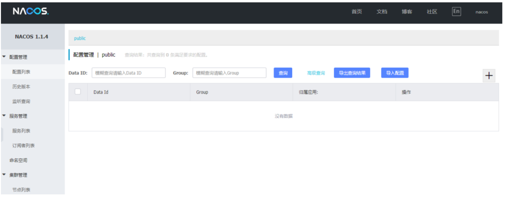

## <font style="color:rgb(51, 51, 51);">将商品微服务注册到nacos</font>
### <font style="color:rgb(51, 51, 51);">接下来开始修改shop-product 模块的代码， 将其注册到nacos服务上</font>
### <font style="color:rgb(51, 51, 51);">在pom.xml中添加nacos的依赖</font>
```xml
<!--nacos客户端-->
<dependency>            
  <groupId>com.alibaba.cloud</groupId>
  <artifactId>spring-cloud-starter-alibaba-nacos-discovery</artifactId>
</dependency>
```

### <font style="color:rgb(51, 51, 51);">在主类上添加@EnableDiscoveryClient注解</font>
```java
@SpringBootApplication
@EnableDiscoveryClient
public class ProductApplication{
    
}
```

### <font style="color:rgb(51, 51, 51);">在application.yml中添加nacos服务的地址</font>
```yaml
spring:
   cloud:
    nacos:
      discovery:
        server-addr: 127.0.0.1:8848
```

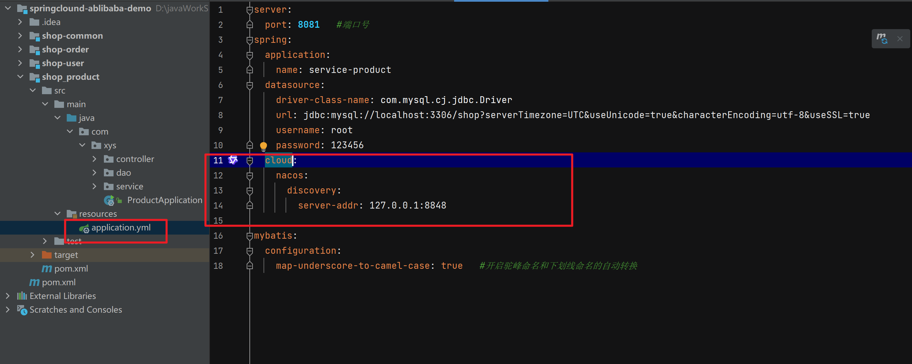

### <font style="color:rgb(51, 51, 51);">启动服务， 观察nacos的控制面板中是否有注册上来的商品微服务</font>
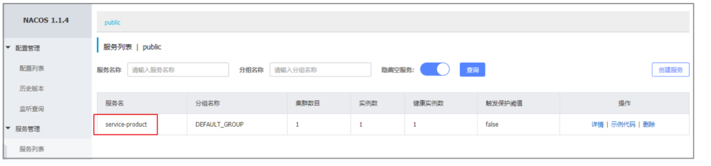

## <font style="color:rgb(51, 51, 51);">将订单微服务注册到nacos</font>
### <font style="color:rgb(51, 51, 51);">接下来开始修改 shop_order 模块的代码， 将其注册到nacos服务上</font>
### <font style="color:rgb(51, 51, 51);">在pom.xml中添加nacos的依赖</font>
```xml
<!--nacos客户端-->
<dependency>
  <groupId>com.alibaba.cloud</groupId>
  <artifactId>spring-cloud-starter-alibaba-nacos-discovery</artifactId>
</dependency>
```

### <font style="color:rgb(51, 51, 51);">在主类上添加@EnableDiscoveryClient注解</font>
```java
@SpringBootApplication
@EnableDiscoveryClient
public class OrderApplication{
}
```

### <font style="color:rgb(51, 51, 51);">在application.yml中添加nacos服务的地址</font>
```yaml
spring:
   cloud:
    nacos:
      discovery:
        server-addr: 127.0.0.1:8848
```

### <font style="color:rgb(51, 51, 51);"> 修改OrderController， 实现微服务调用</font>
```java
@RestController
@Slf4j
public class OrderController {
    @Autowired
    private RestTemplate restTemplate;
    @Autowired
    private OrderService orderService;
    @Autowired
    private DiscoveryClient discoveryClient;
    //准备买1件商品
    @GetMapping("/order/prod/{pid}")
    public Order order(@PathVariable("pid") Integer pid) {
        log.info(">>客户下单，这时候要调用商品微服务查询商品信息");
        //从nacos中获取服务地址
        ServiceInstance serviceInstance = discoveryClient.getInstances("service-product").get(0);
        String url = serviceInstance.getHost() + ":" + serviceInstance.getPort();
        log.info(">>从nacos中获取到的微服务地址为:" + url);
        //通过restTemplate调用商品微服务
        Product product = restTemplate.getForObject("http://" + url + "/product/" + pid, Product.class);
        log.info(">>商品信息,查询结果:" + JSON.toJSONString(product));
        Order order = new Order();
        order.setUid(1);
        order.setUsername("测试用户");
        order.setPid(product.getPid()); 
        order.setPname(product.getPname());
        order.setPprice(product.getPprice());
        order.setNumber(1);
        orderService.save(order);
        return order;
    }
}
```

<font style="color:rgb(119, 119, 119);">DiscoveryClient是专门负责服务注册和发现的，我们可以通过它获取到注册到注册中心的所有服务</font>

### <font style="color:rgb(51, 51, 51);"> 启动服务， 观察nacos的控制面板中是否有注册上来的订单微服务，然后通过访问消费者服务验证调用是否成功</font>
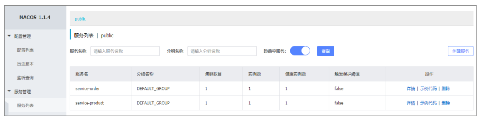

## <font style="color:rgb(51, 51, 51);">实现服务调用的负载均衡</font>
### <font style="color:rgb(51, 51, 51);"> 什么是负载均衡？</font>
> <font style="color:rgb(119, 119, 119);">通俗的讲，  负载均衡就是将负载（工作任务，访问请求）进行分摊到多个操作单元（服务器,组件）上进行执行。</font>
>
> <font style="color:rgb(119, 119, 119);">根据负载均衡发生位置的不同,一般分为</font>**<font style="color:rgb(119, 119, 119);">服务端负载均衡</font>**<font style="color:rgb(119, 119, 119);">和</font>**<font style="color:rgb(119, 119, 119);">客户端负载均衡</font>**<font style="color:rgb(119, 119, 119);">。</font>
>
> <font style="color:rgb(119, 119, 119);">服务端负载均衡指的是发生在服务提供者一方,比如常见的nginx负载均衡</font>
>
> <font style="color:rgb(119, 119, 119);">而客户端负载均衡指的是发生在服务请求的一方，也就是在发送请求之前已经选好了由哪个实例处理请  求。</font>
>

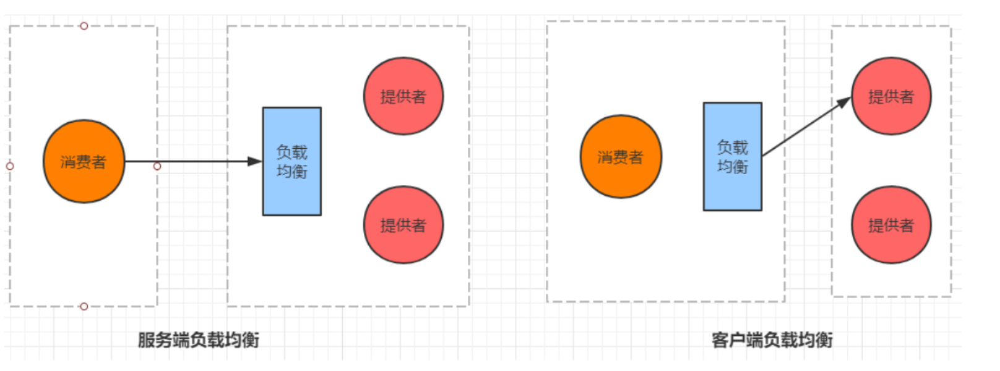

<font style="color:rgb(51, 51, 51);">我们在微服务调用关系中一般会选择客户端负载均衡，也就是在服务调用的一方来决定服务由哪个提供者执行。</font>

### <font style="color:rgb(51, 51, 51);"> 自定义实现负载均衡</font>
#### <font style="color:rgb(51, 51, 51);">通过idea再启动一个 shop-product 微服务，设置其端口为8082</font>
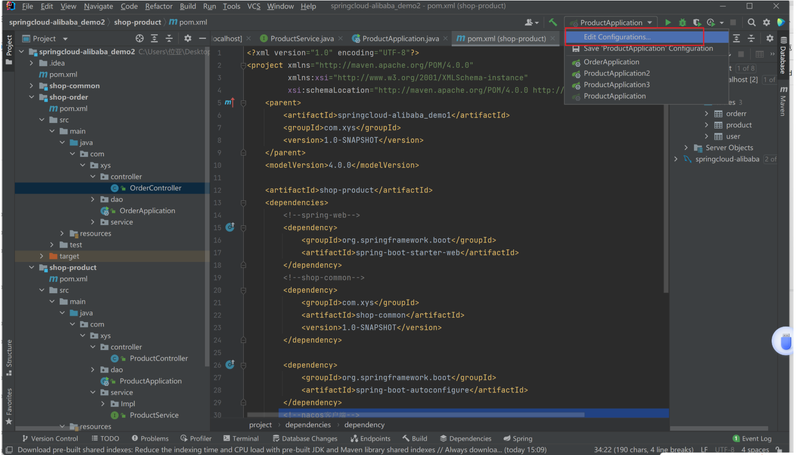

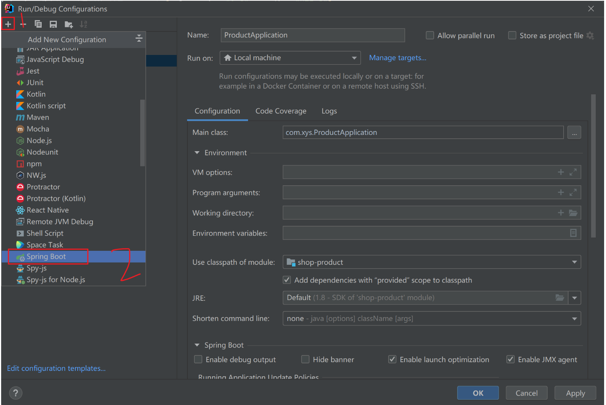

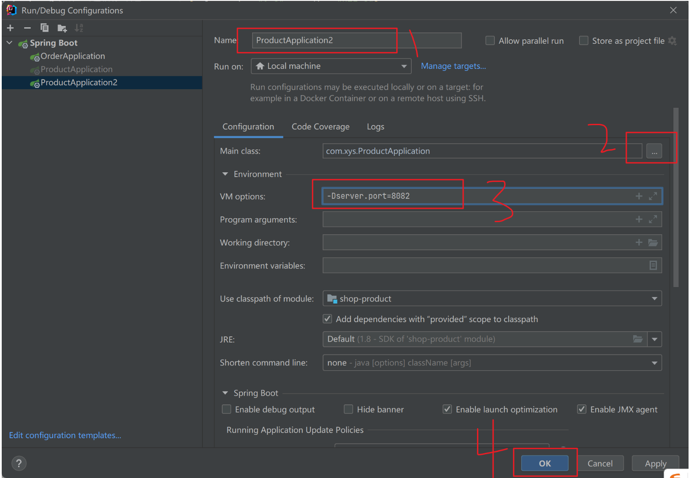

#### <font style="color:rgb(51, 51, 51);">通过nacos查看微服务的启动情况</font>
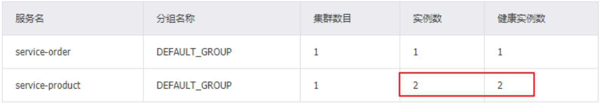

#### <font style="color:rgb(51, 51, 51);">修改 shop-order 的代码，实现负载均衡</font>
```java
@RestController
@Slf4j
public class OrderController {
    @Autowired
    private RestTemplate restTemplate;
    @Autowired
    private OrderService orderService;
    @Autowired
    private DiscoveryClient discoveryClient;
    //准备买1件商品
    @GetMapping("/order/prod/{pid}")
    public Order order(@PathVariable("pid") Integer pid) {
        log.info(">>客户下单，这时候要调用商品微服务查询商品信息");
        //从nacos中获取服务地址
        //自定义规则实现随机挑选服务
        List<ServiceInstance> instances = discoveryClient.getInstances("serviceproduct");
        int index = new Random().nextInt(instances.size());
        ServiceInstance serviceInstance = instances.get(index);
        String url = serviceInstance.getHost() + ":" + serviceInstance.getPort();
        log.info(">>从nacos中获取到的微服务地址为:" + url);
        //通过restTemplate调用商品微服务
        Product product = restTemplate.getForObject("http://" + url + "/product/" + pid, Product.class);
        log.info(">>商品信息，查询结果:" + JSON.toJSONString(product));
        Order order = new Order();
        order.setUid(1);
        order.setUsername("测试用户");
        order.setPid(product.getPid());
        order.setPname(product.getPname());
        order.setPprice(product.getPprice());
        order.setNumber(1);
        orderService.save(order);
        return order;
    }
}
```

#### <font style="color:rgb(51, 51, 51);">启动两个服务提供者和一个服务消费者，多访问几次消费者测试效果</font>
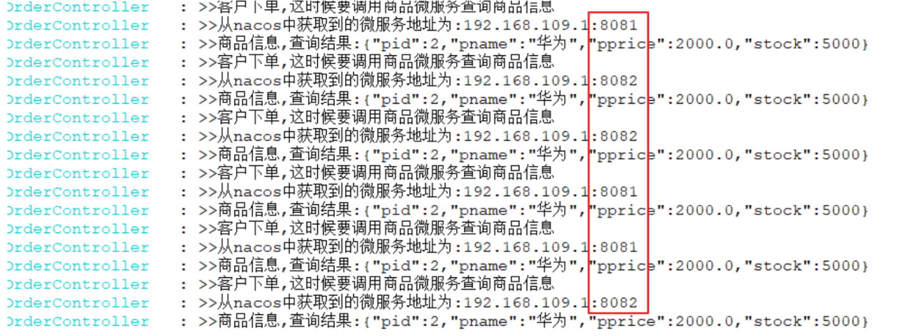

## <font style="color:rgb(51, 51, 51);">基于Ribbon实现负载均衡</font>
### <font style="color:rgb(51, 51, 51);">Ribbon是Spring Cloud的一个组件， 它可以让我们使用一个注解就能轻松的搞定负载均衡</font>
### <font style="color:rgb(51, 51, 51);"> 在RestTemplate 的生成方法上添加@LoadBalanced注解</font>
```java
@Bean
@LoadBalanced
public RestTemplate restTemplate(){
    return new RestTemplate();
}
```

### <font style="color:rgb(51, 51, 51);"> 修改服务调用的方法</font>
```java
@RestController
@Slf4j
public class OrderController{
    @Autowired
    private RestTemplate restTemplate;
    @Autowired
    private OrderService orderService;
    //准备买1件商品
    @GetMapping("/order/prod/{pid}")
    public Order order(@PathVariable("pid") Integer pid) {
        log.info(">>客户下单，这时候要调用商品微服务查询商品信息");
        //直接使用微服务名字， 从nacos中获取服务地址
        String url = "service-product";
        //通过restTemplate调用商品微服务
        Product product = restTemplate.getForObject("http://" + url + "/product/" + pid, Product.class);
        log.info(">>商品信息，查询结果:" + JSON.toJSONString(product));
        Order order = new Order();
        order.setUid(1);
        order.setUsername("测试用户");
        order.setPid(product.getPid());
        order.setPname(product.getPname());
        order.setPprice(product.getPprice());
        order.setNumber(1);
        orderService.save(order);
        return order;
    }
}
```

### <font style="color:rgb(51, 51, 51);"> Ribbon支持的负载均衡策略Ribbon内置了多种负载均衡策略,内部负载均衡的顶级接口为com.netflix.loadbalancer.IRule , 具体的负载策略如下图所示:</font>
| **<font style="color:rgb(51, 51, 51);">策略名</font>**                   | **<font style="color:rgb(51, 51, 51);">策略描述</font>**                                                                                   | **<font style="color:rgb(51, 51, 51);">实现说明</font>**                                                                                                                                                     |     |
| :-------------------------------------------------------------------- | :------------------------------------------------------------------------------------------------------------------------------------- | :------------------------------------------------------------------------------------------------------------------------------------------------------------------------------------------------------- | --- |
| <font style="color:rgb(51, 51, 51);">BestAvailableRule</font>         | <font style="color:rgb(51, 51, 51);">选择一个最小的并发请求的server</font>                                                                         | <font style="color:rgb(51, 51, 51);">逐个考察Server，如果Server被tripped了，则忽略，在选择其中ActiveRequestsCount最小的server</font>                                                                                           |     |
| <font style="color:rgb(51, 51, 51);">AvailabilityFilteringRule</font> | <font style="color:rgb(51, 51, 51);">过滤掉那些因为一直连接失败的被标记为circuit tripped的后端server，并过滤掉那些高并发的的后端server（active connections 超过配置的阈值）</font> | <font style="color:rgb(51, 51, 51);">使用一个AvailabilityPredicate来包含过滤server的逻辑，其实就就是检查status里记录的各个server的运行状 态</font>                                                                                      |     |
| <font style="color:rgb(51, 51, 51);">WeightedResponseTimeRule</font>  | <font style="color:rgb(51, 51, 51);">根据相应时间分配一个weight，相应时 间越长，weight越 小，被选中的可能性越低。</font>                                              | <font style="color:rgb(51, 51, 51);">一个后台线程定期的从status里面读取评价响应时间，为每个server计算一个weight。Weight的计算也比较简单responsetime 减去每个server自己平均的responsetime是server的权    重。当刚开始运行，没有形成statas 时，使用roubine策略选择server。</font> |     |
| <font style="color:rgb(51, 51, 51);">RetryRule</font>                 | <font style="color:rgb(51, 51, 51);">对选定的负载均衡策略机上重试机制。</font>                                                                          | <font style="color:rgb(51, 51, 51);">在一个配置时间段内当选择server不成功，则一直尝试使用subRule的方式选择一个可用的server</font>                                                                                                         |     |
| <font style="color:rgb(51, 51, 51);">RoundRobinRule</font>            | <font style="color:rgb(51, 51, 51);">轮询方式轮询选择 server</font>                                                                            | <font style="color:rgb(51, 51, 51);">轮询index，选择index对应位置的 server</font>                                                                                                                                  |     |
| <font style="color:rgb(51, 51, 51);">RandomRule</font>                | <font style="color:rgb(51, 51, 51);">随机选择一个server</font>                                                                               | <font style="color:rgb(51, 51, 51);">在index上随机，选择index对应位置的server</font>                                                                                                                                 |     |
| <font style="color:rgb(51, 51, 51);">ZoneAvoidanceRule</font>         | <font style="color:rgb(51, 51, 51);">复合判断server所在区域的性能和server 的可用性选择server</font>                                                      | <font style="color:rgb(51, 51, 51);">使用ZoneAvoidancePredicate和AvailabilityPredicate来判断是否选择某个server，前一个判断判定一个zone的运行性能是否可用，剔除不可用 的 zone（ 的 所 有 server）， AvailabilityPredicate用于过滤掉连接数过多的Server。</font>    |     |


### <font style="color:rgb(51, 51, 51);">我们可以通过修改配置来调整Ribbon的负载均衡策略，具体代码如下</font>
```yaml
service-product: # 调用的提供者的名称
    ribbon:
      NFLoadBalancerRuleClassName: com.netflix.loadbalancer.RandomRule
```

## <font style="color:rgb(51, 51, 51);">基于Feign实现服务调用</font>
### <font style="color:rgb(51, 51, 51);">什么是Feign</font>
<font style="color:rgb(119, 119, 119);">Feign是Spring Cloud提供的一个声明式的伪Http客户端， 它使得调用远程服务就像调用本地服务一样简单， 只需要创建一个接口并添加一个注解即可。</font>

<font style="color:rgb(119, 119, 119);">Nacos很好的兼容了Feign， Feign默认集成了 Ribbon， 所以在Nacos下使用Fegin默认就实现了负载均衡的效果。</font>

### <font style="color:rgb(51, 51, 51);">Feign的使用</font>
#### <font style="color:rgb(51, 51, 51);">加入Fegin的依赖</font>
```xml
<!--fegin组件-->
<dependency>                    
  <groupId>org.springframework.cloud</groupId>
  <artifactId>spring-cloud-starter-openfeign</artifactId>
</dependency>
```

#### <font style="color:rgb(51, 51, 51);">在主类上添加Fegin的注解</font>
```java
@SpringBootApplication
@EnableDiscoveryClient
@EnableFeignClients//开启Fegin
public class OrderApplication {
    
}
```

#### <font style="color:rgb(51, 51, 51);">创建一个service， 并使用Fegin实现微服务调用</font>
```java
@FeignClient("service-product")//声明调用的提供者的name
public interface ProductService {            
    //指定调用提供者的哪个方法
    //@FeignClient+@GetMapping 就是一个完整的请求路径 http://serviceproduct/product/{pid}
    @GetMapping(value = "/product/{pid}")
    Product findByPid(@PathVariable("pid") Integer pid);
}
```

#### <font style="color:rgb(51, 51, 51);">修改controller代码，并启动验证</font>
```java
@RestController
@Slf4j
public class OrderController {
    @Autowired
    private OrderService orderService;
    @Autowired
    private ProductService productService;
    //准备买1件商品
    @GetMapping("/order/prod/{pid}")
    public Order order(@PathVariable("pid") Integer pid) {
        log.info(">>客户下单,这时候要调用商品微服务查询商品信息");
        //通过fegin调用商品微服务
        Product product = productService.findByPid(pid);
        log.info(">>商品信息,查询结果:" + JSON.toJSONString(product));
        Order order = new Order();
        order.setUid(1);
        order.setUsername("测试用户");
        order.setPid(product.getPid());
        order.setPname(product.getPname());
        order.setPprice(product.getPprice());
        order.setNumber(1);
        orderService.save(order);
        return order;
    }
}
```

### <font style="color:rgb(51, 51, 51);">重启order微服务,查看效果</font>
  
 


> 更新: 2025-09-17 13:14:19  
> 原文: <https://www.yuque.com/yayawei-srv9p/pf4se6/get3sox20167kl0h>