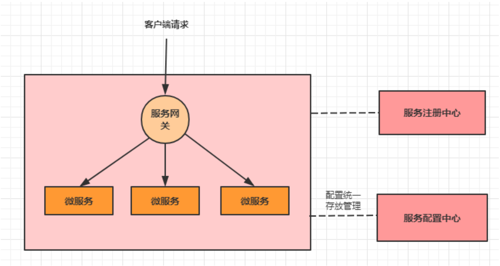
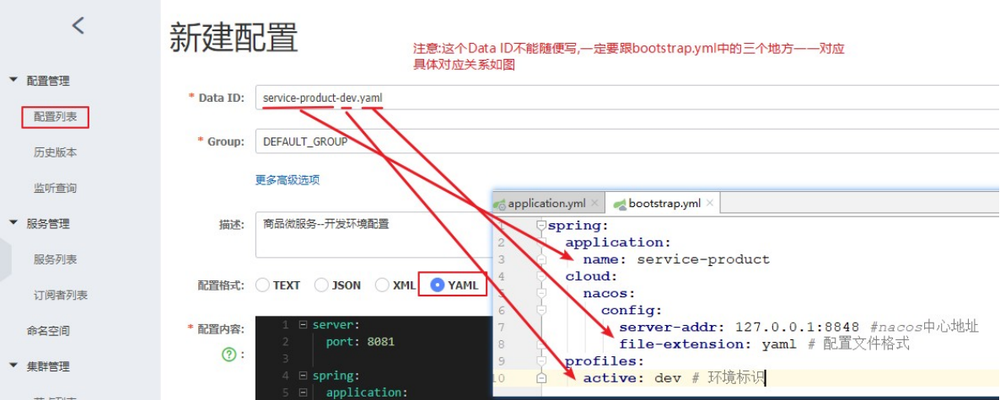
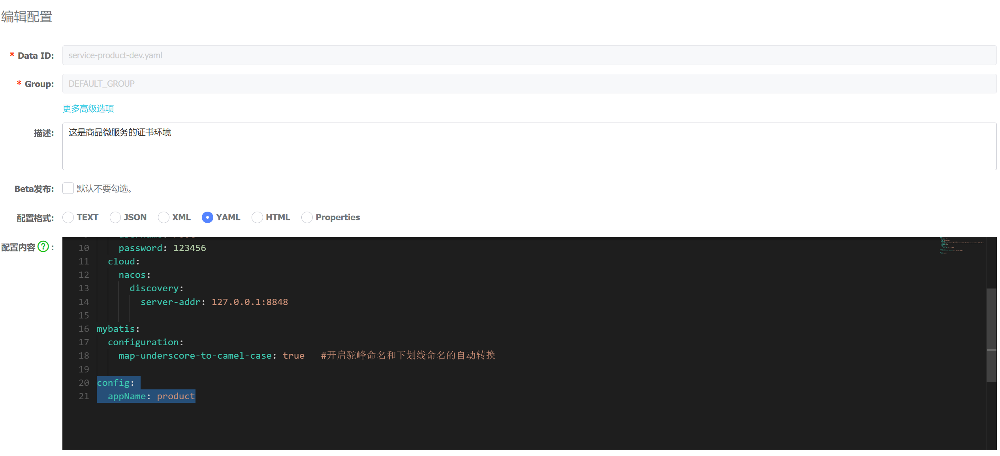
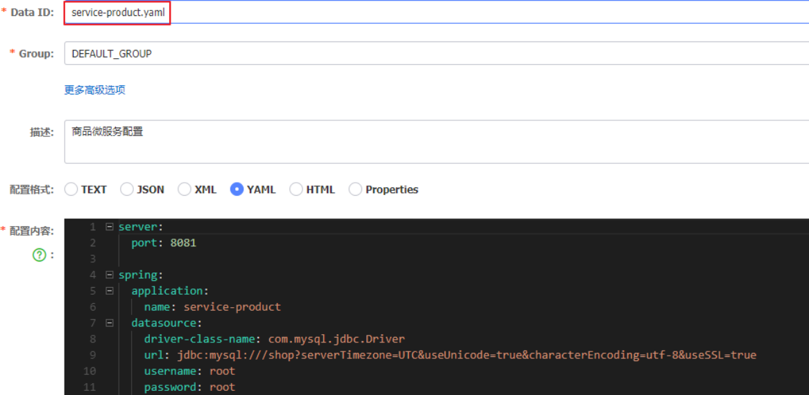
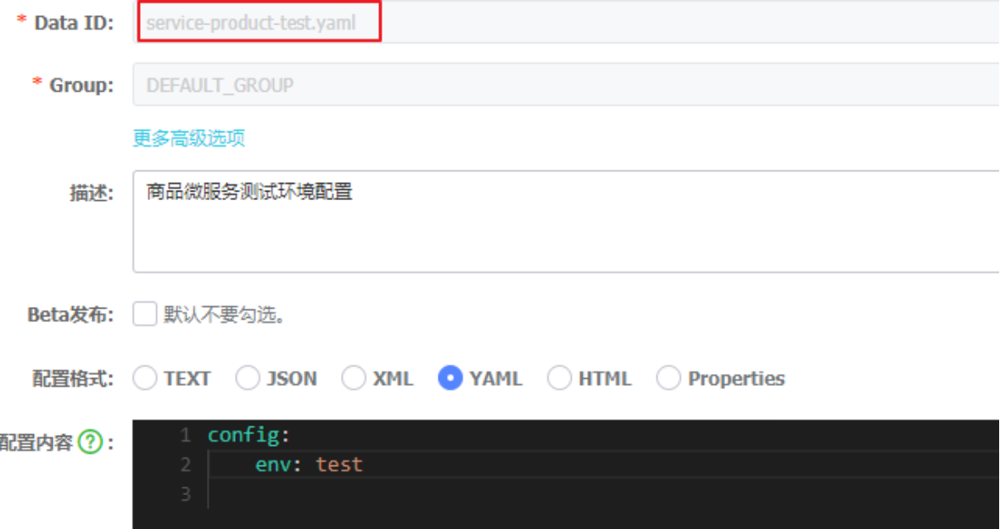
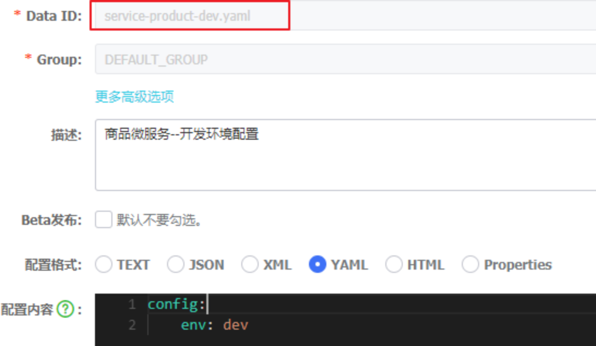
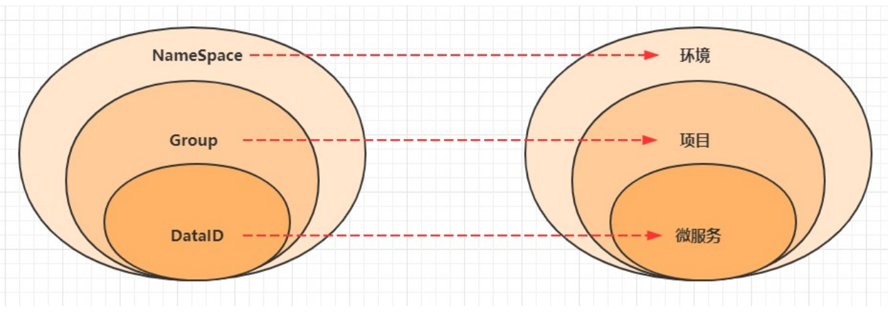

# 第4章 Nacos Config--服务配置

## <font style="color:rgb(51,51,51);">服务配置中心介绍</font>
### <font style="color:rgb(51,51,51);">首先我们来看一下,微服务架构下关于配置文件的一些问题：</font>
<font style="color:rgb(51,51,51);">1. 配置文件相对分散。在一个微服务架构下，配置文件会随着微服务的增多变的越来越多，而且分散  在各个微服务中，不好统一配置和管理。</font>

<font style="color:rgb(51,51,51);">2. 配置文件无法区分环境。微服务项目可能会有多个环境，例如：测试环境、预发布环境、生产环    境。每一个环境所使用的配置理论上都是不同的，一旦需要修改，就需要我们去各个微服务下手动  维护，这比较困难。</font>

<font style="color:rgb(51,51,51);">3. 配置文件无法实时更新。我们修改了配置文件之后，必须重新启动微服务才能使配置生效，这对一  个正在运行的项目来说是非常不友好的。</font>

### <font style="color:rgb(51,51,51);">基于上面这些问题，我们就需要配置中心的加入来解决这些问题。配置中心的思路是：</font>
<font style="color:rgb(51,51,51);">1.首先把项目中各种配置全部都放到一个集中的地方进行统一管理，并提供一套标准的接口。</font>

<font style="color:rgb(51,51,51);">2.当各个服务需要获取配置的时候，就来配置中心的接口拉取自己的配置。</font>

<font style="color:rgb(51,51,51);">3.当配置中心中的各种参数有更新的时候，也能通知到各个服务实时的过来同步最新的信息，使之动  态更新。</font>

### <font style="color:rgb(51,51,51);">当加入了服务配置中心之后，我们的系统架构图会变成下面这样：</font>


## <font style="color:rgb(51,51,51);">在业界常见的服务配置中心，有下面这些：</font>
### <font style="color:rgb(51,51,51);">Apollo</font>
<font style="color:rgb(51,51,51);">Apollo是由携程开源的分布式配置中心。特点有很多，比如：配置更新之后可以实时生效，支持灰   度发布功能，并且能对所有的配置进行版本管理、操作审计等功能，提供开放平台API。并且资料   也写的很详细。</font>

### <font style="color:rgb(51,51,51);">Disconf</font>
<font style="color:rgb(51,51,51);">Disconf是由百度开源的分布式配置中心。它是基于Zookeeper来实现配置变更后实时通知和生效的。</font>

### <font style="color:rgb(51,51,51);">SpringCloud Config</font>
<font style="color:rgb(51,51,51);">这是Spring Cloud中带的配置中心组件。它和Spring是无缝集成，使用起来非常方便，并且它的配置存储支持Git。不过它没有可视化的操作界面，配置的生效也不是实时的，需要重启或去刷新。</font>

### <font style="color:rgb(51,51,51);">Nacos</font>
<font style="color:rgb(51,51,51);">这是SpingCloud alibaba技术栈中的一个组件，前面我们已经使用它做过服务注册中心。其实它也集成了服务配置的功能，我们可以直接使用它作为服务配置中心。</font>

## <font style="color:rgb(51,51,51);">Nacos Config入门</font>
<font style="color:rgb(51,51,51);">使用</font><font style="color:rgb(51,51,51);">nacos</font><font style="color:rgb(51,51,51);">作为配置中心，其实就是将</font><font style="color:rgb(51,51,51);">nacos</font><font style="color:rgb(51,51,51);">当做一个服务端，将各个微服务看成是客户端，我们</font><font style="color:rgb(51,51,51);">     </font><font style="color:rgb(51,51,51);">将各个微服务的配置文件统一存放在</font><font style="color:rgb(51,51,51);">nacos</font><font style="color:rgb(51,51,51);">上，然后各个微服务从</font><font style="color:rgb(51,51,51);">nacos</font><font style="color:rgb(51,51,51);">上拉取配置即可。</font>

<font style="color:rgb(51,51,51);">接下来我们以商品微服务为例，学习nacos config的使用。</font>

### <font style="color:rgb(51,51,51);">搭建nacos环境【使用现有的nacos环境即可】</font>
### <font style="color:rgb(51,51,51);">在微服务中引入nacos的依赖</font>
```xml
<dependency>
    <groupId>com.alibaba.cloud</groupId>
    <artifactId>spring-cloud-starter-alibaba-nacos-config</artifactId>
</dependency>
```

### <font style="color:rgb(51,51,51);">在微服务中添加nacos config的配置</font>
**<font style="color:rgb(51,51,51);">注意:不能使用原来的application.yml作为配置文件，而是新建一个bootstrap.yml作为配置文件</font>**

> <font style="color:rgb(119,119,119);">配置文件优先级(由高到低):</font>
>
> <font style="color:rgb(119,119,119);">bootstrap.properties -> bootstrap.yml -> application.properties -> application.yml</font>
>

```yaml
spring:
  application:
    name: service-product
  cloud:
    nacos:
      config:
        server-addr: 127.0.0.1:8848 #nacos中心地址file-extension: yaml # 配置文件格式
        file-extension: yaml # 配置文件格式
  profiles:
    active: dev # 环境标识
```

### <font style="color:rgb(51,51,51);"> 在nacos中添加配置</font>
> <font style="color:rgb(119,119,119);">点击配置列表，点击右边</font><font style="color:rgb(119,119,119);">+</font><font style="color:rgb(119,119,119);">号，新建配置。在新建配置过程中，要注意下面的细节：</font>
>
> <font style="color:rgb(119,119,119);">1）</font><font style="color:rgb(119,119,119);"> </font><font style="color:rgb(119,119,119);">Data</font><font style="color:rgb(119,119,119);"> </font><font style="color:rgb(119,119,119);">ID</font><font style="color:rgb(119,119,119);">不能随便写，要跟配置文件中的对应，对应关系如图所示</font>
>
> <font style="color:rgb(119,119,119);">2）</font><font style="color:rgb(119,119,119);"> </font><font style="color:rgb(119,119,119);">配置文件格式要跟配置文件的格式对应，且目前仅仅支持</font><font style="color:rgb(119,119,119);">YAML</font><font style="color:rgb(119,119,119);">和</font><font style="color:rgb(119,119,119);">Properties</font>
>
> <font style="color:rgb(119,119,119);">3） 配置内容按照上面选定的格式书写</font>
>



### <font style="color:rgb(51,51,51);">注释本地的application.yam中的内容，启动程序进行测试</font>
> <font style="color:rgb(51,51,51);">如果依旧可以成功访问程序，说明我们nacos的配置中心功能已经实现</font>
>

## **<font style="color:rgb(51,51,51);">Nacos Config深入</font>**
### **<font style="color:rgb(51,51,51);"> 配置动态刷新</font>**
<font style="color:rgb(51,51,51);">在入门案例中，我们实现了配置的远程存放，但是此时如果修改了配置，我们的程序是无法读取到  的，因此，我们需要开启配置的动态刷新功能。</font>

**<font style="color:rgb(51,51,51);">在nacos中的service-product-dev.yaml配置项中添加下面配置:</font>**

```yaml
config:
  appName: product
```



### <font style="color:rgb(51,51,51);">方式一: 硬编码方式</font>
```java
@RestController
public class NacosConfigController { 
    @Autowired
    private ConfigurableApplicationContext applicationContext;

    @GetMapping("/nacos-config-test1") 
    public String nacosConfingTest1() {
        return applicationContext.getEnvironment().getProperty("config.appName");
    }
}
```

### **<font style="color:rgb(51,51,51);">方式二: 注解方式</font>**<font style="color:rgb(51,51,51);">(推荐)</font>
```java
@RestController
@RefreshScope//只需要在需要动态读取配置的类上添加此注解就可以
public class NacosConfigController {
    @Value("${config.appName}")
    private String appName;
    //2 注解方式
    @GetMapping("/nacos-config-test2") public String nacosConfingTest2() {
        return appName;
    }
}
```

## <font style="color:rgb(51,51,51);">配置共享</font>
<font style="color:rgb(51,51,51);">当配置越来越多的时候，我们就发现有很多配置是重复的，这时候就考虑可不可以将公共配置文件  提取出来，然后实现共享呢？当然是可以的。接下来我们就来探讨如何实现这一功能。</font>

### <font style="color:rgb(51,51,51);">同一个微服务的不同环境之间共享配置</font>
<font style="color:rgb(51,51,51);">如果想在同一个微服务的不同环境之间实现配置共享，其实很简单。</font>

<font style="color:rgb(51,51,51);">只需要提取一个以spring.application.name 命名的配置文件，然后将其所有环境的公共配置放在里面即可。</font>

#### <font style="color:rgb(51,51,51);">新建一个名为service-product.yaml配置存放商品微服务的公共配置</font>


#### <font style="color:rgb(51,51,51);">新建一个名为service-product-test.yaml配置存放测试环境的配置</font>


#### <font style="color:rgb(51,51,51);">新建一个名为consumer-dev.yaml配置存放开发环境的配置</font>


#### <font style="color:rgb(51,51,51);"> 添加测试方法</font>
```java
@RestController 
@RefreshScope
public class NacosConfigController { 
    @Value("${config.env}")
    private String env;
    //3 同一微服务的不同环境下共享配置
    @GetMapping("/nacos-config-test3") public String nacosConfingTest3() {
        return env;
    }
}
```

#### <font style="color:rgb(51,51,51);">访问测试</font>


#### <font style="color:rgb(51,51,51);">接下来，修改bootstrap.yml中的配置，将active设置成test，再次访问，观察结果</font>
```yaml
spring: 
  profiles:
    active: test # 环境标识
```

## <font style="color:rgb(51,51,51);">不同微服务中间共享配置</font>
> <font style="color:rgb(51,51,51);">定义：不同为服务之间实现配置共享的原理类似于文件引入，就是定义一个公共配置，然后在当前配置中引  入。</font>
>

### <font style="color:rgb(51,51,51);">在nacos中定义一个DataID为all-service.yaml的配置，用于所有微服务共享</font>
```yaml
spring: 
  datasource:
    driver-class-name: com.mysql.cj.jdbc.Driver
    url: jdbc:mysql://localhost:3306/shop?serverTimezone=UTC&useUnicode=true&characterEncoding=utf-8&useSSL=true
    username: root
    password: 123456
  cloud:
    nacos:
      discovery:
        server-addr: 127.0.0.1:8848
```

### <font style="color:rgb(51,51,51);"> 在nacos的中修改service-product.yaml中为下面内容</font>
```yaml
server: 
  port: 8081
config:
  appName: product
```

### <font style="color:rgb(51,51,51);">修改bootstrap.yaml</font>
```yaml
spring:
  application:
    name: service-product    #服务的名称
  cloud:
    nacos:
      config:
        server-addr: 127.0.0.1:8848 #nacos配置中心的地址
        file-extension: yaml # 配置文件格式
        shared-dataids: all-service.yaml    #引入配置 all-service.yaml
        refreshable-dataids: all-service.yaml
  profiles:
    active: dev # 环境标识  正式环境
```

### <font style="color:rgb(51,51,51);">启动商品微服务进行测试</font>
## **<font style="color:rgb(51,51,51);">nacos的几个概念</font>**
### <font style="color:rgb(51,51,51);">命名空间(Namespace)</font>
> <font style="color:rgb(51,51,51);">命名空间可用于进行不同环境的配置隔离。一般一个环境划分到一个命名空间</font>
>

### <font style="color:rgb(51,51,51);">配置分组(Group)</font>
> <font style="color:rgb(51,51,51);">配置分组用于将不同的服务可以归类到同一分组。一般将一个项目的配置分到一组</font>
>

### <font style="color:rgb(51,51,51);">配置集(Data ID)</font>
> <font style="color:rgb(51,51,51);">在系统中，一个配置文件通常就是一个配置集。一般微服务的配置就是一个配置集</font>
>




> 更新: 2025-11-17 14:39:51  
> 原文: <https://www.yuque.com/yayawei-srv9p/pf4se6/gn9m2m7r1wbsbziy>