# 第5章  Sentinel--服务容错

<font style="color:rgb(51,51,51);">在微服务架构中，我们将业务拆分成一个个的服务，服务与服务之间可以相互调用，但是由于网络  原因或者自身的原因，服务并不能保证服务的100%可用，如果单个服务出现问题，调用这个服务就会    出现网络延迟，此时若有大量的网络涌入，会形成任务堆积，最终导致服务瘫痪。</font>

## <font style="color:rgb(51,51,51);">接下来，我们来模拟一个高并发的场景</font>
### <font style="color:rgb(51,51,51);">编写java代码</font>
```java
package com.xys.controller;

import com.xys.domain.Orderr;
import com.xys.domain.Product;
import com.xys.service.OrderService;
import com.xys.service.ProductService;
import lombok.extern.slf4j.Slf4j;
import org.springframework.beans.factory.annotation.Autowired;
import org.springframework.web.bind.annotation.PathVariable;
import org.springframework.web.bind.annotation.RequestMapping;
import org.springframework.web.bind.annotation.RestController;

@RestController
@Slf4j
public class OrderController2 {
    @Autowired
    private OrderService orderService;
    @Autowired
    private ProductService productService;
    @RequestMapping("/order/prod/{pid}")
    public Orderr order(@PathVariable("pid") Integer pid) {
        log.info("接收到{}号商品的下单请求,接下来调用商品微服务查询此商品信息", pid);
        //调用商品微服务,查询商品信息
        Product product = productService.findByPid(pid);

        //模拟一次网络延时
        try {
            Thread.sleep(100);
        } catch (InterruptedException e) {
            e.printStackTrace();
        }
        //下单(创建订单)
        Orderr order = new Orderr();
        order.setUid(1);
        order.setUsername("测试用户");
        order.setPid(pid);
        order.setPname(product.getPname());
        order.setPprice(product.getPprice());
        order.setNumber(1);

        //为了不产生太多垃圾数据,暂时不做订单保存
        //orderService.createOrder(order);
        log.info("创建订单成功,订单信息为{}");

        return order;
    }
    @RequestMapping("/order/message") public String message() {
        return "高并发下的问题测试";
    }
}
```

### <font style="color:rgb(51,51,51);">修改配置文件中tomcat的并发数</font>
```java
server: 
	    port: 8091 
    tomcat:
        max-threads: 10	#tomcat的最大并发值修改为10,默认是200
```

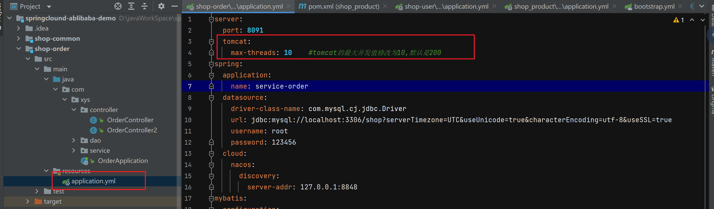

## <font style="color:rgb(51,51,51);">接下来使用压测工具,对请求进行压力测试</font>
<font style="color:rgb(51,51,51);">下载地址</font><u><font style="color:rgb(65,131,196);">https://</font></u><font style="color:rgb(65,131,196);">j</font><u><font style="color:rgb(65,131,196);">meter.apache.or</font></u><font style="color:rgb(65,131,196);">g/</font>

### <font style="color:rgb(51,51,51);">第一步：修改配置，并启动软件</font>
<font style="color:rgb(51,51,51);">进入</font><font style="color:rgb(51,51,51);">bin</font><font style="color:rgb(51,51,51);">目录</font><font style="color:rgb(51,51,51);">,</font><font style="color:rgb(51,51,51);">修改</font><font style="color:rgb(51,51,51);">jmeter.properties</font><font style="color:rgb(51,51,51);">文件中的语言支持为</font><font style="color:rgb(51,51,51);">language=zh_CN</font><font style="color:rgb(51,51,51);">，然后点击</font><font style="color:rgb(51,51,51);">jmeter.bat     </font><font style="color:rgb(51,51,51);">启动软件。</font>

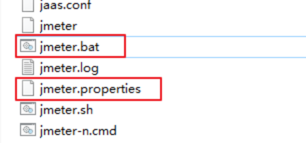

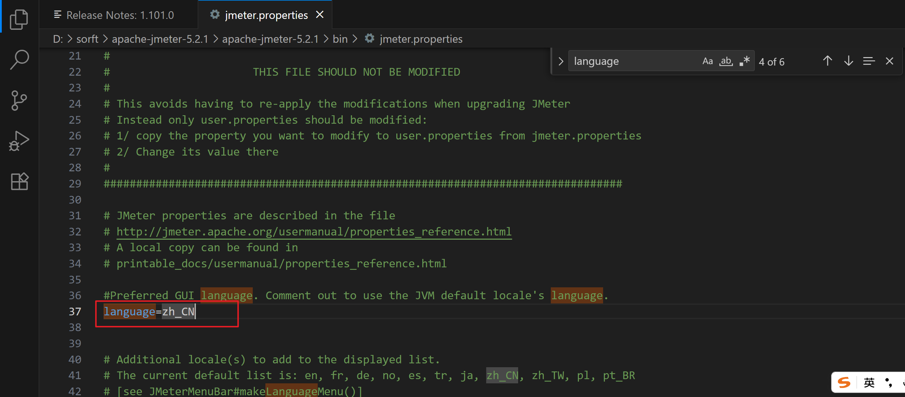

### <font style="color:rgb(51,51,51);">第二步：添加线程组</font>
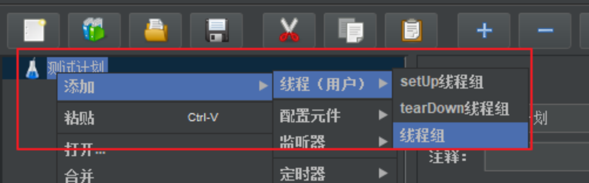

### <font style="color:rgb(51,51,51);">第三步：配置线程并发数</font>


### <font style="color:rgb(51,51,51);">第三步：配置线程并发数</font>
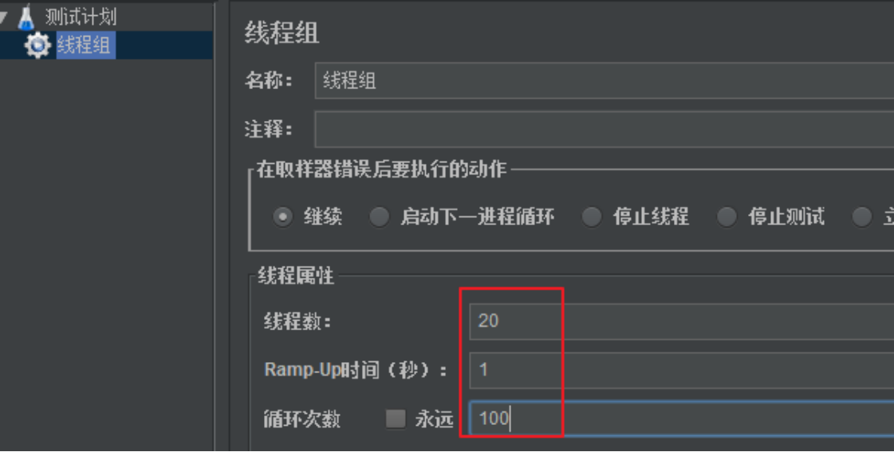

### <font style="color:rgb(51,51,51);">添加Http取样</font>
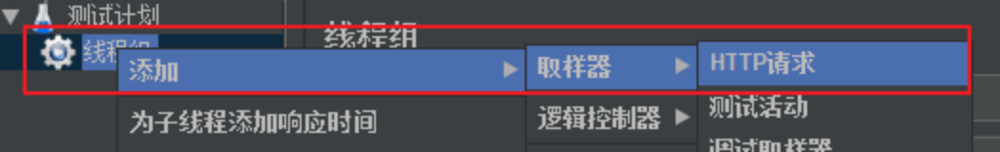

### <font style="color:rgb(51,51,51);">配置取样，并启动测试</font>
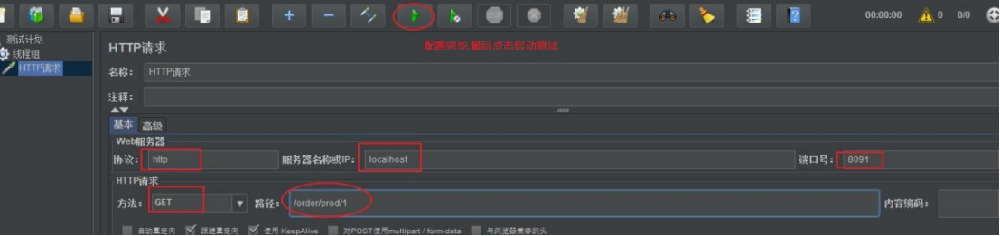

### <font style="color:rgb(51,51,51);">访问ｍessage方法观察效果</font>
**结论：**<font style="color:rgb(51,51,51);">此时会发现, 由于order方法囤积了大量请求, 导致ｍessage方法的访问出现了问题，这就是</font>**<font style="color:rgb(51,51,51);">服务雪崩</font>**<font style="color:rgb(51,51,51);">的雏形。</font>

## **<font style="color:rgb(51,51,51);">服务雪崩效应</font>**
<font style="color:rgb(51,51,51);">在分布式系统中,由于网络原因或自身的原因,服务一般无法保证100%  可用。如果一个服务出现了问题，调用这个服务就会出现线程阻塞的情况，此时若有大量的请求涌入，就会出现多条线程阻塞等待，进而导致服务瘫痪。</font>

<font style="color:rgb(51,51,51);">由于服务与服务之间的依赖性，故障会传播，会对整个微服务系统造成灾难性的严重后果，这就是服务故障的</font>**<font style="color:rgb(51,51,51);">“雪崩效应”</font>**<font style="color:rgb(51,51,51);">。</font>

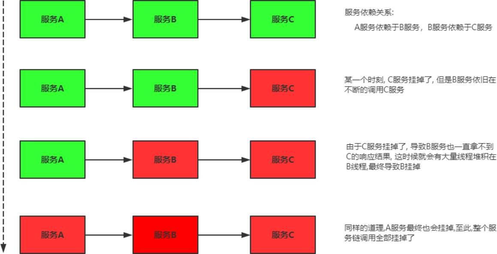

<font style="color:rgb(51,51,51);">雪崩发生的原因多种多样，有不合理的容量设计，或者是高并发下某一个方法响应变慢，亦或是某台机器的资源耗尽。我们无法完全杜绝雪崩源头的发生，只有做好足够的容错，保证在一个服务发生问  题，不会影响到其它服务的正常运行。也就是＂雪落而不雪崩＂。</font>

## **<font style="color:rgb(51,51,51);">常见容错方案</font>**
<font style="color:rgb(51,51,51);">要防止雪崩的扩散，我们就要做好服务的容错，容错说白了就是保护自己不被猪队友拖垮的一些措  施, 下面介绍常见的服务容错思路和组件。</font>


### <font style="color:rgb(51,51,51);">常见的容错思路</font>
<font style="color:rgb(51,51,51);">常见的容错思路有隔离、超时、限流、熔断、降级这几种，下面分别介绍一下。</font>

#### <font style="color:rgb(51,51,51);">隔离</font>
<font style="color:rgb(51,51,51);">它是指将系统按照一定的原则划分为若干个服务模块，各个模块之间相对独立，无强依赖。当有故  障发生时，能将问题和影响隔离在某个模块内部，而不扩散风险，不波及其它模块，不影响整体的  系统服务。常见的隔离方式有：线程池隔离和信号量隔离．</font>

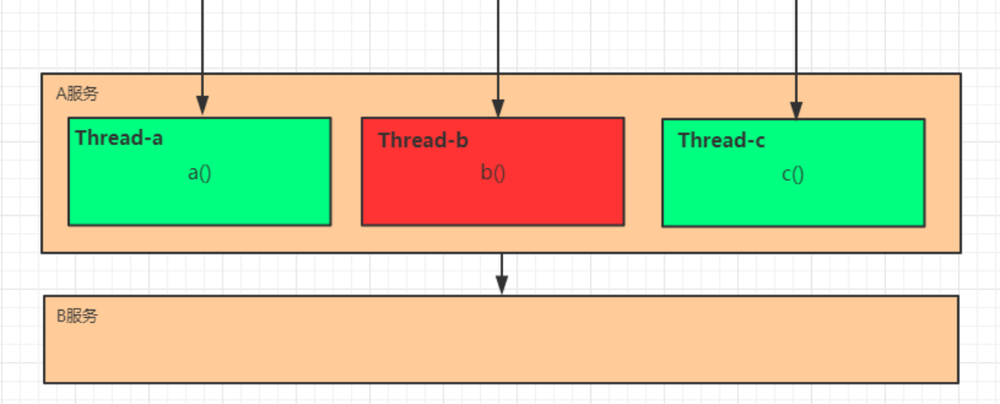

#### <font style="color:rgb(51,51,51);">超时</font>
<font style="color:rgb(51,51,51);">在上游服务调用下游服务的时候，设置一个最大响应时间，如果超过这个时间，下游未作出反应，  就断开请求，释放掉线程。</font>

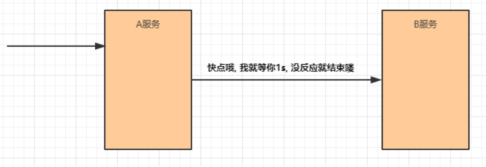

#### <font style="color:rgb(51,51,51);">限流</font>
<font style="color:rgb(51,51,51);">限流就是限制系统的输入和输出流量已达到保护系统的目的。为了保证系统的稳固运行,一旦达到的需要限制的阈值,就需要限制流量并采取少量措施以完成限制流量的目的。</font>

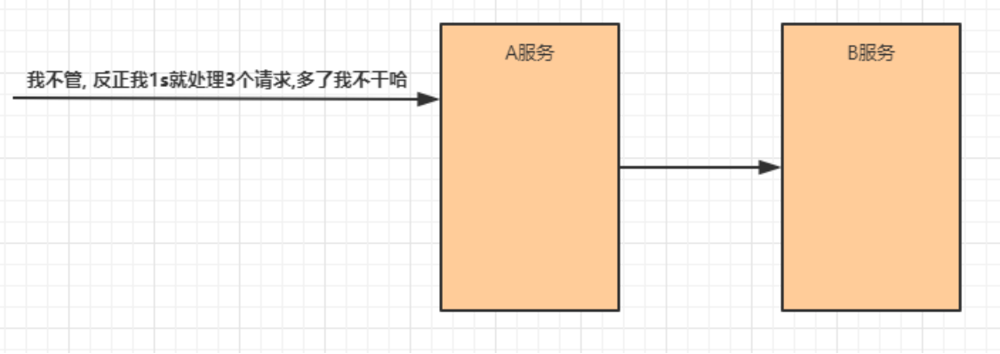

#### <font style="color:rgb(51,51,51);">熔断  </font>
<font style="color:rgb(51,51,51);">在互联网系统中，当下游服务因访问压力过大而响应变慢或失败，上游服务为了保护系统整体的可用性，可以暂时切断对下游服务的调用。这种牺牲局部，保全整体的措施就叫做熔断。</font>

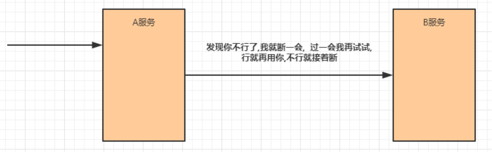

<font style="color:rgb(51,51,51);">服务熔断一般有三种状态：</font>

+ <font style="color:rgb(51,51,51);">熔断关闭状态（Closed）</font>

<font style="color:rgb(51,51,51);">服务没有故障时，熔断器所处的状态，对调用方的调用不做任何限制</font>

+ <font style="color:rgb(51,51,51);">熔断开启状态（Open）</font>

<font style="color:rgb(51,51,51);">后续对该服务接口的调用不再经过网络，直接执行本地的</font><font style="color:rgb(51,51,51);">fallback</font><font style="color:rgb(51,51,51);">方法</font>

+ <font style="color:rgb(51,51,51);">半熔断状态（Half-Open）</font>

<font style="color:rgb(51,51,51);">尝试恢复服务调用，允许有限的流量调用该服务，并监控调用成功率。如果成功率达到预期，则说明服务已恢复，进入熔断关闭状态；如果成功率仍旧很低，则重新进入熔断关闭状态。</font>

### <font style="color:rgb(51,51,51);">常见的容错组件</font>
##### <font style="color:rgb(51,51,51);">Hystrix</font>
<font style="color:rgb(51,51,51);">Hystrix 是由Netflix开源的一个延迟和容错库，用于隔离访问远程系统、服务或者第三方库，防止     级联失败，从而提升系统的可用性与容错性。</font>

**<font style="color:rgb(51,51,51);">Resilience4J</font>**

<font style="color:rgb(51,51,51);">Resilicence4J 一款非常轻量、简单，并且文档非常清晰、丰富的熔断工具，这也是Hystrix官方推荐的替代产品。不仅如此，Resilicence4j还原生支持Spring Boot 1.x/2.x，而且监控也支持和prometheus等多款主流产品进行整合。</font>

##### **<font style="color:rgb(51,51,51);">Sentinel</font>**
<font style="color:rgb(51,51,51);">Sentinel 是阿里巴巴开源的一款断路器实现，本身在阿里内部已经被大规模采用，非常稳定。下面是三个组件在各方面的对比：</font>

| | **<font style="color:rgb(51,51,51);">Sentinel</font>** | **<font style="color:rgb(51,51,51);">Hystrix</font>** | **<font style="color:rgb(51,51,51);">resilience4j</font>** |
| --- | --- | --- | --- |
| <font style="color:rgb(51,51,51);">隔离策略</font> | <br/><font style="color:rgb(51,51,51);">信号量隔离（并发线程数限流）</font> | <font style="color:rgb(51,51,51);">线程池隔离</font><font style="color:rgb(51,51,51);">/</font><font style="color:rgb(51,51,51);">信号量隔离</font> | <br/><font style="color:rgb(51,51,51);">信号量隔离</font> |
| <font style="color:rgb(51,51,51);">熔断降级策略</font> | <br/><font style="color:rgb(51,51,51);">基于响应时间、异常比率、异常数</font> | <br/><font style="color:rgb(51,51,51);">基于异常比率</font> | <font style="color:rgb(51,51,51);">基于异常比率、响应</font><font style="color:rgb(51,51,51);">时间</font> |
| <font style="color:rgb(51,51,51);">实时统计实现</font> | <br/><font style="color:rgb(51,51,51);">滑动窗口（</font><font style="color:rgb(51,51,51);">LeapArray</font><font style="color:rgb(51,51,51);">）</font> | <font style="color:rgb(51,51,51);">滑动窗口（基</font><font style="color:rgb(51,51,51);">于</font><font style="color:rgb(51,51,51);">RxJava</font><font style="color:rgb(51,51,51);">）</font> | <br/><font style="color:rgb(51,51,51);">Ring Bit Bu</font><font style="color:rgb(51,51,51);">ff</font><font style="color:rgb(51,51,51);">er</font> |
| <font style="color:rgb(51,51,51);">动态规则配置</font> | <br/><font style="color:rgb(51,51,51);">支持多种数据源</font> | <font style="color:rgb(51,51,51);">支持多种数据</font><font style="color:rgb(51,51,51);">源</font> | <br/><font style="color:rgb(51,51,51);">有限支持</font> |
| <font style="color:rgb(51,51,51);">扩展性</font> | <font style="color:rgb(51,51,51);">多个扩展点</font> | <font style="color:rgb(51,51,51);">插件的形式</font> | <font style="color:rgb(51,51,51);">接口的形式</font> |
| <font style="color:rgb(51,51,51);">基于注解的支</font><font style="color:rgb(51,51,51);">持</font> | <br/><font style="color:rgb(51,51,51);">支持</font> | <br/><font style="color:rgb(51,51,51);">支持</font> | <br/><font style="color:rgb(51,51,51);">支持</font> |
| <font style="color:rgb(51,51,51);">限流</font> | <font style="color:rgb(51,51,51);">基于</font><font style="color:rgb(51,51,51);">QPS</font><font style="color:rgb(51,51,51);">，支持基于调用关系的限流</font> | <font style="color:rgb(51,51,51);">有限的支持</font> | <font style="color:rgb(51,51,51);">Rate Limiter</font> |
| <font style="color:rgb(51,51,51);">流量整形</font> | <font style="color:rgb(51,51,51);">支持预热模式、匀速器模式、预热排队</font><font style="color:rgb(51,51,51);">模式</font> | <br/><font style="color:rgb(51,51,51);">不支持</font> | <font style="color:rgb(51,51,51);">简单的</font><font style="color:rgb(51,51,51);">Rate Limiter</font><br/><font style="color:rgb(51,51,51);">模式</font> |
| <font style="color:rgb(51,51,51);">系统自适应保</font><font style="color:rgb(51,51,51);">护</font> | <br/><font style="color:rgb(51,51,51);">支持</font> | <br/><font style="color:rgb(51,51,51);">不支持</font> | <br/><font style="color:rgb(51,51,51);">不支持</font> |
| <br/><font style="color:rgb(51,51,51);">控制台</font> | <font style="color:rgb(51,51,51);">提供开箱即用的控制台，可配置规则、</font><font style="color:rgb(51,51,51);">查看秒级监控、机器发现等</font> | <font style="color:rgb(51,51,51);">简单的监控查</font><font style="color:rgb(51,51,51);">看</font> | <font style="color:rgb(51,51,51);">不提供控制台，可对</font><font style="color:rgb(51,51,51);">接其它</font><br/><font style="color:rgb(51,51,51);">监控系统</font> |


## <font style="color:rgb(51,51,51);">Sentinel入门</font>
### <font style="color:rgb(51,51,51);">什么是Sentinel</font>
<font style="color:rgb(51,51,51);">Sentinel   (分布式系统的流量防卫兵)   是阿里开源的一套用于</font>**<font style="color:rgb(51,51,51);">服务容错</font>**<font style="color:rgb(51,51,51);">的综合性解决方案。它以流量为切入点, 从</font>**<font style="color:rgb(51,51,51);">流量控制、熔断降级、系统负载保护</font>**<font style="color:rgb(51,51,51);">等多个维度来保护服务的稳定性。</font>

### <font style="color:rgb(51,51,51);">Sentinel 具有以下特征</font>
**<font style="color:rgb(51,51,51);">丰富的应用场景</font>**<font style="color:rgb(51,51,51);">：</font><font style="color:rgb(51,51,51);">Sentinel</font><font style="color:rgb(51,51,51);"> </font><font style="color:rgb(51,51,51);">承接了阿里巴巴近</font><font style="color:rgb(51,51,51);">10</font><font style="color:rgb(51,51,51);"> </font><font style="color:rgb(51,51,51);">年的双十一大促流量的核心场景</font><font style="color:rgb(51,51,51);">, </font><font style="color:rgb(51,51,51);">例如秒杀（即</font><font style="color:rgb(51,51,51);">突发流量控制在系统容量可以承受的范围）</font><font style="color:rgb(51,51,51);">、消息削峰填谷、集群流量控制、实时熔断下游不可用</font><font style="color:rgb(51,51,51);">  </font><font style="color:rgb(51,51,51);">应用等。</font>

**<font style="color:rgb(51,51,51);">完备的实时监控</font>**<font style="color:rgb(51,51,51);">：Sentinel 提供了实时的监控功能。通过控制台可以看到接入应用的单台机器秒级数据, 甚至500 台以下规模的集群的汇总运行情况。</font>

**<font style="color:rgb(51,51,51);">广泛的开源生态</font>**<font style="color:rgb(51,51,51);">：Sentinel 提供开箱即用的与其它开源框架/库的整合模块, 例如与Spring Cloud、Dubbo、gRPC 的整合。只需要引入相应的依赖并进行简单的配置即可快速地接入Sentinel。</font>

**<font style="color:rgb(51,51,51);">完善的</font>****<font style="color:rgb(51,51,51);">SPI </font>****<font style="color:rgb(51,51,51);">扩展点</font>**<font style="color:rgb(51,51,51);">：</font><font style="color:rgb(51,51,51);">Sentinel </font><font style="color:rgb(51,51,51);">提供简单易用、完善的</font><font style="color:rgb(51,51,51);">SPI </font><font style="color:rgb(51,51,51);">扩展接口。您可以通过实现扩展接口来快速地定制逻辑。例如定制规则管理、适配动态数据源等。</font>

### <font style="color:rgb(51,51,51);">Sentinel 分为两个部分</font>
<font style="color:rgb(51,51,51);">核心库（</font><font style="color:rgb(51,51,51);">Java </font><font style="color:rgb(51,51,51);">客户端）不依赖任何框架</font><font style="color:rgb(51,51,51);">/</font><font style="color:rgb(51,51,51);">库</font><font style="color:rgb(51,51,51);">,</font><font style="color:rgb(51,51,51);">能够运行于所有</font><font style="color:rgb(51,51,51);">Java </font><font style="color:rgb(51,51,51);">运行时环境，同时对</font><font style="color:rgb(51,51,51);">Dubbo / </font><font style="color:rgb(51,51,51);">Spring Cloud </font><font style="color:rgb(51,51,51);">等框架也有较好的支持。</font>

<font style="color:rgb(51,51,51);">控制台（Dashboard）基于Spring Boot 开发，打包后可以直接运行，不需要额外的Tomcat 等应用容器。</font>

### **<font style="color:rgb(51,51,51);">微服务集成Sentinel</font>**
<font style="color:rgb(51,51,51);">微服务集成Sentinel非常简单, 只需要加入Sentinel的依赖即可</font>

<font style="color:rgb(51,51,51);">1 在pom.xml中加入下面依赖</font>

```xml
<dependency>
    <groupId>com.alibaba.cloud</groupId>
    <artifactId>spring-cloud-starter-alibaba-sentinel</artifactId>
</dependency>
```

<font style="color:rgb(51,51,51);">2 编写一个Controller测试使用</font>

```java
@RestController @Slf4j
public class OrderController3 { 
    @RequestMapping("/order/message1") 
    public String message1() {
        return "message1";
    }

    @RequestMapping("/order/message2") 
    public String message2() {
        return "message2";
    }
}
```

### **<font style="color:rgb(51,51,51);">安装Sentinel控制台</font>**
<font style="color:rgb(51,51,51);">Sentinel 提供一个轻量级的控制台, 它提供机器发现、单机资源实时监控以及规则管理等功能。</font>

#### <font style="color:rgb(51,51,51);">下载jar包,解压到文件夹</font>
[https://github.com/alibaba/Sentinel/releases](https://github.com/alibaba/Sentinel/releases)

#### <font style="color:rgb(51,51,51);">启动控制台  直接使用jar命令启动项目(控制台本身是一个SpringBoot项目)</font>
```java
java -Dserver.port=8080 -Dcsp.sentinel.dashboard.server=localhost:8080 -Dproject.name=sentinel-dashboard -jar sentinel-dashboard-1.7.0.jar
```

#### <font style="color:rgb(51,51,51);">修改shop-order ,在里面加入有关控制台的配置</font>
```yaml
spring: 
  cloud:
    sentinel: 
      transport:
        port: 9999 #跟控制台交流的端口,随意指定一个未使用的端口即可,注意不要有重复的
        dashboard: localhost:8080 # 指定控制台服务的地址，Sentinel控制台地址
```

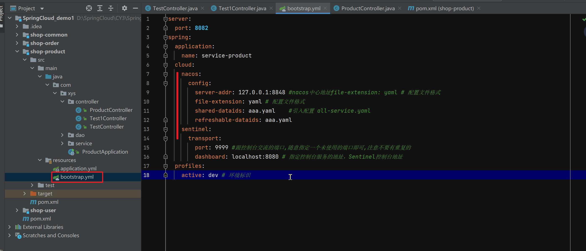

#### <font style="color:rgb(51,51,51);">通过浏览器访问localhost:8080 进入控制台( 默认用户名密码是sentinel/sentinel )</font>
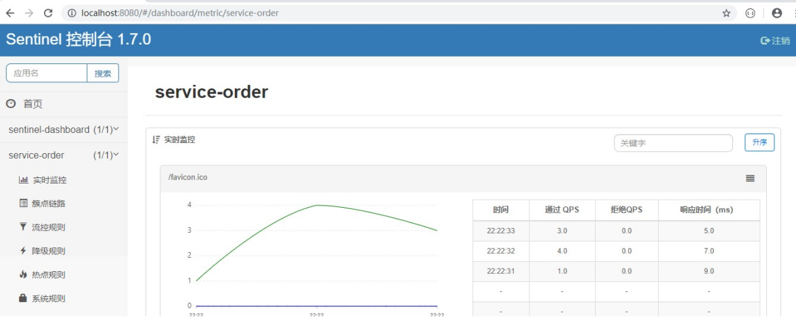

#### 常见问题   订单微服务在Sentinel中没有显示
> 1、是否导入Sentinel依赖
>
> 2、检查是否配置Sentinel相关配置
>
> 3、服务是否启动   商品微服务和订单微服务
>
> 4、需要访问订单微服务的任意一个Controller
>
> 5、刷新 Sentinel
>

**<font style="color:rgb(51,51,51);">补充：了解控制台的使用原理</font>**

<font style="color:rgb(51,51,51);">Sentinel的控制台其实就是一个SpringBoot编写的程序。我们需要将我们的微服务程序注册到控制台上, 即在微服务中指定控制台的地址,  并且还要开启一个跟控制台传递数据的端口,  控制台也可以通过此端口调用微服务中的监控程序获取微服务的各种信息。</font>

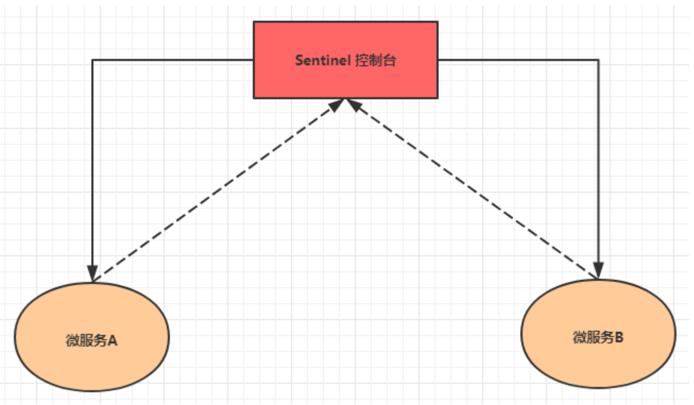

### **<font style="color:rgb(51,51,51);"> 实现一个接口的限流</font>**
#### <font style="color:rgb(51,51,51);">通过控制台为message1添加一个流控规则</font>


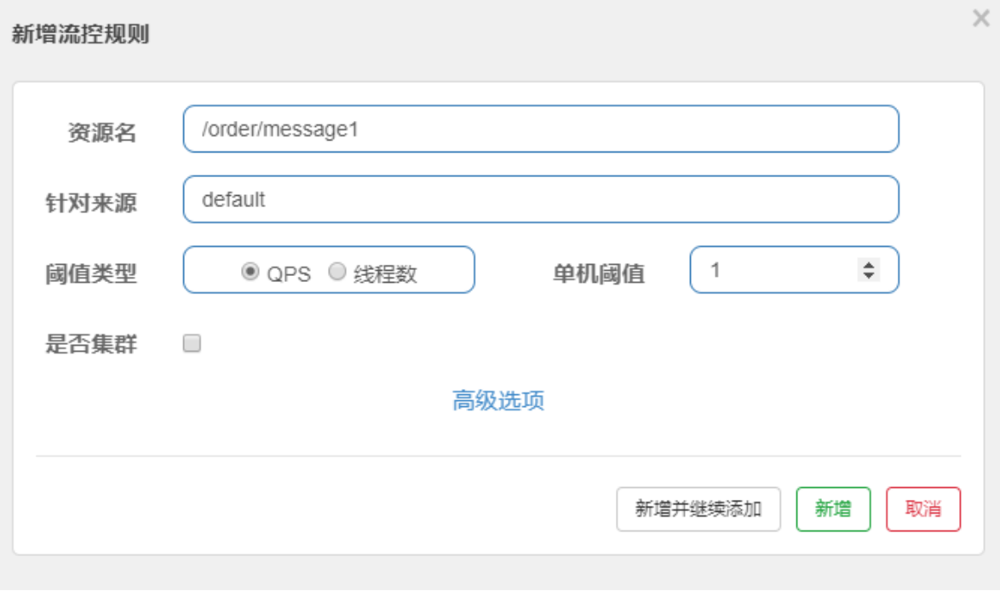

#### <font style="color:rgb(51,51,51);">通过控制台快速频繁访问, 观察效果</font>
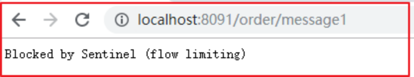

## <font style="color:rgb(51,51,51);">Sentinel的概念和功能</font>
### **<font style="color:rgb(51,51,51);">基本概念</font>**
+ **<font style="color:rgb(51,51,51);">资源</font>**

**<font style="color:rgb(51,51,51);">资源就是</font>****<font style="color:rgb(51,51,51);">Sentinel</font>****<font style="color:rgb(51,51,51);">要保护的东西</font>**

<font style="color:rgb(51,51,51);">资源是Sentinel 的关键概念。它可以是Java 应用程序中的任何内容，可以是一个服务，也可以是一个方法，甚至可以是一段代码。</font>

> <font style="color:rgb(119,119,119);">我们入门案例中的message1方法就可以认为是一个资源</font>
>

+ <font style="color:rgb(51,51,51);">规则</font>

**<font style="color:rgb(51,51,51);">规则就是用来定义如何进行保护资源的</font>**

<font style="color:rgb(51,51,51);">作用在资源之上,  定义以什么样的方式保护资源，主要包括流量控制规则、熔断降级规则以及系统保护规则。</font>

> <font style="color:rgb(119,119,119);">我们入门案例中就是为message1资源设置了一种流控规则, 限制了进入message1的流量</font>
>

### <font style="color:rgb(51,51,51);">重要功能</font>
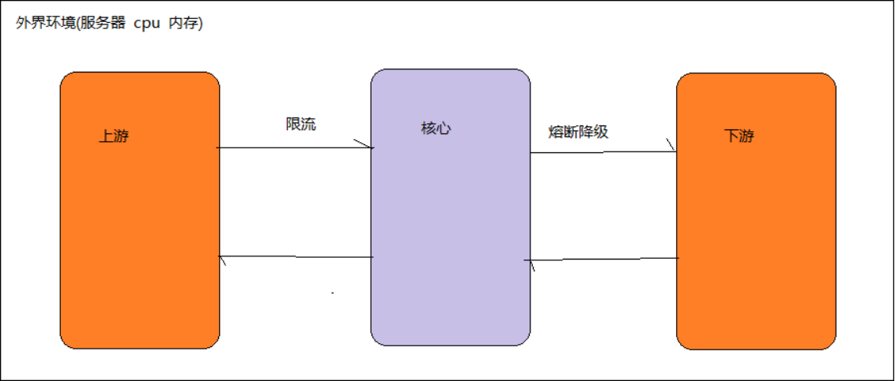

<font style="color:rgb(51,51,51);">Sentinel</font><font style="color:rgb(51,51,51);">的主要功能就是容错，主要体现为下面这三个：</font>

+ **<font style="color:rgb(51,51,51);">流量控制</font>**

<font style="color:rgb(51,51,51);">流量控制在网络传输中是一个常用的概念，它用于调整网络包的数据。任意时间到来的请求往往是</font><font style="color:rgb(51,51,51);">  </font><font style="color:rgb(51,51,51);">随机不可控的，而系统的处理能力是有限的。我们需要根据系统的处理能力对流量进行控制。</font><font style="color:rgb(51,51,51);">Sentinel</font><font style="color:rgb(51,51,51);"> </font><font style="color:rgb(51,51,51);">作为一个调配器，可以根据需要把随机的请求调整成合适的形状。</font>

+ **<font style="color:rgb(51,51,51);">熔断降级</font>**

<font style="color:rgb(51,51,51);">当检测到调用链路中某个资源出现不稳定的表现，例如请求响应时间长或异常比例升高的时候，则</font><font style="color:rgb(51,51,51);">  </font><font style="color:rgb(51,51,51);">对这个资源的调用进行限制，让请求快速失败，避免影响到其它的资源而导致级联故障。</font>

<font style="color:rgb(51,51,51);">Sentinel </font><font style="color:rgb(51,51,51);">对这个问题采取了两种手段</font><font style="color:rgb(51,51,51);">: </font>

    - <font style="color:rgb(51,51,51);">通过并发线程数进行限制</font>

<font style="color:rgb(51,51,51);">Sentinel</font><font style="color:rgb(51,51,51);">    </font><font style="color:rgb(51,51,51);">通过限制资源并发线程的数量，来减少不稳定资源对其它资源的影响。当某个资源</font><font style="color:rgb(51,51,51);">出现不稳定的情况下，例如响应时间变长，对资源的直接影响就是会造成线程数的逐步堆</font><font style="color:rgb(51,51,51);">    </font><font style="color:rgb(51,51,51);">积。当线程数在特定资源上堆积到一定的数量之后，对该资源的新请求就会被拒绝。堆积的</font><font style="color:rgb(51,51,51);">线程完成任务后才开始继续接收请求。</font>

    - <font style="color:rgb(51,51,51);">通过响应时间对资源进行降级</font>

<font style="color:rgb(51,51,51);">除了对并发线程数进行控制以外，Sentinel还可以通过响应时间来快速降级不稳定的资源。当依赖的资源出现响应时间过长后，所有对该资源的访问都会被直接拒绝，直到过了指定的时间窗口之后才重新恢复。</font>

> **<font style="color:rgb(119,119,119);">Sentinel 和Hystrix 的区别</font>**
>
> <font style="color:rgb(119,119,119);">两者的原则是一致的, 都是当一个资源出现问题时, 让其快速失败, 不要波及到其它服务但是在限制的手段上, 确采取了完全不一样的方法:</font>
>
> <font style="color:rgb(119,119,119);">Hystrix 采用的是线程池隔离的方式, 优点是做到了资源之间的隔离, 缺点是增加了线程切换的成本。</font>
>
> <font style="color:rgb(119,119,119);">Sentinel 采用的是通过并发线程的数量和响应时间来对资源做限制。</font>
>

**<font style="color:rgb(51,51,51);">系统负载保护</font>**

<font style="color:rgb(51,51,51);">Sentinel 同时提供系统维度的自适应保护能力。当系统负载较高的时候，如果还持续让请求进入可能会导致系统崩溃，无法响应。在集群环境下，会把本应这台机器承载的流量转发到其它的机器上去。如果这个时候其它的机器也处在一个边缘状态的时候，Sentinel 提供了对应的保护机制，让系统的入口流量和系统的负载达到一个平衡，保证系统在能力范围之内处理最多的请求。</font>

**<font style="color:rgb(51,51,51);">总之一句话:   我们需要做的事情，就是在Sentinel的资源上配置各种各样的规则，来实现各种容错的功能。</font>**

## <font style="color:rgb(51,51,51);"> Sentinel规则</font>
### <font style="color:rgb(51,51,51);">流控规则</font>
<font style="color:rgb(51,51,51);">流量控制，其原理是监控应用流量的</font><font style="color:rgb(51,51,51);">QPS(</font><font style="color:rgb(51,51,51);">每秒查询率</font><font style="color:rgb(51,51,51);">)   </font><font style="color:rgb(51,51,51);">或并发线程数等指标，当达到指定的阈值时</font><font style="color:rgb(51,51,51);">对流量进行控制，以避免被瞬时的流量高峰冲垮，从而保障应用的高可用性。</font>

<font style="color:rgb(51,51,51);">第</font><font style="color:rgb(51,51,51);">1</font><font style="color:rgb(51,51,51);">步</font><font style="color:rgb(51,51,51);">:   </font><font style="color:rgb(51,51,51);">点击簇点链路，我们就可以看到访问过的接口地址，然后点击对应的流控按钮，进入流控规则配</font><font style="color:rgb(51,51,51);">置页面。新增流控规则界面如下</font><font style="color:rgb(51,51,51);">:</font>

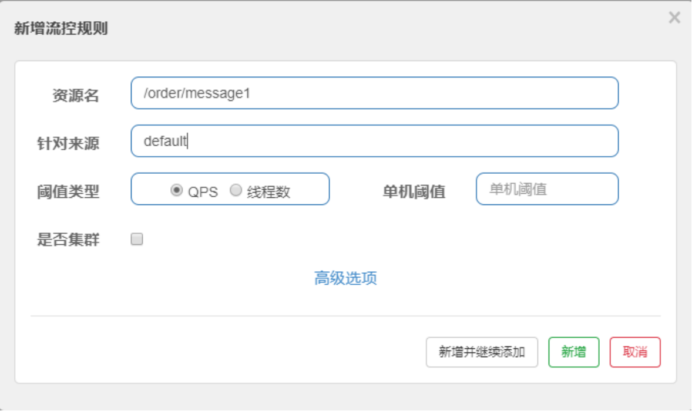

 

**<font style="color:rgb(51,51,51);">资源名</font>**<font style="color:rgb(51,51,51);">：唯一名称，默认是请求路径，可自定义</font>

**<font style="color:rgb(51,51,51);">针对来源</font>**<font style="color:rgb(51,51,51);">：指定对哪个微服务进行限流，默认指</font><font style="color:rgb(51,51,51);">default</font><font style="color:rgb(51,51,51);">，意思是不区分来源，全部限制</font><font style="color:rgb(51,51,51);">   </font>**<font style="color:rgb(51,51,51);">阈值类型</font>****<font style="color:rgb(51,51,51);">/</font>****<font style="color:rgb(51,51,51);">单机阈值</font>**<font style="color:rgb(51,51,51);">：</font>

+ <font style="color:rgb(51,51,51);">QPS（每秒请求数量）: 当调用该接口的QPS达到阈值的时候，进行限流</font>
+ <font style="color:rgb(51,51,51);">线程数：当调用该接口的线程数达到阈值的时候，进行限流</font>

**<font style="color:rgb(51,51,51);">是否集群</font>**<font style="color:rgb(51,51,51);">：暂不需要集群</font>

<font style="color:rgb(51,51,51);">接下来我们以</font><font style="color:rgb(51,51,51);">QPS</font><font style="color:rgb(51,51,51);">为例来研究限流规则的配置。</font>

#### <font style="color:rgb(51,51,51);"> 简单配置</font>
<font style="color:rgb(51,51,51);">我们先做一个简单配置，设置阈值类型为QPS，单机阈值为3。即每秒请求量大于3的时候开始限流。</font>

<font style="color:rgb(51,51,51);">接下来，在流控规则页面就可以看到这个配置。</font>


 

<font style="color:rgb(51,51,51);">然后快速访问</font><font style="color:rgb(51,51,51);">/order/message1</font><font style="color:rgb(51,51,51);"> </font><font style="color:rgb(51,51,51);">接口，观察效果。此时发现，当</font><font style="color:rgb(51,51,51);">QPS</font><font style="color:rgb(51,51,51);"> > </font><font style="color:rgb(51,51,51);">3</font><font style="color:rgb(51,51,51);">的时候，服务就不能正常响</font><font style="color:rgb(51,51,51);">应，而是返回</font><font style="color:rgb(51,51,51);">Blocked by Sentinel (flow limiting)</font><font style="color:rgb(51,51,51);">结果。</font>


#### <font style="color:rgb(51,51,51);"> 配置流控模式</font>
<font style="color:rgb(51,51,51);">点击上面设置流控规则的</font>**<font style="color:rgb(51,51,51);">编辑</font>**<font style="color:rgb(51,51,51);">按钮，然后在编辑页面点击</font>**<font style="color:rgb(51,51,51);">高级选项</font>**<font style="color:rgb(51,51,51);">，会看到有流控模式一栏。</font>

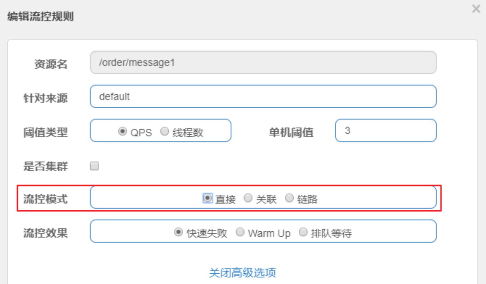

 

<font style="color:rgb(51,51,51);">sentinel</font><font style="color:rgb(51,51,51);">共有三种流控模式，分别是：</font>

+ <font style="color:rgb(51,51,51);">直接（默认）：接口达到限流条件时，开启限流</font>
+ <font style="color:rgb(51,51,51);">关联：当关联的资源达到限流条件时，开启限流</font><font style="color:rgb(51,51,51);">[</font><font style="color:rgb(51,51,51);">适合做应用让步</font><font style="color:rgb(51,51,51);">]</font>
+ <font style="color:rgb(51,51,51);">链路：当从某个接口过来的资源达到限流条件时，开启限流</font>

<font style="color:rgb(51,51,51);">下面呢分别演示三种模式：</font>

**<font style="color:rgb(51,51,51);">直接流控模式</font>**

<font style="color:rgb(51,51,51);">直接流控模式是最简单的模式，当指定的接口达到限流条件时开启限流。上面案例使用的就是直接流控模式。</font>

**<font style="color:rgb(51,51,51);">关联流控模式</font>**

<font style="color:rgb(51,51,51);">关联流控模式指的是，当指定接口关联的接口达到限流条件时，开启对指定接口开启限流。</font>

<font style="color:rgb(51,51,51);">第</font><font style="color:rgb(51,51,51);">1</font><font style="color:rgb(51,51,51);">步：配置限流规则</font><font style="color:rgb(51,51,51);">, </font><font style="color:rgb(51,51,51);">将流控模式设置为关联，关联资源设置为的</font><font style="color:rgb(51,51,51);">/order/message2</font><font style="color:rgb(51,51,51);">。</font>

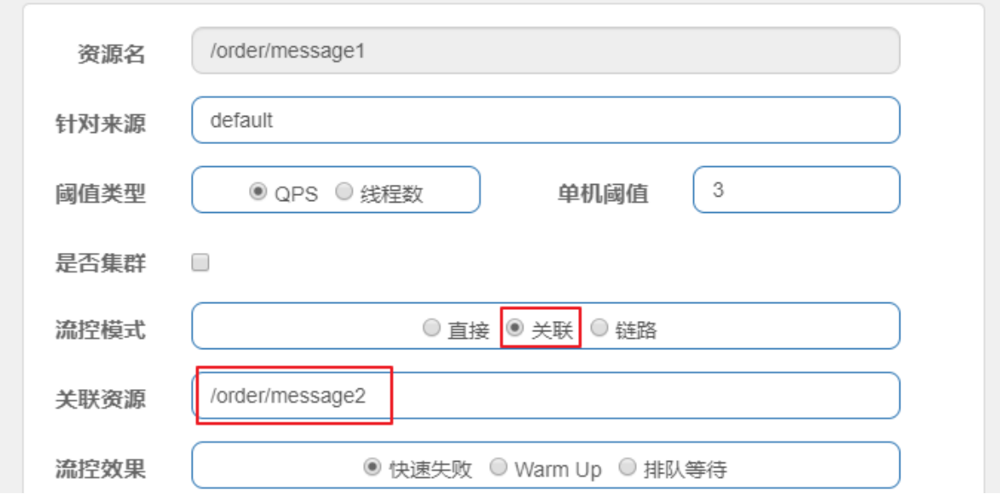

 

<font style="color:rgb(51,51,51);">第2步：通过postman软件向/order/message2连续发送请求，注意QPS一定要大于3</font>

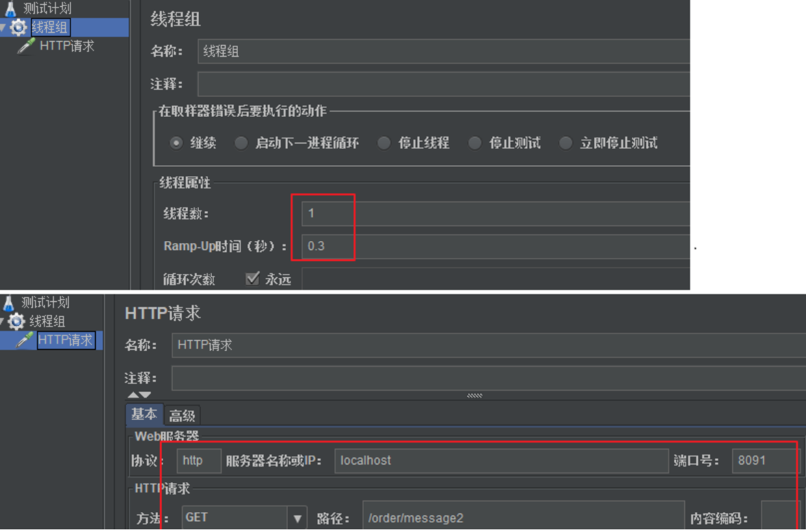

 

<font style="color:rgb(51,51,51);">第3步：访问/order/message1,会发现已经被限流</font>


#### **<font style="color:rgb(51,51,51);">配置流控效果</font>**
**<font style="color:rgb(51,51,51);">快速失败（默认）</font>**<font style="color:rgb(51,51,51);">: </font><font style="color:rgb(51,51,51);">直接失败，抛出异常，不做任何额外的处理，是最简单的效果</font>

**<font style="color:rgb(51,51,51);">Warm Up</font>**<font style="color:rgb(51,51,51);">：它从开始阈值到最大</font><font style="color:rgb(51,51,51);">QPS</font><font style="color:rgb(51,51,51);">阈值会有一个缓冲阶段，一开始的阈值是最大</font><font style="color:rgb(51,51,51);">QPS</font><font style="color:rgb(51,51,51);">阈值的</font>

<font style="color:rgb(51,51,51);">1/3</font><font style="color:rgb(51,51,51);">，然后慢慢增长，直到最大阈值，适用于将突然增大的流量转换为缓步增长的场景。</font>

**<font style="color:rgb(51,51,51);">排队等待</font>**<font style="color:rgb(51,51,51);">：让请求以均匀的速度通过，单机阈值为每秒通过数量，其余的排队等待；</font><font style="color:rgb(51,51,51);">  </font><font style="color:rgb(51,51,51);">它还会让设</font><font style="color:rgb(51,51,51);">置一个超时时间，当请求超过超时间时间还未处理，则会被丢弃。</font>

### <font style="color:rgb(51,51,51);"> 降级规则</font>
<font style="color:rgb(51,51,51);">降级规则就是设置当满足什么条件的时候，对服务进行降级。</font><font style="color:rgb(51,51,51);">Sentinel</font><font style="color:rgb(51,51,51);">提供了三个衡量条件：</font>

+ <font style="color:rgb(51,51,51);">平均响应时间：当资源的平均响应时间超过阈值（以ms  为单位）之后，资源进入准降级状态。如果接下来1s 内持续进入5 个请求，它们的RT都持续超过这个阈值，那么在接下的时间窗口</font>

<font style="color:rgb(51,51,51);">（以</font><font style="color:rgb(51,51,51);">s </font><font style="color:rgb(51,51,51);">为单位）之内，就会对这个方法进行服务降级。</font>

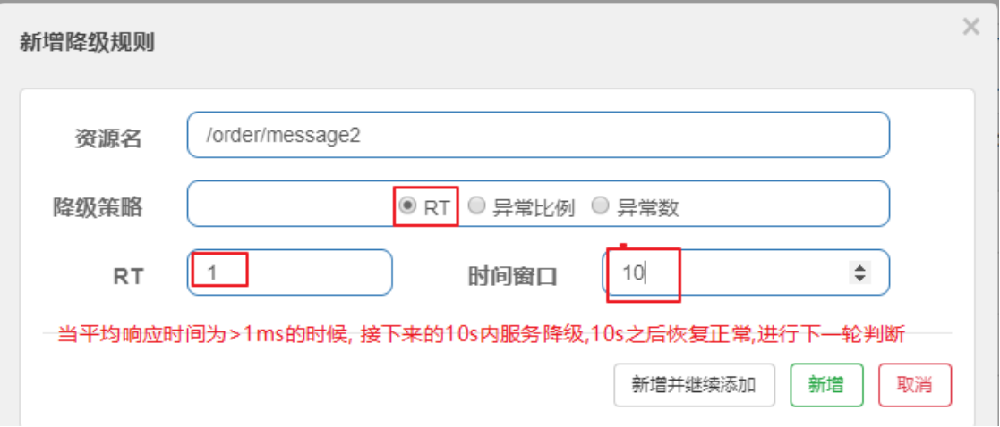

> <font style="color:rgb(119,119,119);">注意Sentinel 默认统计的RT 上限是4900 ms，超出此阈值的都会算作4900 ms，若需要变更此上限可以通过启动配置项-Dcsp.sentinel.statistic.max.rt=xxx 来配置。</font>
>

+ <font style="color:rgb(51,51,51);">异常比例：当资源的每秒异常总数占通过量的比值超过阈值之后，资源进入降级状态，即在接下的  时间窗口（以s 为单位）之内，对这个方法的调用都会自动地返回。异常比率的阈值范围是[0.0, 1.0]。</font>

#### 配置一个异常比例的降级规则
<font style="color:rgb(51,51,51);">第</font><font style="color:rgb(51,51,51);">1</font><font style="color:rgb(51,51,51);">步</font><font style="color:rgb(51,51,51);">: </font><font style="color:rgb(51,51,51);">首先模拟一个异常</font>

```java
int i = 0;
@RequestMapping("/order/message2") 
public String message2() {
    i++;
    //异常比例为0.333 
    if (i % 3 == 0){
        throw new RuntimeException();
    }
    return "message2";
}
```

<font style="color:rgb(51,51,51);">第</font><font style="color:rgb(51,51,51);">2</font><font style="color:rgb(51,51,51);">步</font><font style="color:rgb(51,51,51);">: </font><font style="color:rgb(51,51,51);">设置异常比例为</font><font style="color:rgb(51,51,51);">0.25</font>

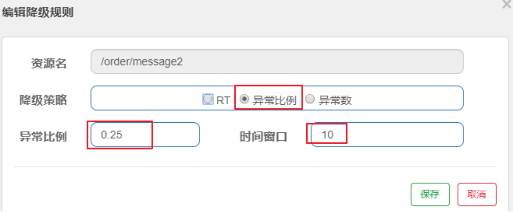

<font style="color:rgb(51,51,51);">异常数：当资源近1 分钟的异常数目超过阈值之后会进行服务降级。注意由于统计时间窗口是分钟级别的，若时间窗口小于60s，则结束熔断状态后仍可能再进入熔断状态。</font>

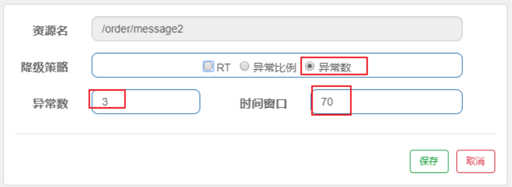

<font style="color:rgb(119,119,119);">问题：</font>

<font style="color:rgb(119,119,119);">流控规则和降级规则返回的异常页面是一样的，我们怎么来区分到底是什么原因导致的呢？</font>

### **<font style="color:rgb(51,51,51);"> 热点规则</font>**
<font style="color:rgb(51,51,51);">热点参数流控规则是一种更细粒度的流控规则</font><font style="color:rgb(51,51,51);">, </font><font style="color:rgb(51,51,51);">它允许将规则具体到参数上。</font>

#### <font style="color:rgb(51,51,51);">热点规则简单使用</font>
<font style="color:rgb(51,51,51);">第</font><font style="color:rgb(51,51,51);">1</font><font style="color:rgb(51,51,51);">步</font><font style="color:rgb(51,51,51);">: </font><font style="color:rgb(51,51,51);">编写代码</font>

```java
@RequestMapping("/order/message3")
@SentinelResource("message3")//注意这里必须使用这个注解标识,热点规则不生效
public String message3(String name, Integer age) {
    return name + age;
}
```

<font style="color:rgb(51,51,51);">第</font><font style="color:rgb(51,51,51);">2</font><font style="color:rgb(51,51,51);">步</font><font style="color:rgb(51,51,51);">: </font><font style="color:rgb(51,51,51);">配置热点规则</font>

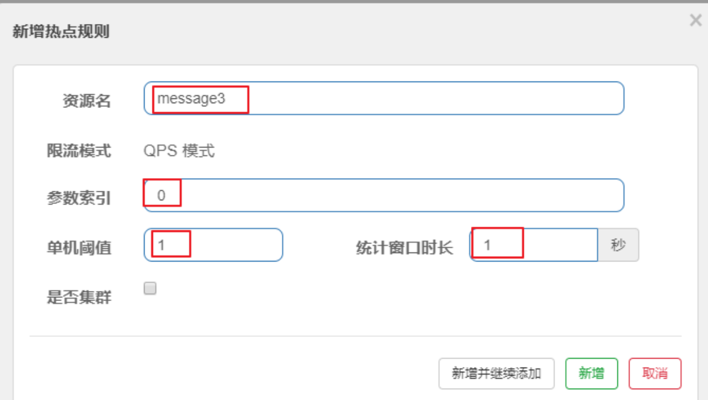

<font style="color:rgb(51,51,51);">第</font><font style="color:rgb(51,51,51);">3</font><font style="color:rgb(51,51,51);">步</font><font style="color:rgb(51,51,51);">: </font><font style="color:rgb(51,51,51);">分别用两个参数访问</font><font style="color:rgb(51,51,51);">,</font><font style="color:rgb(51,51,51);">会发现只对第一个参数限流了</font>

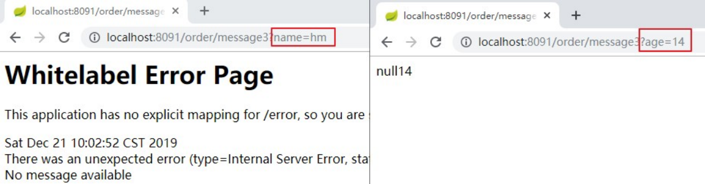

#### <font style="color:rgb(51,51,51);">热点规则增强使用</font>
<font style="color:rgb(51,51,51);">参数例外项允许对一个参数的具体值进行流控</font><font style="color:rgb(51,51,51);">编辑刚才定义的规则</font><font style="color:rgb(51,51,51);">,</font><font style="color:rgb(51,51,51);">增加参数例外项</font>

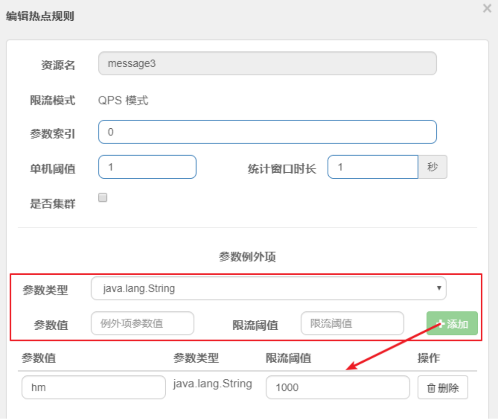

### **<font style="color:rgb(51,51,51);"> 授权规则</font>**
<font style="color:rgb(51,51,51);">很多时候，我们需要根据调用来源来判断该次请求是否允许放行，这时候可以使用</font><font style="color:rgb(51,51,51);">  </font><font style="color:rgb(51,51,51);">Sentinel   </font><font style="color:rgb(51,51,51);">的来源</font><font style="color:rgb(51,51,51);">访问控制的功能。来源访问控制根据资源的请求来源（</font><font style="color:rgb(51,51,51);">origin</font><font style="color:rgb(51,51,51);">）限制资源是否通过：</font>

+ <font style="color:rgb(51,51,51);">若配置白名单，则只有请求来源位于白名单内时才可通过；</font>
+ <font style="color:rgb(51,51,51);">若配置黑名单，则请求来源位于黑名单时不通过，其余的请求通过。</font>

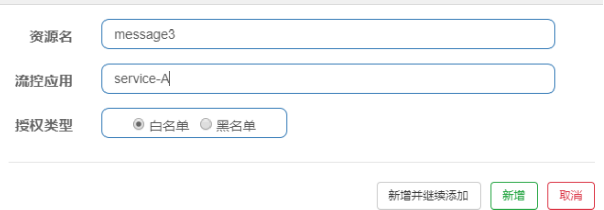

 

<font style="color:rgb(51,51,51);">上面的资源名和授权类型不难理解，但是流控应用怎么填写呢？</font>

> <font style="color:rgb(119,119,119);">其实这个位置要填写的是来源标识，Sentinel提供了RequestOriginParser 接口来处理来源。只要Sentinel保护的接口资源被访问，Sentinel就会调用RequestOriginParser 的实现类去解析访问来源。</font>
>

<font style="color:rgb(51,51,51);">第</font><font style="color:rgb(51,51,51);">1</font><font style="color:rgb(51,51,51);">步</font><font style="color:rgb(51,51,51);">: </font><font style="color:rgb(51,51,51);">自定义来源处理规则</font>

```java
@Component
public class RequestOriginParserDefinition implements RequestOriginParser{ 
    @Override
    public String parseOrigin(HttpServletRequest request) { 
        String serviceName = request.getParameter("serviceName"); 
        return serviceName;
    }
}
```

<font style="color:rgb(51,51,51);">第</font><font style="color:rgb(51,51,51);">2</font><font style="color:rgb(51,51,51);">步</font><font style="color:rgb(51,51,51);">: </font><font style="color:rgb(51,51,51);">授权规则配置</font>

<font style="color:rgb(51,51,51);">这个配置的意思是只有</font><font style="color:rgb(51,51,51);">serviceName=pc</font><font style="color:rgb(51,51,51);">不能访问</font><font style="color:rgb(51,51,51);">(</font><font style="color:rgb(51,51,51);">黑名单</font><font style="color:rgb(51,51,51);">)</font>

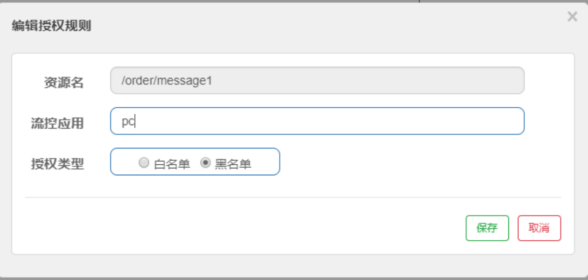

 

<font style="color:rgb(51,51,51);">第3步: 访问</font><u><font style="color:rgb(65,131,196);">http://localhost:8091/order/messa</font></u><font style="color:rgb(65,131,196);">g</font><u><font style="color:rgb(65,131,196);">e1?serviceName=pc</font></u><font style="color:rgb(51,51,51);">观察结果</font>

## **<font style="color:rgb(51,51,51);"> Sentinel规则持久化</font>**
<font style="color:rgb(51,51,51);">通过前面的讲解，我们已经知道，可以通过</font><font style="color:rgb(51,51,51);">Dashboard</font><font style="color:rgb(51,51,51);">来为每个</font><font style="color:rgb(51,51,51);">Sentinel</font><font style="color:rgb(51,51,51);">客户端设置各种各样的规则，但是这里有一个问题，就是这些规则默认是存放在内存中，极不稳定，所以需要将其持久化。</font>

<font style="color:rgb(51,51,51);">本地文件数据源会定时轮询文件的变更，读取规则。这样我们既可以在应用本地直接修改文件来更</font><font style="color:rgb(51,51,51);">  </font><font style="color:rgb(51,51,51);">新规则，也可以通过</font><font style="color:rgb(51,51,51);">Sentinel</font><font style="color:rgb(51,51,51);"> </font><font style="color:rgb(51,51,51);">控制台推送规则。以本地文件数据源为例，推送过程如下图所示：</font>

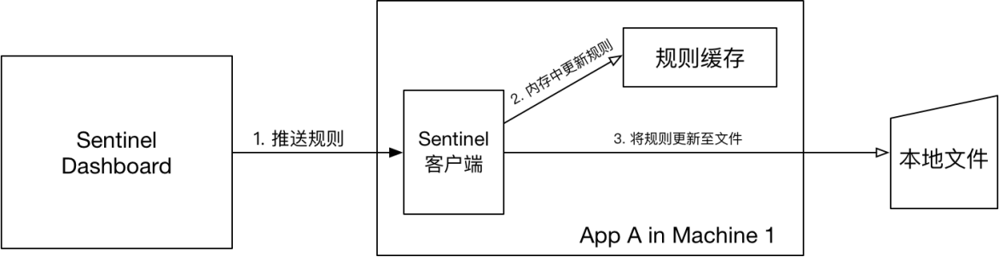

 

<font style="color:rgb(51,51,51);">首先</font><font style="color:rgb(51,51,51);">Sentinel </font><font style="color:rgb(51,51,51);">控制台通过</font><font style="color:rgb(51,51,51);">API </font><font style="color:rgb(51,51,51);">将规则推送至客户端并更新到内存中，接着注册的写数据源会将新的规则保存到本地的文件中。</font>

<font style="color:rgb(51,51,51);">1</font><font style="color:rgb(51,51,51);"> </font><font style="color:rgb(51,51,51);">编写处理类</font>

```java
package com.xys.config;

import com.alibaba.csp.sentinel.command.handler.ModifyParamFlowRulesCommandHandler;
import com.alibaba.csp.sentinel.datasource.*;
import com.alibaba.csp.sentinel.init.InitFunc;
import com.alibaba.csp.sentinel.slots.block.authority.AuthorityRule;
import com.alibaba.csp.sentinel.slots.block.authority.AuthorityRuleManager;
import com.alibaba.csp.sentinel.slots.block.degrade.DegradeRule;
import com.alibaba.csp.sentinel.slots.block.degrade.DegradeRuleManager;
import com.alibaba.csp.sentinel.slots.block.flow.FlowRule;
import com.alibaba.csp.sentinel.slots.block.flow.FlowRuleManager;
import com.alibaba.csp.sentinel.slots.block.flow.param.ParamFlowRule;
import com.alibaba.csp.sentinel.slots.block.flow.param.ParamFlowRuleManager;
import com.alibaba.csp.sentinel.slots.system.SystemRule;
import com.alibaba.csp.sentinel.slots.system.SystemRuleManager;
import com.alibaba.csp.sentinel.transport.util.WritableDataSourceRegistry;
import com.alibaba.fastjson.JSON;
import com.alibaba.fastjson.TypeReference;

import java.io.File;
import java.io.IOException;
import java.util.List;

/*
    文件持久化（SPI注入）
 */
public class FilePersistence implements InitFunc {
    public static final String APPLICATION_NAME = "service-order";
    @Override
    public void init() throws Exception {
        String ruleDir = System.getProperty("user.home") + "/sentinel-rules/" + APPLICATION_NAME;
        System.out.println(ruleDir);
        String flowRulePath = ruleDir + "/flow-rule.json";
        String degradeRulePath = ruleDir + "/degrade-rule.json"; String systemRulePath = ruleDir + "/system-rule.json";
        String authorityRulePath = ruleDir + "/authority-rule.json"; String paramFlowRulePath = ruleDir + "/param-flow-rule.json";

        this.mkdirIfNotExits(ruleDir); this.createFileIfNotExits(flowRulePath); this.createFileIfNotExits(degradeRulePath); this.createFileIfNotExits(systemRulePath); this.createFileIfNotExits(authorityRulePath); this.createFileIfNotExits(paramFlowRulePath);

        // 流控规则
        ReadableDataSource<String, List<FlowRule>> flowRuleRDS = new FileRefreshableDataSource<>(
                flowRulePath, flowRuleListParser
        );
        FlowRuleManager.register2Property(flowRuleRDS.getProperty()); WritableDataSource<List<FlowRule>> flowRuleWDS = new
                FileWritableDataSource<>(
                flowRulePath, this::encodeJson
        );
        WritableDataSourceRegistry.registerFlowDataSource(flowRuleWDS);


        // 降级规则
        ReadableDataSource<String, List<DegradeRule>> degradeRuleRDS = new FileRefreshableDataSource<>(
                degradeRulePath, degradeRuleListParser
        );
        DegradeRuleManager.register2Property(degradeRuleRDS.getProperty()); WritableDataSource<List<DegradeRule>> degradeRuleWDS = new
                FileWritableDataSource<>(
                degradeRulePath, this::encodeJson
        );
        WritableDataSourceRegistry.registerDegradeDataSource(degradeRuleWDS);


        // 系统规则
        ReadableDataSource<String, List<SystemRule>> systemRuleRDS = new FileRefreshableDataSource<>(
                systemRulePath, systemRuleListParser
        );
        SystemRuleManager.register2Property(systemRuleRDS.getProperty()); WritableDataSource<List<SystemRule>> systemRuleWDS = new
                FileWritableDataSource<>(
                systemRulePath, this::encodeJson

        );
        WritableDataSourceRegistry.registerSystemDataSource(systemRuleWDS);


        // 授权规则
        ReadableDataSource<String, List<AuthorityRule>> authorityRuleRDS = new FileRefreshableDataSource<>(
                authorityRulePath, authorityRuleListParser
        );
        AuthorityRuleManager.register2Property(authorityRuleRDS.getProperty()); WritableDataSource<List<AuthorityRule>> authorityRuleWDS = new
                FileWritableDataSource<>(
                authorityRulePath, this::encodeJson
        );


        WritableDataSourceRegistry.registerAuthorityDataSource(authorityRuleWDS);


        // 热点参数规则
        ReadableDataSource<String, List<ParamFlowRule>> paramFlowRuleRDS = new FileRefreshableDataSource<>(
                paramFlowRulePath, paramFlowRuleListParser
        );
        ParamFlowRuleManager.register2Property(paramFlowRuleRDS.getProperty()); WritableDataSource<List<ParamFlowRule>> paramFlowRuleWDS = new
                FileWritableDataSource<>(
                paramFlowRulePath, this::encodeJson
        );


        ModifyParamFlowRulesCommandHandler.setWritableDataSource(paramFlowRuleWDS);
    }


    private Converter<String, List<FlowRule>> flowRuleListParser = source -> JSON.parseObject(
            source,
            new TypeReference<List<FlowRule>>() {
            }
    );
    private Converter<String, List<DegradeRule>> degradeRuleListParser = source
            -> JSON.parseObject(
            source,
            new TypeReference<List<DegradeRule>>() {
            }
    );
    private Converter<String, List<SystemRule>> systemRuleListParser = source -> JSON.parseObject(
            source,

            new TypeReference<List<SystemRule>>() {
            }
    );


    private Converter<String, List<AuthorityRule>> authorityRuleListParser = source -> JSON.parseObject(
            source,
            new TypeReference<List<AuthorityRule>>() {
            }
    );


    private Converter<String, List<ParamFlowRule>> paramFlowRuleListParser = source -> JSON.parseObject(
            source,
            new TypeReference<List<ParamFlowRule>>() {
            }
    );


    private void mkdirIfNotExits(String filePath) throws IOException { File file = new File(filePath);
        if (!file.exists()) { file.mkdirs();
        }
    }


    private void createFileIfNotExits(String filePath) throws IOException { File file = new File(filePath);
        if (!file.exists()) { file.createNewFile();
        }
    }


    private <T> String encodeJson(T t) { return JSON.toJSONString(t);
    }
}

```


<font style="color:rgb(51,51,51);">2 添加配置</font>

<font style="color:rgb(51,51,51);">在</font><font style="color:rgb(51,51,51);">resources</font><font style="color:rgb(51,51,51);">下创建配置目录</font><font style="color:rgb(51,51,51);">META</font><font style="color:rgb(51,51,51);">-</font><font style="color:rgb(51,51,51);">INF/services</font><font style="color:rgb(51,51,51);"> </font><font style="color:rgb(51,51,51);">,</font><font style="color:rgb(51,51,51);">然后添加文件</font>

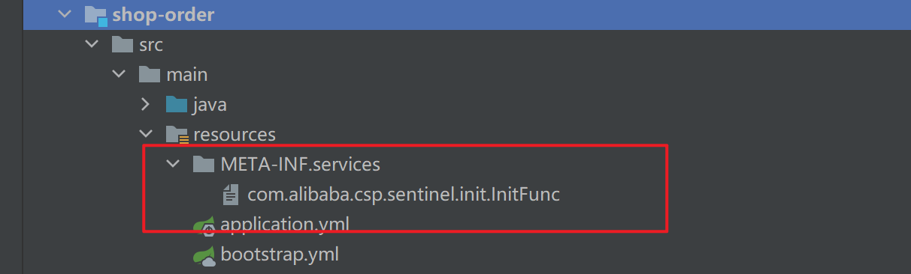

<font style="color:rgb(51,51,51);">在文件中添加配置类的全路径</font>

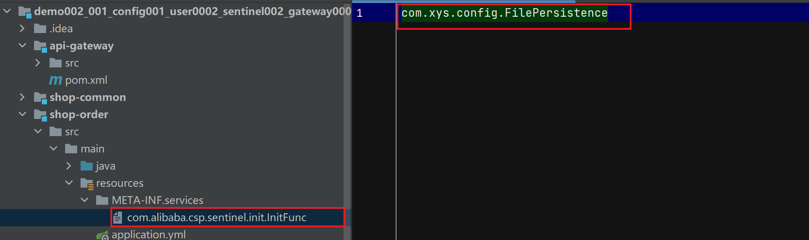

 


> 更新: 2025-11-27 13:36:55  
> 原文: <https://www.yuque.com/yayawei-srv9p/pf4se6/kpgni09lhq9oxtwn>