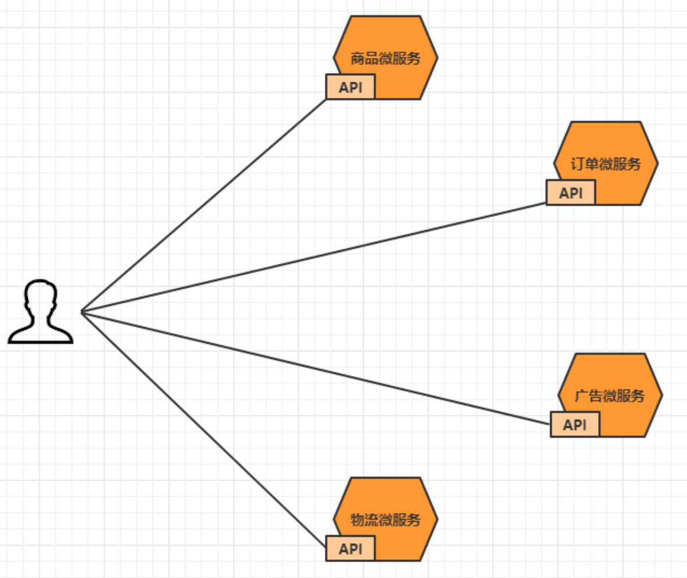
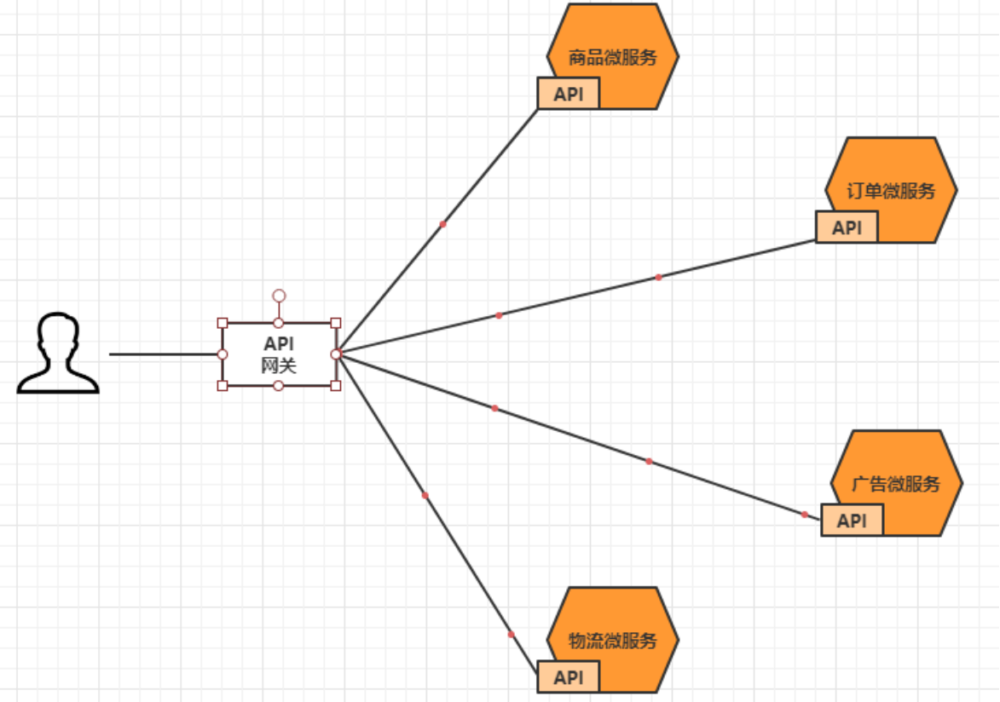
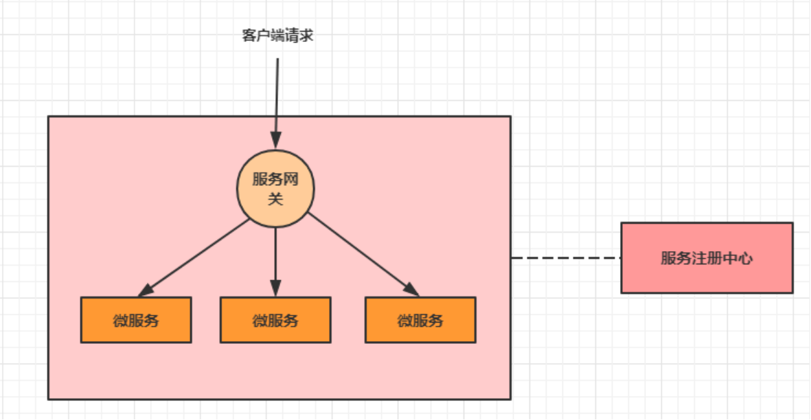
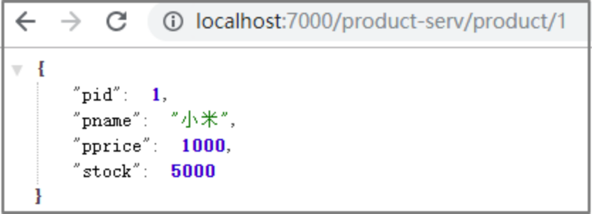
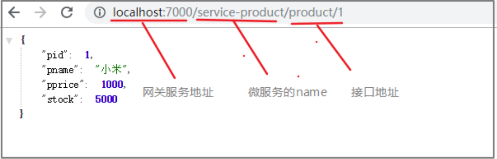
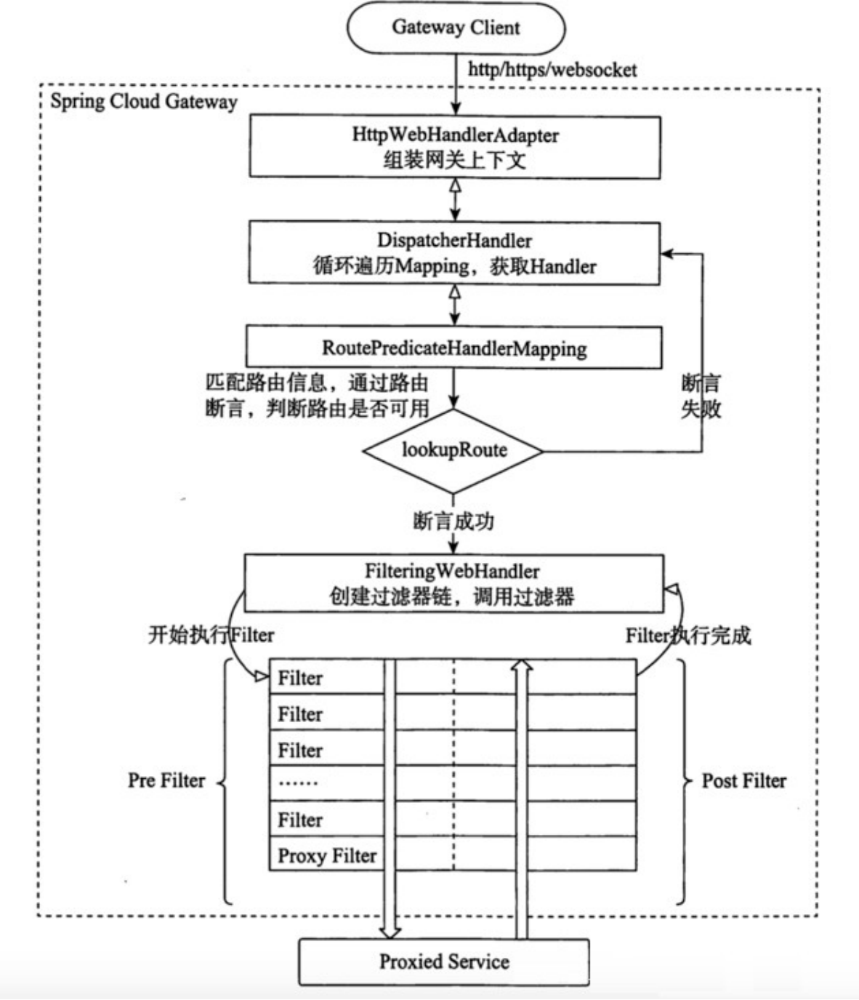
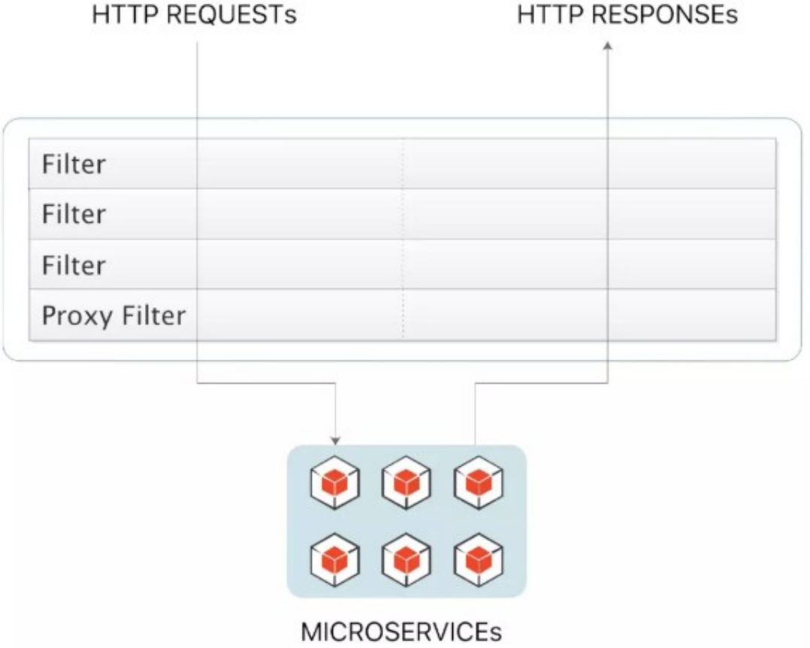
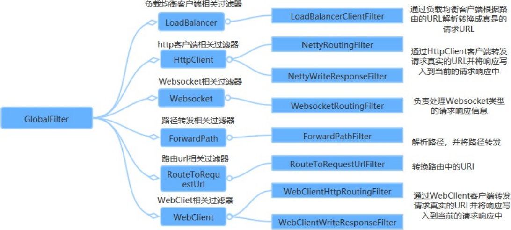
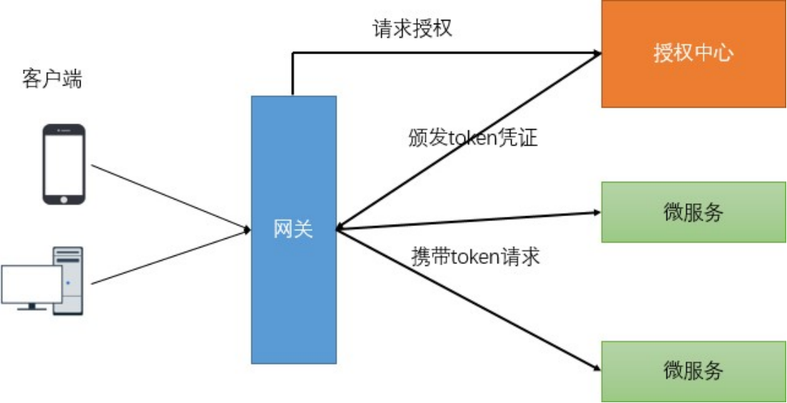

# 第6章 Gateway--服务网关

## <font style="color:rgb(51,51,51);"> 网关简介</font>
<font style="color:rgb(51,51,51);">大家都都知道在微服务架构中，一个系统会被拆分为很多个微服务。那么作为客户端要如何去调用</font><font style="color:rgb(51,51,51);">  </font><font style="color:rgb(51,51,51);">这么多的微服务呢？如果没有网关的存在，我们只能在客户端记录每个微服务的地址，然后分别去调</font><font style="color:rgb(51,51,51);">     </font><font style="color:rgb(51,51,51);">用。</font>



<font style="color:rgb(51,51,51);">这样的架构，会存在着诸多的问题：</font>

+ <font style="color:rgb(51,51,51);">客户端多次请求不同的微服务，增加客户端代码或配置编写的复杂性</font>
+ <font style="color:rgb(51,51,51);">认证复杂，每个服务都需要独立认证。</font>
+ <font style="color:rgb(51,51,51);">存在跨域请求，在一定场景下处理相对复杂。</font>

<font style="color:rgb(51,51,51);">上面的这些问题可以借助</font>**<font style="color:rgb(51,51,51);">API网关</font>**<font style="color:rgb(51,51,51);">来解决。</font>

<font style="color:rgb(51,51,51);">所谓的</font><font style="color:rgb(51,51,51);">API</font><font style="color:rgb(51,51,51);">网关，就是指系统的</font>**<font style="color:rgb(51,51,51);">统一入口</font>**<font style="color:rgb(51,51,51);">，它封装了应用程序的内部结构，为客户端提供统一服</font>

<font style="color:rgb(51,51,51);">务，一些与业务本身功能无关的公共逻辑可以在这里实现，诸如认证、鉴权、监控、路由转发等等。</font><font style="color:rgb(51,51,51);">  </font><font style="color:rgb(51,51,51);">添加上</font><font style="color:rgb(51,51,51);">API</font><font style="color:rgb(51,51,51);">网关之后，系统的架构图变成了如下所示：</font>



<font style="color:rgb(51,51,51);">我们也可以观察下，我们现在的整体架构图：</font>



<font style="color:rgb(51,51,51);">在业界比较流行的网关，有下面这些：</font>

+ **<font style="color:rgb(51,51,51);">Ngnix+lua</font>**

<font style="color:rgb(51,51,51);">使用</font><font style="color:rgb(51,51,51);">nginx</font><font style="color:rgb(51,51,51);">的反向代理和负载均衡可实现对</font><font style="color:rgb(51,51,51);">api</font><font style="color:rgb(51,51,51);">服务器的负载均衡及高可用</font>

<font style="color:rgb(51,51,51);">lua</font><font style="color:rgb(51,51,51);">是一种脚本语言</font><font style="color:rgb(51,51,51);">,</font><font style="color:rgb(51,51,51);">可以来编写一些简单的逻辑</font><font style="color:rgb(51,51,51);">, nginx</font><font style="color:rgb(51,51,51);">支持</font><font style="color:rgb(51,51,51);">lua</font><font style="color:rgb(51,51,51);">脚本</font>

+ **<font style="color:rgb(51,51,51);">Kong</font>**

<font style="color:rgb(51,51,51);">基于</font><font style="color:rgb(51,51,51);">Nginx+Lua</font><font style="color:rgb(51,51,51);">开发，性能高，稳定，有多个可用的插件</font><font style="color:rgb(51,51,51);">(</font><font style="color:rgb(51,51,51);">限流、鉴权等等</font><font style="color:rgb(51,51,51);">)</font><font style="color:rgb(51,51,51);">可以开箱即用。</font><font style="color:rgb(51,51,51);">问题：</font><font style="color:rgb(51,51,51);">只支持</font><font style="color:rgb(51,51,51);">Http</font><font style="color:rgb(51,51,51);">协议；二次开发，自由扩展困难；提供管理</font><font style="color:rgb(51,51,51);">API</font><font style="color:rgb(51,51,51);">，缺乏更易用的管控、配置方式。</font>

**<font style="color:rgb(51,51,51);">Zuul </font>**<font style="color:rgb(51,51,51);">Netflix开源的网关，功能丰富，使用JAVA开发，易于二次开发问题：缺乏管控，无法动态配置；依赖组件较多；处理Http请求依赖的是Web容器，性能不如Nginx</font>

+ **<font style="color:rgb(51,51,51);">Spring Cloud Gateway</font>**

<font style="color:rgb(51,51,51);">Spring</font><font style="color:rgb(51,51,51);">公司为了替换</font><font style="color:rgb(51,51,51);">Zuul</font><font style="color:rgb(51,51,51);">而开发的网关服务，将在下面具体介绍。</font>

**<font style="color:rgb(51,51,51);">注意：SpringCloud alibaba技术栈中并没有提供自己的网关，我们可以采用Spring Cloud Gateway</font>**

**<font style="color:rgb(51,51,51);">来做网关</font>**

## <font style="color:rgb(51,51,51);">Gateway简介</font>
<font style="color:rgb(51,51,51);">Spring</font><font style="color:rgb(51,51,51);">  </font><font style="color:rgb(51,51,51);">Cloud</font><font style="color:rgb(51,51,51);">  </font><font style="color:rgb(51,51,51);">Gateway</font><font style="color:rgb(51,51,51);">是</font><font style="color:rgb(51,51,51);">Spring</font><font style="color:rgb(51,51,51);">公司基于</font><font style="color:rgb(51,51,51);">Spring</font><font style="color:rgb(51,51,51);">  </font><font style="color:rgb(51,51,51);">5.0</font><font style="color:rgb(51,51,51);">，</font><font style="color:rgb(51,51,51);">Spring</font><font style="color:rgb(51,51,51);">  </font><font style="color:rgb(51,51,51);">Boot</font><font style="color:rgb(51,51,51);">  </font><font style="color:rgb(51,51,51);">2.0</font><font style="color:rgb(51,51,51);">  </font><font style="color:rgb(51,51,51);">和</font><font style="color:rgb(51,51,51);">Project</font><font style="color:rgb(51,51,51);">  </font><font style="color:rgb(51,51,51);">Reactor</font><font style="color:rgb(51,51,51);">  </font><font style="color:rgb(51,51,51);">等技术</font><font style="color:rgb(51,51,51);">开发的网关，它旨在为微服务架构提供一种简单有效的统一的</font><font style="color:rgb(51,51,51);">API </font><font style="color:rgb(51,51,51);">路由管理方式。它的目标是替代</font><font style="color:rgb(51,51,51);">Netflix Zuul</font><font style="color:rgb(51,51,51);">，其不仅提供统一的路由方式，并且基于</font><font style="color:rgb(51,51,51);">Filter </font><font style="color:rgb(51,51,51);">链的方式提供了网关基本的功能，例如：安全，监控和限流。</font>

**<font style="color:rgb(51,51,51);">优点：</font>**

+ <font style="color:rgb(51,51,51);">性能强劲：是第一代网关Zuul的1.6倍</font>
+ <font style="color:rgb(51,51,51);">功能强大：内置了很多实用的功能，例如转发、监控、限流等</font>
+ <font style="color:rgb(51,51,51);">设计优雅，容易扩展</font>

**<font style="color:rgb(51,51,51);">缺点：</font>**

+ <font style="color:rgb(51,51,51);">其实现依赖Netty与WebFlux，不是传统的Servlet编程模型，学习成本高</font>
+ <font style="color:rgb(51,51,51);">不能将其部署在Tomcat、Jetty等Servlet容器里，只能打成jar包执行</font>
+ <font style="color:rgb(51,51,51);">需要Spring Boot 2.0及以上的版本，才支持</font>

## <font style="color:rgb(51,51,51);">快速入门</font>
<font style="color:rgb(51,51,51);">要求</font><font style="color:rgb(51,51,51);">: </font><font style="color:rgb(51,51,51);">通过浏览器访问</font><font style="color:rgb(51,51,51);">api</font><font style="color:rgb(51,51,51);">网关</font><font style="color:rgb(51,51,51);">,</font><font style="color:rgb(51,51,51);">然后通过网关将请求转发到商品微服务</font>

### <font style="color:rgb(51,51,51);">基础版</font>
<font style="color:rgb(51,51,51);">第</font><font style="color:rgb(51,51,51);">1</font><font style="color:rgb(51,51,51);">步：创建一个</font><font style="color:rgb(51,51,51);">api</font><font style="color:rgb(51,51,51);">-</font><font style="color:rgb(51,51,51);">gateway</font><font style="color:rgb(51,51,51);"> </font><font style="color:rgb(51,51,51);">的模块</font><font style="color:rgb(51,51,51);">,</font><font style="color:rgb(51,51,51);">导入相关依赖</font>

```xml
<!--gateway网关-->
<dependency>
  <groupId>org.springframework.cloud</groupId>
  <artifactId>spring-cloud-starter-gateway</artifactId>
</dependency>
```

<font style="color:rgb(51,51,51);">第</font><font style="color:rgb(51,51,51);">2</font><font style="color:rgb(51,51,51);">步</font><font style="color:rgb(51,51,51);">: </font><font style="color:rgb(51,51,51);">创建主类</font>

```java
package com.xys;

import org.springframework.boot.SpringApplication;
import org.springframework.boot.autoconfigure.SpringBootApplication;

@SpringBootApplication
public class GatewayApplication {
    public static void main(String[] args) {
        SpringApplication.run(GatewayApplication.class, args);
    }
}

```

<font style="color:rgb(51,51,51);">第</font><font style="color:rgb(51,51,51);">3</font><font style="color:rgb(51,51,51);">步</font><font style="color:rgb(51,51,51);">: </font><font style="color:rgb(51,51,51);">添加配置文件</font>

```yaml
server:
  port: 7000
spring:
  application:
    name: api-gateway
  cloud:
    gateway:
      routes: # 路由数组[路由 就是指定当请求满足什么条件的时候转到哪个微服务]
        - id: product_route # 当前路由的标识, 要求唯一
          uri: http://localhost:8081 # 请求要转发到的地址
          order: 1 # 路由的优先级,数字越小级别越高
          predicates: # 断言(就是路由转发要满足的条件)
            - Path=/product-serv/** # 当请求路径满足Path指定的规则时,才进行路由转发
          filters: # 过滤器,请求在传递过程中可以通过过滤器对其进行一定的修改
            - StripPrefix=1 # 转发之前去掉1层路径
```

<font style="color:rgb(51,51,51);">第</font><font style="color:rgb(51,51,51);">4</font><font style="color:rgb(51,51,51);">步</font><font style="color:rgb(51,51,51);">: </font><font style="color:rgb(51,51,51);">启动项目</font><font style="color:rgb(51,51,51);">, </font><font style="color:rgb(51,51,51);">并通过网关去访问微服务</font>


配置多个路由的配置文件如下：

```yaml
server:
  port: 7000
spring:
  application:
    name: api-gateway
  cloud:
    gateway:
      routes: # 路由数组[路由 就是指定当请求满足什么条件的时候转到哪个微服务]
        - id: product_route # 当前路由的标识, 要求唯一
          uri: http://localhost:8081 # 请求要转发到的地址
          order: 1 # 路由的优先级,数字越小级别越高
          predicates: # 断言(就是路由转发要满足的条件)
            - Path=/product-serv/** # 当请求路径满足Path指定的规则时,才进行路由转发
          filters: # 过滤器,请求在传递过程中可以通过过滤器对其进行一定的修改
            - StripPrefix=1 # 转发之前去掉1层路径
        - id: user_route # 当前路由的标识, 要求唯一
          uri: http://localhost:8071 # 请求要转发到的地址
          order: 1 # 路由的优先级,数字越小级别越高
          predicates: # 断言(就是路由转发要满足的条件)
            - Path=/user-serv/** # 当请求路径满足Path指定的规则时,才进行路由转发
          filters: # 过滤器,请求在传递过程中可以通过过滤器对其进行一定的修改
            - StripPrefix=1 # 转发之前去掉1层路径
```

### <font style="color:rgb(51,51,51);"> 增强版</font>
<font style="color:rgb(51,51,51);">现在在配置文件中写死了转发路径的地址, 前面我们已经分析过地址写死带来的问题,  接下来我们从注册中心获取此地址。</font>

<font style="color:rgb(51,51,51);">第</font><font style="color:rgb(51,51,51);">1</font><font style="color:rgb(51,51,51);">步：加入</font><font style="color:rgb(51,51,51);">nacos</font><font style="color:rgb(51,51,51);">依赖</font>

```xml
<!--nacos客户端-->
<dependency>
    <groupId>com.alibaba.cloud</groupId>
    <artifactId>spring-cloud-starter-alibaba-nacos-discovery</artifactId>
</dependency>
```

<font style="color:rgb(51,51,51);">第</font><font style="color:rgb(51,51,51);">2</font><font style="color:rgb(51,51,51);">步：在主类上添加注解</font>

```java
@SpringBootApplication 
@EnableDiscoveryClient
public class ApiGatewayApplication {
    public static void main(String[] args) { 
        SpringApplication.run(ApiGatewayApplication.class, args);
    }
}
```

<font style="color:rgb(51,51,51);">第</font><font style="color:rgb(51,51,51);">3</font><font style="color:rgb(51,51,51);">步：修改配置文件</font>

```yaml
server:
  port: 7000
spring:
  application:
    name: api-gateway
  cloud:
    nacos:
      discovery:
        server-addr: 127.0.0.1:8848
    gateway:
      discovery:
        locator:
          enabled: true # 让gateway可以发现nacos中的微服务
      routes: # 路由数组[路由 就是指定当请求满足什么条件的时候转到哪个微服务]
        - id: product_route # 当前路由的标识, 要求唯一
          uri: lb://service-product  #lb指的是从nacos中按照名称获取微服务,并遵循负载均衡策略
          orders: 1 # 路由的优先级,数字越小级别越高
          predicates: # 断言(就是路由转发要满足的条件)
            - Path=/product-serv/** # 当请求路径满足Path指定的规则时,才进行路由转发
          filters: # 过滤器,请求在传递过程中可以通过过滤器对其进行一定的修改
            - StripPrefix=1 # 转发之前去掉1层路径
```

<font style="color:rgb(51,51,51);">第</font><font style="color:rgb(51,51,51);">4</font><font style="color:rgb(51,51,51);">步</font><font style="color:rgb(51,51,51);">:</font><font style="color:rgb(51,51,51);">测试</font>



### <font style="color:rgb(51,51,51);"> 简写版</font>
<font style="color:rgb(51,51,51);">第</font><font style="color:rgb(51,51,51);">1</font><font style="color:rgb(51,51,51);">步</font><font style="color:rgb(51,51,51);">: </font><font style="color:rgb(51,51,51);">去掉关于路由的配置</font>

```yaml
server:
  port: 7000
spring:
  application:
    name: api-gateway
  cloud:
    nacos:
      discovery:
        server-addr: 127.0.0.1:8848
    gateway:
      discovery:
        locator:
          enabled: true # 让gateway可以发现nacos中的微服务
```

<font style="color:rgb(51,51,51);">第</font><font style="color:rgb(51,51,51);">2</font><font style="color:rgb(51,51,51);">步</font><font style="color:rgb(51,51,51);">: </font><font style="color:rgb(51,51,51);">启动项目，并通过网关去访问微服务</font>



<font style="color:rgb(51,51,51);">这时候，就发现只要按照</font>**<font style="color:rgb(51,51,51);">网关地址</font>****<font style="color:rgb(51,51,51);">/</font>****<font style="color:rgb(51,51,51);">微服务</font>****<font style="color:rgb(51,51,51);">/</font>****<font style="color:rgb(51,51,51);">接口</font>**<font style="color:rgb(51,51,51);">的格式去访问，就可以得到成功响应。</font>

## <font style="color:rgb(51,51,51);">Gateway核心架构</font>
### <font style="color:rgb(51,51,51);"> 基本概念</font>
<font style="color:rgb(51,51,51);">路由</font><font style="color:rgb(51,51,51);">(Route) </font><font style="color:rgb(51,51,51);">是</font><font style="color:rgb(51,51,51);">gateway </font><font style="color:rgb(51,51,51);">中最基本的组件之一，表示一个具体的路由信息载体。主要定义了下面的几个信息</font><font style="color:rgb(51,51,51);">:</font>

+ **<font style="color:rgb(51,51,51);">id</font>**<font style="color:rgb(51,51,51);">，路由标识符，区别于其他Route。</font>
+ **<font style="color:rgb(51,51,51);">uri</font>**<font style="color:rgb(51,51,51);">，路由指向的目的地 uri，即客户端请求最终被转发到的微服务。</font>
+ **<font style="color:rgb(51,51,51);">order</font>**<font style="color:rgb(51,51,51);">，用于多个Route 之间的排序，数值越小排序越靠前，匹配优先级越高。</font>
+ **<font style="color:rgb(51,51,51);">predicate</font>**<font style="color:rgb(51,51,51);">，断言的作用是进行条件判断，只有断言都返回真，才会真正的执行路由。</font>
+ **<font style="color:rgb(51,51,51);">filter</font>**<font style="color:rgb(51,51,51);">，过滤器用于修改请求和响应信息。</font>

### <font style="color:rgb(51,51,51);"> 执行流程</font>


** **

<font style="color:rgb(51,51,51);">执行流程大体如下：</font>

<font style="color:rgb(51,51,51);">1.</font><font style="color:rgb(51,51,51);"> </font><font style="color:rgb(51,51,51);">Gateway</font><font style="color:rgb(51,51,51);"> </font><font style="color:rgb(51,51,51);">Client</font><font style="color:rgb(51,51,51);">向</font><font style="color:rgb(51,51,51);">Gateway</font><font style="color:rgb(51,51,51);"> </font><font style="color:rgb(51,51,51);">Server</font><font style="color:rgb(51,51,51);">发送请求</font>

<font style="color:rgb(51,51,51);">2.</font><font style="color:rgb(51,51,51);"> </font><font style="color:rgb(51,51,51);">请求首先会被</font><font style="color:rgb(51,51,51);">HttpWebHandlerAdapter</font><font style="color:rgb(51,51,51);">进行提取组装成网关上下文</font>

<font style="color:rgb(51,51,51);">3.</font><font style="color:rgb(51,51,51);"> </font><font style="color:rgb(51,51,51);">然后网关的上下文会传递到</font><font style="color:rgb(51,51,51);">DispatcherHandler</font><font style="color:rgb(51,51,51);">，它负责将请求分发给</font>

<font style="color:rgb(51,51,51);">RoutePredicateHandlerMapping</font>

<font style="color:rgb(51,51,51);">4.</font><font style="color:rgb(51,51,51);"> </font><font style="color:rgb(51,51,51);">RoutePredicateHandlerMapping</font><font style="color:rgb(51,51,51);">负责路由查找，并根据路由断言判断路由是否可用</font>

<font style="color:rgb(51,51,51);">5. 如果过断言成功，由FilteringWebHandler创建过滤器链并调用</font>

<font style="color:rgb(51,51,51);">6.</font><font style="color:rgb(51,51,51);"> </font><font style="color:rgb(51,51,51);">请求会一次经过</font><font style="color:rgb(51,51,51);">PreFilter--</font><font style="color:rgb(51,51,51);">微服务</font><font style="color:rgb(51,51,51);">--PostFilter</font><font style="color:rgb(51,51,51);">的方法，最终返回响应</font>

## <font style="color:rgb(51,51,51);"> 断言</font>
<font style="color:rgb(51,51,51);">Predicate(</font><font style="color:rgb(51,51,51);">断言</font><font style="color:rgb(51,51,51);">, </font><font style="color:rgb(51,51,51);">谓词</font><font style="color:rgb(51,51,51);">) </font><font style="color:rgb(51,51,51);">用于进行条件判断，只有断言都返回真，才会真正的执行路由。断言就是说</font><font style="color:rgb(51,51,51);">: </font><font style="color:rgb(51,51,51);">在</font>**<font style="color:rgb(51,51,51);">什么条件下</font>**<font style="color:rgb(51,51,51);">才能进行路由转发</font>

### <font style="color:rgb(51,51,51);"> 内置路由断言工厂</font>
<font style="color:rgb(51,51,51);">SpringCloud Gateway</font><font style="color:rgb(51,51,51);">包括许多内置的断言工厂，所有这些断言都与</font><font style="color:rgb(51,51,51);">HTTP</font><font style="color:rgb(51,51,51);">请求的不同属性匹配。具体如下：</font>

+ <font style="color:rgb(51,51,51);">基于Datetime类型的断言工厂</font>

<font style="color:rgb(51,51,51);">此类型的断言根据时间做判断，主要有三个：</font>

<font style="color:rgb(51,51,51);">AfterRoutePredicateFactory</font><font style="color:rgb(51,51,51);">：</font><font style="color:rgb(51,51,51);">接收一个日期参数，判断请求日期是否晚于指定日期</font><font style="color:rgb(51,51,51);">BeforeRoutePredicateFactory</font><font style="color:rgb(51,51,51);">：</font><font style="color:rgb(51,51,51);">接收一个日期参数，判断请求日期是否早于指定日期</font><font style="color:rgb(51,51,51);">BetweenRoutePredicateFactory</font><font style="color:rgb(51,51,51);">：</font><font style="color:rgb(51,51,51);">接收两个日期参数，判断请求日期是否在指定时间段内</font>

> <font style="color:rgb(119,119,119);">-After=2019-12-31T23:59:59.789+08:00[Asia/Shanghai]</font>
>

+ <font style="color:rgb(51,51,51);">基于远程地址的断言工厂  </font>

<font style="color:rgb(51,51,51);">RemoteAddrRoutePredicateFactory：接收一个IP地址段，判断请求主机地址是否在地址段中</font>

> <font style="color:rgb(119,119,119);">-RemoteAddr=192.168.1.1/24</font>
>

+ <font style="color:rgb(51,51,51);">基于Cookie的断言工厂</font>

<font style="color:rgb(51,51,51);">CookieRoutePredicateFactory</font><font style="color:rgb(51,51,51);">：接收两个参数，</font><font style="color:rgb(51,51,51);">cookie </font><font style="color:rgb(51,51,51);">名字和一个正则表达式。</font><font style="color:rgb(51,51,51);">判断请求</font>

<font style="color:rgb(51,51,51);">cookie</font><font style="color:rgb(51,51,51);">是否具有给定名称且值与正则表达式匹配。</font>

> <font style="color:rgb(119,119,119);">-Cookie=chocolate, ch.</font>
>

+ <font style="color:rgb(51,51,51);">基于Header的断言工厂</font>

<font style="color:rgb(51,51,51);">HeaderRoutePredicateFactory</font><font style="color:rgb(51,51,51);">：接收两个参数，标题名称和正则表达式。</font><font style="color:rgb(51,51,51);">  </font><font style="color:rgb(51,51,51);">判断请求</font><font style="color:rgb(51,51,51);">Header</font><font style="color:rgb(51,51,51);">是否具有给定名称且值与正则表达式匹配。</font>

> <font style="color:rgb(119,119,119);">-Header=X-Request-Id, \d+</font>
>

+ <font style="color:rgb(51,51,51);">基于Host的断言工厂</font>

<font style="color:rgb(51,51,51);">HostRoutePredicateFactory</font><font style="color:rgb(51,51,51);">：</font><font style="color:rgb(51,51,51);">接收一个参数</font><font style="color:rgb(51,51,51);">，</font><font style="color:rgb(51,51,51);">主机名模式。判断请求的</font><font style="color:rgb(51,51,51);">Host</font><font style="color:rgb(51,51,51);">是否满足匹配规则。</font>

> <font style="color:rgb(119,119,119);">-Host=**.testhost.org</font>
>

+ <font style="color:rgb(51,51,51);">基于Method请求方法的断言工厂</font>

<font style="color:rgb(51,51,51);">MethodRoutePredicateFactory</font><font style="color:rgb(51,51,51);">：</font><font style="color:rgb(51,51,51);">接收一个参数</font><font style="color:rgb(51,51,51);">，</font><font style="color:rgb(51,51,51);">判断请求类型是否跟指定的类型匹配。</font>

> <font style="color:rgb(119,119,119);">-Method=GET</font>
>

+ <font style="color:rgb(51,51,51);">基于Path请求路径的断言工厂</font>

<font style="color:rgb(51,51,51);">PathRoutePredicateFactory</font><font style="color:rgb(51,51,51);">：</font><font style="color:rgb(51,51,51);">接收一个参数</font><font style="color:rgb(51,51,51);">，</font><font style="color:rgb(51,51,51);">判断请求的</font><font style="color:rgb(51,51,51);">URI</font><font style="color:rgb(51,51,51);">部分是否满足路径规则。</font>

> <font style="color:rgb(119,119,119);">-Path=/foo/{segment}</font>
>

+ <font style="color:rgb(51,51,51);">基于Query请求参数的断言工厂</font>

<font style="color:rgb(51,51,51);">QueryRoutePredicateFactory </font><font style="color:rgb(51,51,51);">：</font><font style="color:rgb(51,51,51);">接收两个参数</font><font style="color:rgb(51,51,51);">，</font><font style="color:rgb(51,51,51);">请求</font><font style="color:rgb(51,51,51);">param</font><font style="color:rgb(51,51,51);">和正则表达式</font><font style="color:rgb(51,51,51);">，</font><font style="color:rgb(51,51,51);">判断请求参数是否具有给定名称且值与正则表达式匹配。</font>

> <font style="color:rgb(119,119,119);">-Query=baz, ba.</font>
>

+ <font style="color:rgb(51,51,51);">基于路由权重的断言工厂</font>

<font style="color:rgb(51,51,51);">WeightRoutePredicateFactory</font><font style="color:rgb(51,51,51);">：</font><font style="color:rgb(51,51,51);">接收一个</font><font style="color:rgb(51,51,51);">[</font><font style="color:rgb(51,51,51);">组名</font><font style="color:rgb(51,51,51);">,</font><font style="color:rgb(51,51,51);">权重</font><font style="color:rgb(51,51,51);">], </font><font style="color:rgb(51,51,51);">然后对于同一个组内的路由按照权重转发</font>

> <font style="color:rgb(119,119,119);">routes:</font>
>
> <font style="color:rgb(119,119,119);">-id: weight_route1 uri: host1 predicates:</font>
>
> <font style="color:rgb(119,119,119);">-Path=/product/**</font>
>
> <font style="color:rgb(119,119,119);">-Weight=group3, 1</font>
>
> <font style="color:rgb(119,119,119);">-id: weight_route2 uri: host2 predicates:</font>
>
> <font style="color:rgb(119,119,119);">-Path=/product/**</font>
>
> <font style="color:rgb(119,119,119);">-Weight= group3, 9</font>
>

### <font style="color:rgb(51,51,51);">内置路由断言工厂的使用</font>
<font style="color:rgb(51,51,51);">接下来我们验证几个内置断言的使用</font><font style="color:rgb(51,51,51);">:</font>

```yaml
server:
  port: 7000
spring:
  application:
    name: api-gateway
  cloud:
    nacos:
      discovery:
        server-addr: 127.0.0.1:8848
    gateway:
      discovery:
        locator:
          enabled: true # 让gateway可以发现nacos中的微服务
      routes: # 路由数组[路由 就是指定当请求满足什么条件的时候转到哪个微服务]
        - id: product_route # 当前路由的标识, 要求唯一
          uri: lb://service-product  #lb指的是从nacos中按照名称获取微服务,并遵循负载均衡策略
          orders: 1 # 路由的优先级,数字越小级别越高
          predicates: # 断言(就是路由转发要满足的条件)
            - Path=/product-serv/** # 当请求路径满足Path指定的规则时,才进行路由转发
            - Method=POST # 当请求方式满足Method指定的规则时,才进行路由转发
            - Before=2024-11-28T00:00:00.000+08:00 #限制请求时间在2024-11-28之前
```

### <font style="color:rgb(51,51,51);"> 自定义路由断言工厂</font>
<font style="color:rgb(51,51,51);">我们来设定一个场景: 假设我们的应用仅仅让age在(min,max)之间的人来访问。</font>

<font style="color:rgb(51,51,51);">第</font><font style="color:rgb(51,51,51);">1</font><font style="color:rgb(51,51,51);">步：在配置文件中</font><font style="color:rgb(51,51,51);">,</font><font style="color:rgb(51,51,51);">添加一个</font><font style="color:rgb(51,51,51);">Age</font><font style="color:rgb(51,51,51);">的断言配置</font>

```yaml
server:
  port: 7000
spring:
  application:
    name: api-gateway
  cloud:
    nacos:
      discovery:
        server-addr: 127.0.0.1:8848
    gateway:
      discovery:
        locator:
          enabled: true # 让gateway可以发现nacos中的微服务
      routes: # 路由数组[路由 就是指定当请求满足什么条件的时候转到哪个微服务]
        - id: product_route # 当前路由的标识, 要求唯一
          uri: lb://service-product  #lb指的是从nacos中按照名称获取微服务,并遵循负载均衡策略
          orders: 1 # 路由的优先级,数字越小级别越高
          predicates: # 断言(就是路由转发要满足的条件)
            - Path=/product-serv/** # 当请求路径满足Path指定的规则时,才进行路由转发
            - Age=20,50 # 限制年龄只有在20到50岁之间的人能访问
          filters: # 过滤器,请求在传递过程中可以通过过滤器对其进行一定的修改
            - StripPrefix=1 # 转发之前去掉1层路径
```

<font style="color:rgb(51,51,51);">第</font><font style="color:rgb(51,51,51);">2</font><font style="color:rgb(51,51,51);">步：自定义一个断言工厂</font><font style="color:rgb(51,51,51);">, </font><font style="color:rgb(51,51,51);">实现断言方法</font>

```java
package com.xys.predicate;

import lombok.Data;
import org.springframework.cloud.gateway.handler.predicate.AbstractRoutePredicateFactory;
import org.springframework.stereotype.Component;
import org.springframework.web.server.ServerWebExchange;

import java.util.Arrays;
import java.util.List;
import java.util.function.Predicate;

//泛型 用于接收一个配置类,配置类用于接收中配置文件中的配置
@Component
public class AgeRoutePredicateFactory extends AbstractRoutePredicateFactory<AgeRoutePredicateFactory.Config> {

    public AgeRoutePredicateFactory() {
        super(AgeRoutePredicateFactory.Config.class);
    }

    //用于从配置文件中获取参数值赋值到配置类中的属性上
    @Override
    public List<String> shortcutFieldOrder() {
        //这里的顺序要跟配置文件中的参数顺序一致
        return Arrays.asList("minAge", "maxAge");
    }


    //断言
    @Override
    public Predicate<ServerWebExchange> apply(AgeRoutePredicateFactory.Config config) {
        return new Predicate<ServerWebExchange>() {
            @Override
            public boolean test(ServerWebExchange serverWebExchange) {
                //从serverWebExchange获取传入的参数
                String ageStr = serverWebExchange.getRequest().getQueryParams().getFirst("age");
                int age = Integer.parseInt(ageStr);
                //判断是否在指定范围内
                return age >= config.getMinAge() && age <= config.getMaxAge();
            }
        };
    }

    @Data
    public static class Config {
        private int minAge;
        private int maxAge;
    }
}
```

<font style="color:rgb(51,51,51);">第</font><font style="color:rgb(51,51,51);">4</font><font style="color:rgb(51,51,51);">步：启动测试</font>

```java
#测试发现当age在(20,60)可以访问,其它范围不能访问
http://localhost:7000/product-serv/product/1?age=30 
http://localhost:7000/product-serv/product/1?age=10
```

## <font style="color:rgb(51,51,51);">过滤器</font>
**<font style="color:rgb(51,51,51);">三个知识点:</font>**

1. <font style="color:rgb(51,51,51);"> 作用: 过滤器就是在请求的传递过程中,对请求和响应做一些手脚</font>
2. <font style="color:rgb(51,51,51);"> 生命周期: Pre Post</font>
3. <font style="color:rgb(51,51,51);"> 分类: 局部过滤器(作用在某一个路由上) 全局过滤器(作用全部路由上)</font>

<font style="color:rgb(51,51,51);"> </font>**<font style="color:rgb(51,51,51);">在Gateway中, Filter的生命周期只有两个：“pre” 和“post”。</font>**

+ <font style="color:rgb(51,51,51);">PRE：   这种过滤器在请求被路由之前调用。我们可利用这种过滤器实现身份验证、在集群中选择请求的微服务、记录调试信息等。                                                                             </font>
+ <font style="color:rgb(51,51,51);"> POST：这种过滤器在路由到微服务以后执行。这种过滤器可用来为响应添加标准的HTTP Header、收集统计信息和指标、将响应从微服务发送给客户端等。</font>

  
**<font style="color:rgb(51,51,51);">Gateway 的Filter从作用范围可分为两种: GatewayFilter与GlobalFilter。</font>**

+ <font style="color:rgb(51,51,51);">GatewayFilter：应用到单个路由或者一个分组的路由上。</font>
+ <font style="color:rgb(51,51,51);">GlobalFilter：应用到所有的路由上。</font>

### <font style="color:rgb(51,51,51);">局部过滤器</font>
<font style="color:rgb(51,51,51);">局部过滤器是针对单个路由的过滤器。</font>

#### <font style="color:rgb(51,51,51);">内置局部过滤器</font>
<font style="color:rgb(51,51,51);">在SpringCloud Gateway中内置了很多不同类型的网关路由过滤器。具体如下：</font>

| **<font style="color:rgb(51,51,51);">过滤器工厂</font>** | **<font style="color:rgb(51,51,51);">作用</font>** | **<font style="color:rgb(51,51,51);">参数</font>** |
| --- | --- | --- |
| <font style="color:rgb(51,51,51);">AddRequestHeader</font> | <font style="color:rgb(51,51,51);">为原始请求添加</font><font style="color:rgb(51,51,51);">Header</font> | <font style="color:rgb(51,51,51);">Header</font><font style="color:rgb(51,51,51);">的名称及值</font> |
| <font style="color:rgb(51,51,51);">AddRequestParameter</font> | <font style="color:rgb(51,51,51);">为原始请求添加请求参数</font> | <font style="color:rgb(51,51,51);">参数名称及值</font> |
| <font style="color:rgb(51,51,51);">AddResponseHeader</font> | <font style="color:rgb(51,51,51);">为原始响应添加</font><font style="color:rgb(51,51,51);">Header</font> | <font style="color:rgb(51,51,51);">Header</font><font style="color:rgb(51,51,51);">的名称及值</font> |
| <br/><font style="color:rgb(51,51,51);">DedupeResponseHeader</font> | <br/><font style="color:rgb(51,51,51);">剔除响应头中重复的值</font> | <font style="color:rgb(51,51,51);">需要去重的</font><font style="color:rgb(51,51,51);">Header</font><font style="color:rgb(51,51,51);">名称及去重策略</font> |
| <br/><font style="color:rgb(51,51,51);">Hystrix</font> | <font style="color:rgb(51,51,51);">为路由引入</font><font style="color:rgb(51,51,51);">Hystrix</font><font style="color:rgb(51,51,51);">的断路器保护</font> | <font style="color:rgb(51,51,51);">HystrixCommand</font><font style="color:rgb(51,51,51);"> </font><font style="color:rgb(51,51,51);">的名</font><font style="color:rgb(51,51,51);">称</font> |
| <br/><font style="color:rgb(51,51,51);">FallbackHeaders</font> | <font style="color:rgb(51,51,51);">为</font><font style="color:rgb(51,51,51);">fallbackUri</font><font style="color:rgb(51,51,51);">的请求头中添加具体的异常信息</font> | <font style="color:rgb(51,51,51);">Header</font><font style="color:rgb(51,51,51);">的名称</font> |
| <font style="color:rgb(51,51,51);">PrefixPath</font> | <font style="color:rgb(51,51,51);">为原始请求路径添加前缀</font> | <font style="color:rgb(51,51,51);">前缀路径</font> |
| <br/><font style="color:rgb(51,51,51);">PreserveHostHeader</font> | <font style="color:rgb(51,51,51);">为请求添加一个</font><font style="color:rgb(51,51,51);">preserveHostHeader=true </font><font style="color:rgb(51,51,51);">的</font><font style="color:rgb(51,51,51);">属</font><font style="color:rgb(51,51,51);">性，路由过滤器会检查该属性以决定是否要发送原始的</font><font style="color:rgb(51,51,51);">Host</font> | <br/><font style="color:rgb(51,51,51);">无</font> |
| <br/><br/><font style="color:rgb(51,51,51);">RequestRateLimiter</font> | <br/><font style="color:rgb(51,51,51);">用于对请求限流，限流算法为令牌桶</font> | <font style="color:rgb(51,51,51);">keyResolver</font><font style="color:rgb(51,51,51);">、</font><font style="color:rgb(51,51,51);">rateLimiter</font><font style="color:rgb(51,51,51);">、</font><font style="color:rgb(51,51,51);">statusCode</font><font style="color:rgb(51,51,51);">、</font><font style="color:rgb(51,51,51);">denyEmptyKey</font><font style="color:rgb(51,51,51);">、</font><font style="color:rgb(51,51,51);">emptyKeyStatus</font> |
| <br/><font style="color:rgb(51,51,51);">RedirectTo</font> | <font style="color:rgb(51,51,51);">将原始请求重定向到指定的</font><font style="color:rgb(51,51,51);">URL</font> | <font style="color:rgb(51,51,51);">http</font><font style="color:rgb(51,51,51);">状态码及重定向的</font><font style="color:rgb(51,51,51);">url</font> |
| <br/><font style="color:rgb(51,51,51);">RemoveHopByHopHeadersFilter</font> | <br/><font style="color:rgb(51,51,51);">为原始请求删除</font><font style="color:rgb(51,51,51);">IETF</font><font style="color:rgb(51,51,51);">组织规定的一系列</font><font style="color:rgb(51,51,51);">Header</font> | <font style="color:rgb(51,51,51);">默认就会启用，可以通过配置指定仅删除哪些</font><font style="color:rgb(51,51,51);">Header</font> |
| <font style="color:rgb(51,51,51);">RemoveRequestHeader</font> | <font style="color:rgb(51,51,51);">为原始请求删除某个</font><font style="color:rgb(51,51,51);">Header</font> | <font style="color:rgb(51,51,51);">Header</font><font style="color:rgb(51,51,51);">名称</font> |
| <font style="color:rgb(51,51,51);">RemoveResponseHeader</font> | <font style="color:rgb(51,51,51);">为原始响应删除某个</font><font style="color:rgb(51,51,51);">Header</font> | <font style="color:rgb(51,51,51);">Header</font><font style="color:rgb(51,51,51);">名称</font> |
| <br/><font style="color:rgb(51,51,51);">RewritePath</font> | <br/><font style="color:rgb(51,51,51);">重写原始的请求路径</font> | <font style="color:rgb(51,51,51);">原始路径正则表达式以及重写后路径的正则表达式</font> |
| <br/><font style="color:rgb(51,51,51);">RewriteResponseHeader</font> | <font style="color:rgb(51,51,51);">重写原始响应中的某个</font><font style="color:rgb(51,51,51);">Header</font> | <font style="color:rgb(51,51,51);">Header</font><font style="color:rgb(51,51,51);">名称，值的正</font><font style="color:rgb(51,51,51);">则表达式，重写后的值</font> |
| <br/><font style="color:rgb(51,51,51);">SaveSession</font> | <font style="color:rgb(51,51,51);">在转发请求之前，强制执行</font><br/><u><font style="color:rgb(51,51,51);">WebSession::save</font></u><font style="color:rgb(51,51,51);"> </font><font style="color:rgb(51,51,51);">操作</font> | <br/><font style="color:rgb(51,51,51);">无</font> |
| <br/><font style="color:rgb(51,51,51);">secureHeaders</font> | <font style="color:rgb(51,51,51);">为原始响应添加一系列起安全作用的响应头</font> | <font style="color:rgb(51,51,51);">无，支持修改这些安全响应头的值</font> |
| <font style="color:rgb(51,51,51);">SetPath</font> | <font style="color:rgb(51,51,51);">修改原始的请求路径</font> | <font style="color:rgb(51,51,51);">修改后的路径</font> |


| **<font style="color:rgb(51,51,51);">过滤器工厂</font>** | **<font style="color:rgb(51,51,51);">作用</font>** | **<font style="color:rgb(51,51,51);">参数</font>** |
| --- | --- | --- |
| <br/><font style="color:rgb(51,51,51);">SetResponseHeader</font> | <font style="color:rgb(51,51,51);">修改原始响应中某个</font><font style="color:rgb(51,51,51);">Header</font><font style="color:rgb(51,51,51);">的值</font> | <font style="color:rgb(51,51,51);">Header</font><font style="color:rgb(51,51,51);">名称，修改后的值</font> |
| <br/><font style="color:rgb(51,51,51);">SetStatus</font> | <br/><font style="color:rgb(51,51,51);">修改原始响应的状态码</font> | <font style="color:rgb(51,51,51);">HTTP </font><font style="color:rgb(51,51,51);">状态码，可以是数字，也可以是字符串</font> |
| <br/><font style="color:rgb(51,51,51);">StripPrefix</font> | <br/><font style="color:rgb(51,51,51);">用于截断原始请求的路径</font> | <font style="color:rgb(51,51,51);">使用数字表示要截断的路径的数量</font> |
| <br/><font style="color:rgb(51,51,51);">Retry</font> | <br/><font style="color:rgb(51,51,51);">针对不同的响应进行重试</font> | <font style="color:rgb(51,51,51);">retries</font><font style="color:rgb(51,51,51);">、</font><font style="color:rgb(51,51,51);">statuses</font><font style="color:rgb(51,51,51);">、</font><font style="color:rgb(51,51,51);">methods</font><font style="color:rgb(51,51,51);">、</font><font style="color:rgb(51,51,51);">series</font> |
| <br/><font style="color:rgb(51,51,51);">RequestSize</font> | <font style="color:rgb(51,51,51);">设置允许接收最大请求包的大</font><font style="color:rgb(51,51,51);">小。</font><font style="color:rgb(51,51,51);">如果请求包大小超过设置的</font><font style="color:rgb(51,51,51);">值，则返回</font><u><font style="color:rgb(51,51,51);">413</font></u><u><font style="color:rgb(51,51,51);"> </font></u><u><font style="color:rgb(51,51,51);">Payload</font></u><u><font style="color:rgb(51,51,51);"> </font></u><u><font style="color:rgb(51,51,51);">Too</font></u><br/><font style="color:rgb(51,51,51);">Large</font> | <br/><font style="color:rgb(51,51,51);">请求包大小，单位为字节，默认值为</font><font style="color:rgb(51,51,51);">5M</font> |
| <br/><font style="color:rgb(51,51,51);">ModifyRequestBody</font> | <font style="color:rgb(51,51,51);">在转发请求之前修改原始请求体内容</font> | <br/><font style="color:rgb(51,51,51);">修改后的请求体内容</font> |
| <font style="color:rgb(51,51,51);">ModifyResponseBody</font> | <font style="color:rgb(51,51,51);">修改原始响应体的内容</font> | <font style="color:rgb(51,51,51);">修改后的响应体内容</font> |


#### <font style="color:rgb(51,51,51);">内置局部过滤器的使用</font>
```yaml
server:
  port: 7000
spring:
  application:
    name: api-gateway
  cloud:
    nacos:
      discovery:
        server-addr: 127.0.0.1:8848
    gateway:
      discovery:
        locator:
          enabled: true # 让gateway可以发现nacos中的微服务
      routes: # 路由数组[路由 就是指定当请求满足什么条件的时候转到哪个微服务]
        - id: product_route # 当前路由的标识, 要求唯一
          uri: lb://service-product  #lb指的是从nacos中按照名称获取微服务,并遵循负载均衡策略
          orders: 1 # 路由的优先级,数字越小级别越高
          predicates: # 断言(就是路由转发要满足的条件)
            - Path=/product-serv/** # 当请求路径满足Path指定的规则时,才进行路由转发
          filters: # 过滤器,请求在传递过程中可以通过过滤器对其进行一定的修改
            - StripPrefix=1 # 转发之前去掉1层路径
            - SetStatus=201
            - Log=true,false # 控制日志是否开启
       
```

**<font style="color:rgb(51,51,51);">5.6.1.2 自定义局部过滤器</font>**

<font style="color:rgb(51,51,51);">第</font><font style="color:rgb(51,51,51);">1</font><font style="color:rgb(51,51,51);">步：在配置文件中</font><font style="color:rgb(51,51,51);">,</font><font style="color:rgb(51,51,51);">添加一个</font><font style="color:rgb(51,51,51);">Log</font><font style="color:rgb(51,51,51);">的过滤器配置</font>

```yaml
server:
  port: 7000
spring:
  application:
    name: api-gateway
  cloud:
    nacos:
      discovery:
        server-addr: 127.0.0.1:8848
    gateway:
      discovery:
        locator:
          enabled: true # 让gateway可以发现nacos中的微服务
      routes: # 路由数组[路由 就是指定当请求满足什么条件的时候转到哪个微服务]
        - id: product_route # 当前路由的标识, 要求唯一
          uri: lb://service-product  #lb指的是从nacos中按照名称获取微服务,并遵循负载均衡策略
          orders: 1 # 路由的优先级,数字越小级别越高
          predicates: # 断言(就是路由转发要满足的条件)
            - Path=/product-serv/** # 当请求路径满足Path指定的规则时,才进行路由转发
          filters: # 过滤器,请求在传递过程中可以通过过滤器对其进行一定的修改
            - StripPrefix=1 # 转发之前去掉1层路径
            - Log=true,false # 控制日志是否开启
```

<font style="color:rgb(51,51,51);">第</font><font style="color:rgb(51,51,51);">2</font><font style="color:rgb(51,51,51);">步：自定义一个过滤器工厂</font><font style="color:rgb(51,51,51);">,</font><font style="color:rgb(51,51,51);">实现方法</font>

```java
package com.xys.filter;

import lombok.Data;
import lombok.NoArgsConstructor;
import org.springframework.cloud.gateway.filter.GatewayFilter;
import org.springframework.cloud.gateway.filter.GatewayFilterChain;
import org.springframework.cloud.gateway.filter.factory.AbstractGatewayFilterFactory;
import org.springframework.stereotype.Component;
import org.springframework.web.server.ServerWebExchange;
import reactor.core.publisher.Mono;

import java.util.Arrays;
import java.util.List;

//自定义局部过滤器
@Component
public class LogGatewayFilterFactory extends AbstractGatewayFilterFactory<LogGatewayFilterFactory.Config> {
   //构造函数
   public LogGatewayFilterFactory() {
       super(LogGatewayFilterFactory.Config.class);
   }

   //读取配置文件中的参数 赋值到 配置类中
   @Override
   public List<String> shortcutFieldOrder() {
       return Arrays.asList("consoleLog", "cacheLog");
   }

   //过滤器逻辑
   @Override
   public GatewayFilter apply(LogGatewayFilterFactory.Config config) {
       return new GatewayFilter() {
           @Override
           public Mono<Void> filter(ServerWebExchange exchange, GatewayFilterChain chain) {
               if (config.isConsoleLog()) {
                   System.out.println("consoleLog已经开启了....");
               }
               if (config.isCacheLog()) {
                   System.out.println("cacheLog已经开启了....");
               }

               return chain.filter(exchange);
           }
       };
   }

   //配置类 接收配置参数
   @Data
   @NoArgsConstructor
   public static class Config {
       private boolean consoleLog;
       private boolean cacheLog;
   }
}

```

<font style="color:rgb(51,51,51);">第</font><font style="color:rgb(51,51,51);">3</font><font style="color:rgb(51,51,51);">步：启动测试</font>

### <font style="color:rgb(51,51,51);">全局过滤器</font>
<font style="color:rgb(51,51,51);">全局过滤器作用于所有路由</font><font style="color:rgb(51,51,51);">,  </font><font style="color:rgb(51,51,51);">无需配置。通过全局过滤器可以实现对权限的统一校验，安全性验证等功</font><font style="color:rgb(51,51,51);">能。</font>

#### <font style="color:rgb(51,51,51);"> 内置全局过滤器</font>
<font style="color:rgb(51,51,51);">SpringCloud Gateway</font><font style="color:rgb(51,51,51);">内部也是通过一系列的内置全局过滤器对整个路由转发进行处理如下：</font>



#### <font style="color:rgb(51,51,51);">自定义全局过滤器</font>
<font style="color:rgb(51,51,51);">内置的过滤器已经可以完成大部分的功能，但是对于企业开发的一些业务功能处理，还是需要我们</font><font style="color:rgb(51,51,51);">  </font><font style="color:rgb(51,51,51);">自己编写过滤器来实现的，那么我们一起通过代码的形式自定义一个过滤器，去完成统一的权限校验。</font>

<font style="color:rgb(51,51,51);">开发中的鉴权逻辑：</font>

+ <font style="color:rgb(51,51,51);">当客户端第一次请求服务时，服务端对用户进行信息认证（登录）</font>
+ <font style="color:rgb(51,51,51);">认证通过，将用户信息进行加密形成</font><font style="color:rgb(51,51,51);">token</font><font style="color:rgb(51,51,51);">，返回给客户端，作为登录凭证</font><font style="color:rgb(51,51,51);">  </font>
+ <font style="color:rgb(51,51,51);">以后每次请求，客户端都携带认证的token</font>
+ <font style="color:rgb(51,51,51);">服务端对token进行解密，判断是否有效。</font>



 

<font style="color:rgb(51,51,51);">如上图，对于验证用户是否已经登录鉴权的过程可以在网关统一检验。</font><font style="color:rgb(51,51,51);">检验的标准就是请求中是否携带</font><font style="color:rgb(51,51,51);">token</font><font style="color:rgb(51,51,51);">凭证以及</font><font style="color:rgb(51,51,51);">token</font><font style="color:rgb(51,51,51);">的正确性。</font>

<font style="color:rgb(51,51,51);">下面的我们自定义一个GlobalFilter，去校验所有请求的请求参数中是否包含“token”，如何不包含请求参数“token”则不转发路由，否则执行正常的逻辑。</font>

```java
package com.xys.filter;

import org.springframework.cloud.gateway.filter.GatewayFilterChain;
import org.springframework.cloud.gateway.filter.GlobalFilter;
import org.springframework.core.Ordered;
import org.springframework.http.HttpStatus;
import org.springframework.stereotype.Component;
import org.springframework.web.server.ServerWebExchange;
import reactor.core.publisher.Mono;

//自定义全局过滤器需要实现GlobalFilter和Ordered接口
@Component
public class AuthGlobalFilter implements GlobalFilter, Ordered {

   //完成判断逻辑
   @Override
   public Mono<Void> filter(ServerWebExchange exchange, GatewayFilterChain chain) {
       String token = exchange.getRequest().getQueryParams().getFirst("token");
       if (token == null || !"admin".equals(token)) {
           System.out.println("鉴权失败");
           exchange.getResponse().setStatusCode(HttpStatus.UNAUTHORIZED);
           return exchange.getResponse().setComplete();
       }
       //调用chain.filter继续向下游执行
       return chain.filter(exchange);
   }

   //顺序,数值越小,优先级越高
   @Override
   public int getOrder() {
       return 0;
   }
}

```

 

  


## 


> 更新: 2025-07-16 21:56:15  
> 原文: <https://www.yuque.com/yayawei-srv9p/pf4se6/gs8go21emg1w8mc1>