+# 第7章 SkyWalking--链路追踪

## <font style="color:rgb(51,51,51);">链路追踪介绍</font>
<font style="color:rgb(51,51,51);">在大型系统的微服务化构建中，一个系统被拆分成了许多模块。这些模块负责不同的功能，组合成</font><font style="color:rgb(51,51,51);">  </font><font style="color:rgb(51,51,51);">系统，最终可以提供丰富的功能。在这种架构中，一次请求往往需要涉及到多个服务。互联网应用构建</font><font style="color:rgb(51,51,51);">  </font><font style="color:rgb(51,51,51);">在不同的软件模块集上，这些软件模块，有可能是由不同的团队开发、可能使用不同的编程语言来实</font><font style="color:rgb(51,51,51);">     </font><font style="color:rgb(51,51,51);">现、有可能布在了几千台服务器，横跨多个不同的数据中心，也就意味着这种架构形式也会存在一些问</font><font style="color:rgb(51,51,51);">  </font><font style="color:rgb(51,51,51);">题：</font>

+ <font style="color:rgb(51,51,51);">如何快速发现问题？</font>
+ <font style="color:rgb(51,51,51);">如何判断故障影响范围？</font>
+ <font style="color:rgb(51,51,51);">如何梳理服务依赖以及依赖的合理性？</font>
+ <font style="color:rgb(51,51,51);">如何分析链路性能问题以及实时容量规划？</font>

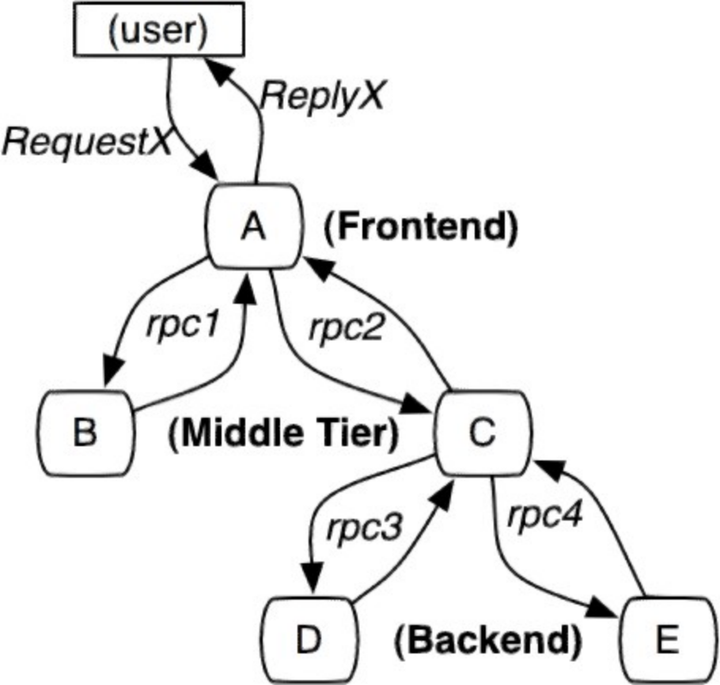

 


<font style="color:rgb(51,51,51);">分布式链路追踪（Distributed  Tracing），就是将一次分布式请求还原成调用链路，进行日志记录，性能监控并将一次分布式请求的调用情况集中展示。比如各个服务节点上的耗时、请求具体到达哪  台机器上、每个服务节点的请求状态等等。</font>

### <font style="color:rgb(51,51,51);">skywalking是什么</font>
<font style="color:rgb(51,51,51);">skywalking是一个国产开源框架，2015年由吴晟开源 ， 2017年加入Apache孵化器。skywalking是分布式系统的应用程序性能监视工具，专为微服务、云原生架构和基于容器（Docker、K8s、Mesos）架构而设计。它是一款优秀的APM（Application Performance  Management）工具，包括了分布式追踪、性能指标分析、应用和服务依赖分析等。</font>

<font style="color:rgb(51,51,51);">官网：</font>[http://skywalking.apache.org/](http://skywalking.apache.org/)

<font style="color:rgb(51,51,51);">下载：</font>[http://skywalking.apache.org/downloads/](http://skywalking.apache.org/downloads/)<font style="color:rgb(51,51,51);"> </font>

<font style="color:rgb(51,51,51);">Github：</font>[https://github.com/apache/skywalking](https://github.com/apache/skywalking)

<font style="color:rgb(51,51,51);">文档：</font>[https://skywalking.apache.org/docs/main/v8.4.0/readme/](https://skywalking.apache.org/docs/main/v8.3.0/readme/)

<font style="color:rgb(51,51,51);">中文文档：</font>[https://skyapm.github.io/document-cn-translation-of-skywalking/](https://skyapm.github.io/document-cn-translation-of-skywalking/)

### <font style="color:rgb(51,51,51);">链路追踪框架对比</font>
<font style="color:rgb(51,51,51);">1、</font><font style="color:rgb(51,51,51);">Zipkin是Twitter开源的调用链分析工具，目前基于springcloud sleuth得到了广泛的使用，特点是轻量，使用部署简单。</font>

<font style="color:rgb(51,51,51);">2、</font><font style="color:rgb(51,51,51);">Pinpoint是韩国人开源的基于字节码注入的调用链分析，以及应用监控分析工具。特点是支持多种插件，UI功能强大，接入端无代码侵入。</font>

<font style="color:rgb(51,51,51);">3、</font><font style="color:rgb(51,51,51);">SkyWalking是本土开源的基于字节码注入的调用链分析，以及应用监控分析工具。特点是支持多种插件，UI功能较强，接入端无代码侵入。目前已加入Apache孵化器。</font>

<font style="color:rgb(51,51,51);">4、</font><font style="color:rgb(51,51,51);">CAT是大众点评开源的基于编码和配置的调用链分析，应用监控分析，日志采集，监控报警等一系列的监控平台工具。</font>

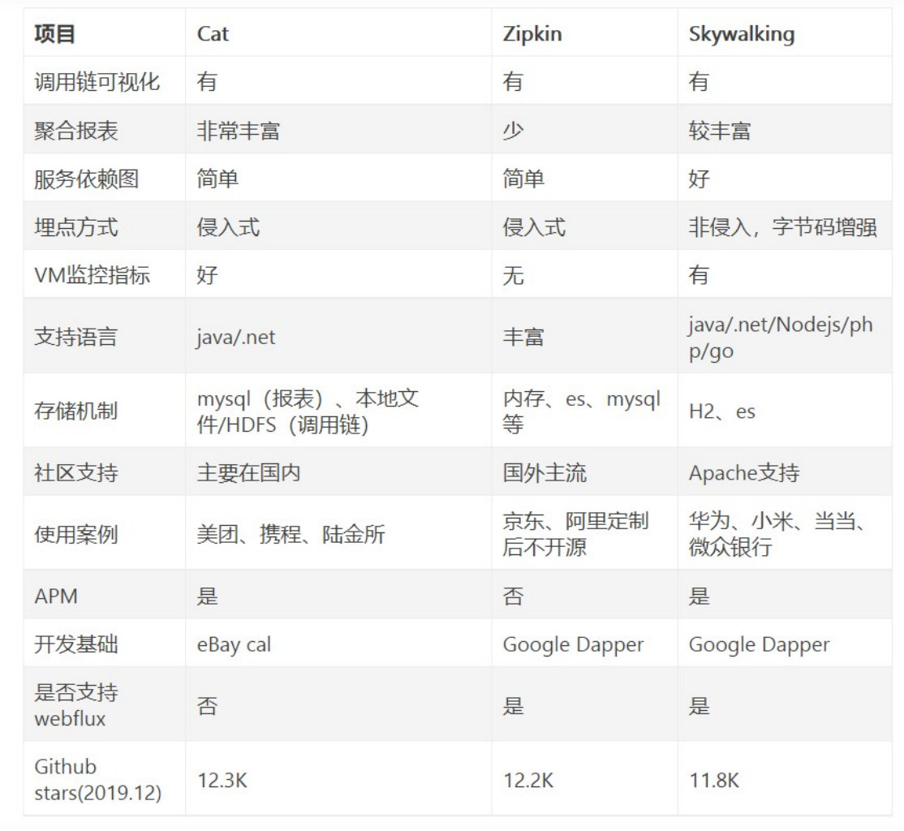

<font style="color:rgb(51,51,51);">常见的链路追踪技术有下面这些：</font>

**<font style="color:rgb(51,51,51);">cat </font>**<font style="color:rgb(51,51,51);">由大众点评开源，基于</font><font style="color:rgb(51,51,51);">Java</font><font style="color:rgb(51,51,51);">开发的实时应用监控平台，包括实时应用监控，业务监控</font><font style="color:rgb(51,51,51);">。</font><font style="color:rgb(51,51,51);">集成</font><font style="color:rgb(51,51,51);">方案是通过代码埋点的方式来实现监控，比如：</font><font style="color:rgb(51,51,51);">拦截器，过滤器等。</font><font style="color:rgb(51,51,51);">对代码的侵入性很大，集成</font><font style="color:rgb(51,51,51);">成本较高。风险较大。</font>

**<font style="color:rgb(51,51,51);">zipkin </font>**<font style="color:rgb(51,51,51);">由</font><font style="color:rgb(51,51,51);">Twitter</font><font style="color:rgb(51,51,51);">公司开源，开放源代码分布式的跟踪系统，用于收集服务的定时数据，以解决微服务架构中的延迟问题，包括：数据的收集、存储、查找和展现。该产品结合</font><font style="color:rgb(51,51,51);">spring-cloud-sleuth </font><font style="color:rgb(51,51,51);">使用较为简单，</font><font style="color:rgb(51,51,51);">集成很方便，</font><font style="color:rgb(51,51,51);">但是功能较简单。</font>

**<font style="color:rgb(51,51,51);">pinpoint </font>**<font style="color:rgb(51,51,51);">Pinpoint</font><font style="color:rgb(51,51,51);">是韩国人开源的基于字节码注入的调用链分析，以及应用监控分析工具。特点是支持多种插件，</font><font style="color:rgb(51,51,51);">UI</font><font style="color:rgb(51,51,51);">功能强大，接入端无代码侵入。</font>

##### **<font style="color:rgb(51,51,51);">skywalking</font>**
<font style="color:rgb(51,51,51);">SkyWalking</font><font style="color:rgb(51,51,51);">是本土开源的基于字节码注入的调用链分析，以及应用监控分析工具。特点是支持多</font><font style="color:rgb(51,51,51);">    </font><font style="color:rgb(51,51,51);">种插件，</font><font style="color:rgb(51,51,51);">UI</font><font style="color:rgb(51,51,51);">功能较强，接入端无代码侵入。目前已加入</font><font style="color:rgb(51,51,51);">Apache</font><font style="color:rgb(51,51,51);">孵化器。</font>

##### **<font style="color:rgb(51,51,51);">Sleuth</font>**
<font style="color:rgb(51,51,51);">SpringCloud </font><font style="color:rgb(51,51,51);">提供的分布式系统中链路追踪解决方案。</font>

### <font style="color:rgb(51,51,51);"> 性能对比</font>
<font style="color:rgb(51,51,51);">模拟了三种并发用户：</font><font style="color:rgb(51,51,51);">500，750，1000。使用jmeter测试，每个线程发送30个请求，设置思考时间为10ms。使用的采样率为1，即100%，这边与生产可能有差别。pinpoint默认的采样率为20，即50%，通过设置agent的配置文件改为100%。zipkin默认也是1。组合起来，一共有12种。下面看下汇总表：</font>

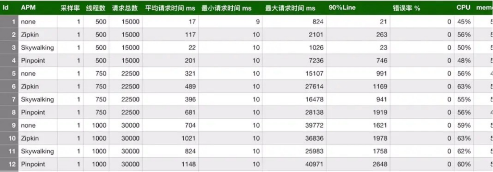

从上表可以看出，在三种链路监控组件中，**skywalking的探针对吞吐量的影响最小，zipkin的吞吐量居中。pinpoint的探针对吞吐量的影响较为明显**，在500并发用户时，测试服务的吞吐量从1385降低到774，影响很大。然后再看下CPU和memory的影响，在内部服务器进行的压测，对CPU和memory的影响都差不多在10%之内。

### <font style="color:rgb(51,51,51);"> Skywalking主要功能特性</font>
+ 多种监控手段，可以通过语言探针和service mesh获得监控的数据；
+ 支持多种语言自动探针，包括 Java，.NET Core 和 Node.JS；
+ 轻量高效，无需大数据平台和大量的服务器资源；
+ 模块化，UI、存储、集群管理都有多种机制可选；
+ 支持告警；
+ 优秀的可视化解决方案；

## <font style="color:rgb(51,51,51);">SkyWalking 环境搭建部署</font>
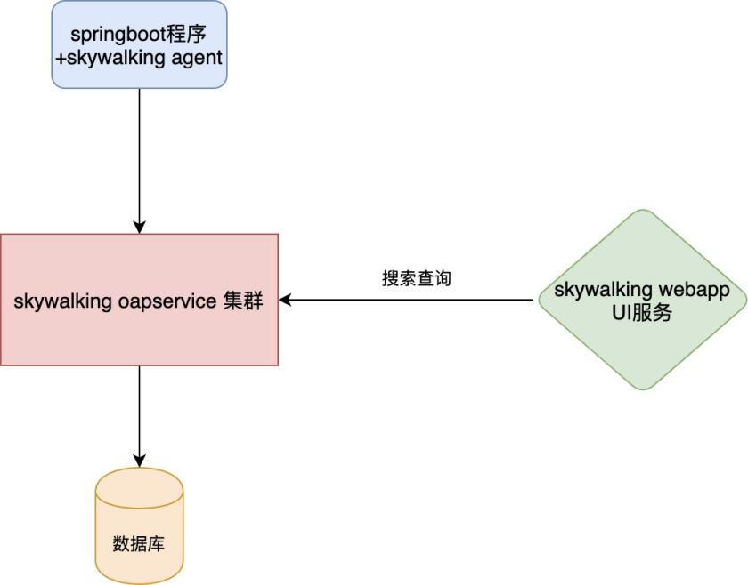

+ skywalking agent和业务系统绑定在一起，负责收集各种监控数据
+ skywalking oapservice是负责处理监控数据的，比如接受skywalking agent的监控数据，并存储在数据库中; 接受skywalking webapp的前端请求，从数据库查询数据，并返回数据给前端。skywalking  oapservice通常以集群的形式存在。
+ skywalking webapp，前端界面，用于展示数据。
+ 用于存储监控数据的数据库，比如mysql、elasticsearch等。

### <font style="color:rgb(51,51,51);"> 下载SkyWalking</font>
下载：[http://skywalking.apache.org/downloads/](http://skywalking.apache.org/downloads/)


**目录结构**

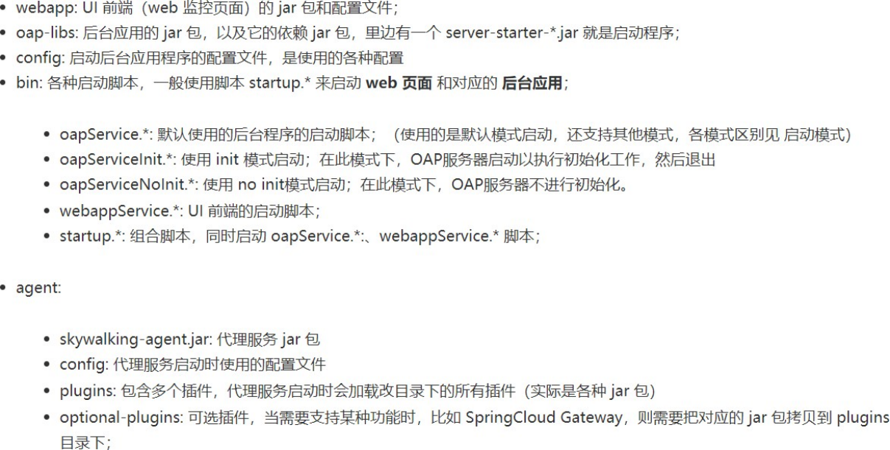

### <font style="color:rgb(51,51,51);"> 搭建SkyWalking OAP 服务</font>
<font style="color:rgb(51,51,51);">1、</font><font style="color:rgb(51,51,51);"> </font><font style="color:rgb(51,51,51);">修改</font>skywalking-web-ui端口

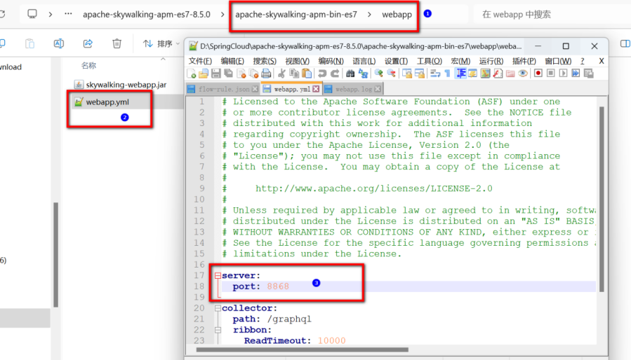

<font style="color:rgb(51,51,51);">2、</font><font style="color:rgb(51,51,51);"> </font><font style="color:rgb(51,51,51);">启动服务</font><font style="color:rgb(51,51,51);">bin/startup.bat</font>

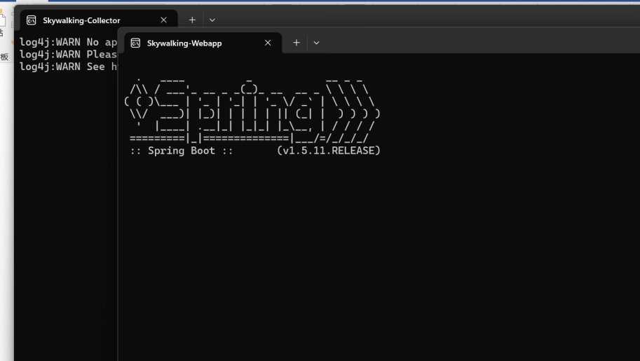

启动成功后会启动两个服务，一个是skywalking-oap-server，一个是skywalking-web-ui ： 8868

skywalking-oap-server服务启动后会暴露11800 和 12800  两个端口<font style="color:rgb(35,41,45);">，分别为</font><font style="color:rgb(223,64,42);">收集监控数据的端口11800和接受前端请求的端口12800</font><font style="color:rgb(35,41,45);">，</font>修改端口可以修改config/applicaiton.yml

<font style="color:rgb(51,51,51);">3、</font><font style="color:rgb(51,51,51);"> </font><font style="color:rgb(51,51,51);">日志信息存储在</font><font style="color:rgb(51,51,51);">logs目录</font>

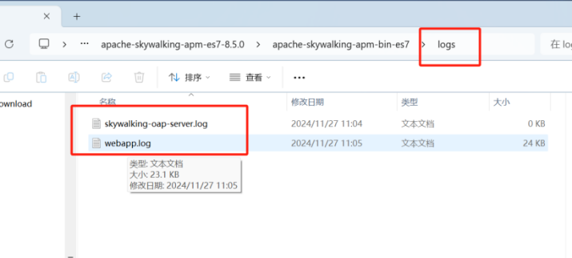

<font style="color:rgb(51,51,51);">4、</font><font style="color:rgb(51,51,51);"> </font><font style="color:rgb(51,51,51);">访问：</font>[http://localhost:8868/](http://localhost:8868/)

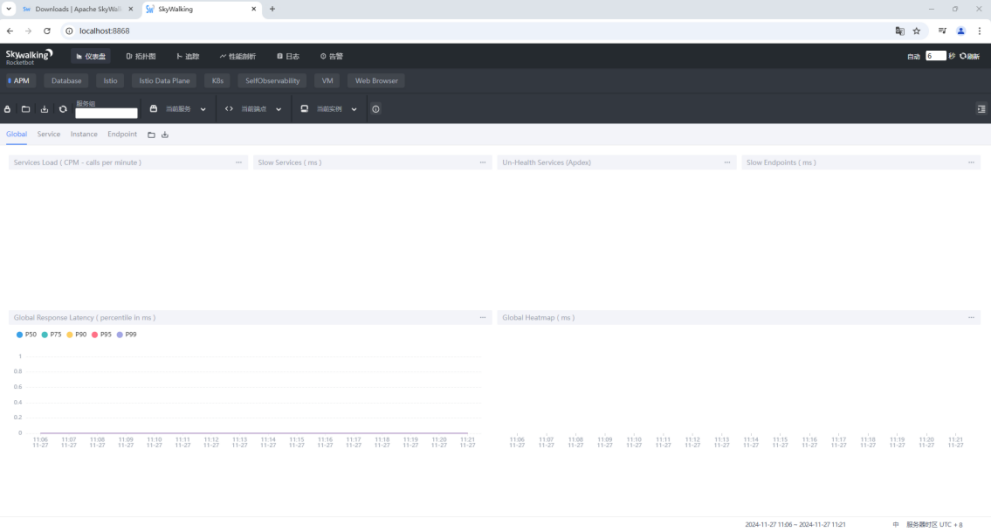

### <font style="color:rgb(51,51,51);"> SkyWalking中三个概念</font>
+ **服务(Service) ：**表示对请求提供相同行为的一系列或一组工作负载，在使用Agent时，可以定义服务的名字；
+ **服务实例****(Service Instance) ：**上述的一组工作负载中的每一个工作负载称为一个实例，  一个服务实例实际就是操作系统上的一个真实进程；
+ **端点(Endpoint) ：**对于特定服务所接收的请求路径, 如HTTP的URI路径和gRPC服务的类名 + 方法签名；

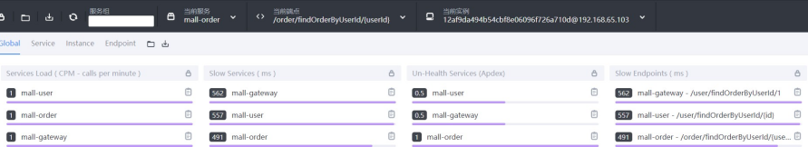

## <font style="color:rgb(51,51,51);"> SkyWalking接入微服务</font>
### Skywalking接入单个微服务
1、在运行的程序配置jvm参数，如下图所示：

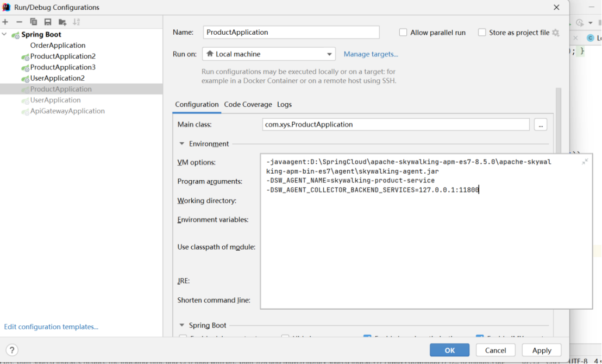

```xml
-javaagent:D:\SpringCloud\apache-skywalking-apm-es7-8.5.0\apache-skywalking-apm-bin-es7\agent\skywalking-agent.jar
-DSW_AGENT_NAME=skywalking-product-service
-DSW_AGENT_COLLECTOR_BACKEND_SERVICES=127.0.0.1:11800
```

**<font style="color:rgb(223,64,42);">注意：此处存在</font>****<font style="color:rgb(223,64,42);">bug，跟踪链路不显示gateway</font>**

2、拷贝agent/<font style="color:rgb(77,77,77);">optional-plugins目录下的gateway插件到</font>agent/<font style="color:rgb(77,77,77);">plugins目录</font>

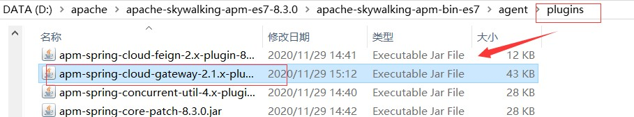

3、查看链路追踪

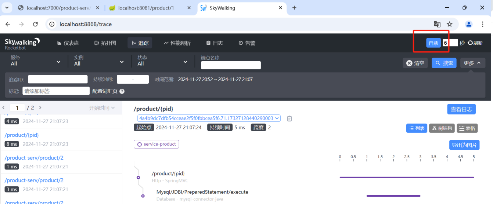

### <font style="color:rgb(51,51,51);">Skywalking跨多个微服务跟踪</font>
Skywalking跨多个微服务跟踪，只需要每个微服务启动时添加javaagent参数即可。

**<font style="color:rgb(51,51,51);"></font>**

## Skywalking持久化跟踪数据
默认使用的H2数据库存储   config/application.yml

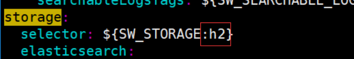

###  基于mysql持久化:
1. 修改config目录下的application.yml，使用mysql作为持久化存储的仓库


2. 修改mysql连接配置

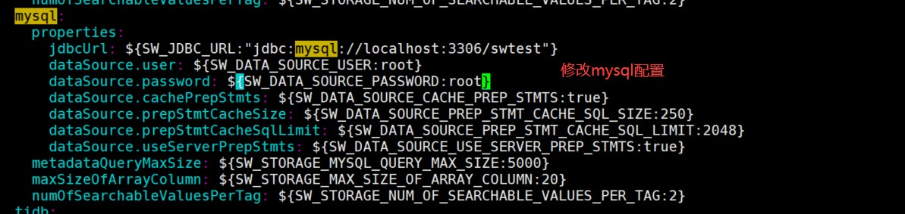

注意：<font style="color:rgb(223,64,42);">需要添加</font><font style="color:rgb(223,64,42);">mysql数据驱动包，因为在lib目录下是没有mysql数据驱动包的，所以修改完配置启动是会报错，启动失败的。</font>

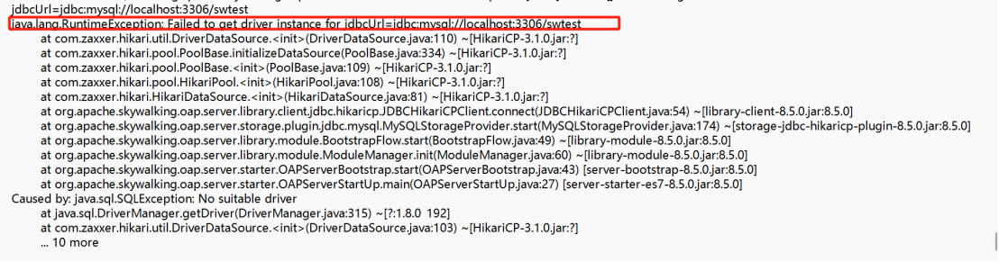

3. 添加mysql数据驱动包到oap-libs目录下

4. 启动Skywalking，发现依然报错

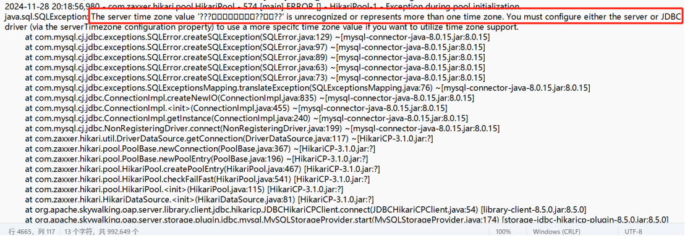

5. 修改config目录下的application.yml，使用mysql作为持久化存储的仓库

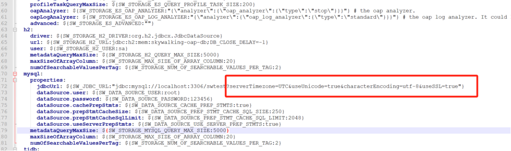

SW_JDBC_URL:"jdbc:mysql://localhost:3306/swtest?serverTimezone=UTC&useUnicode=true&characterEncoding=utf-8&useSSL=false"

<font style="color:#DF2A3F;">注意：数据库是否存在，如果不存在自己用sql语句创建一个</font>

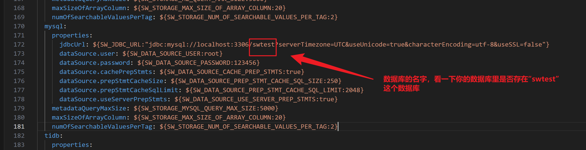

6．启动Skywalking，查看swtest数据库，可以看到生成了很多表。

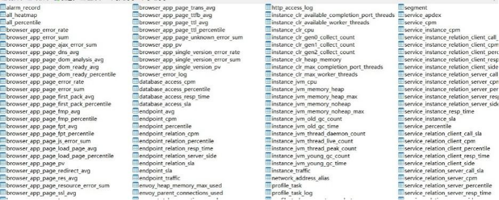

说明启动成功了，打开配置对应的地址<u><font style="color:rgb(0,56,132);">http://127.0.0.1:8868/</font></u>，可以看到skywalking的web界面。

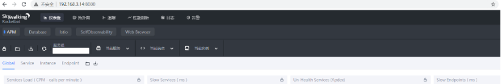

测试：重启skywalking，验证跟踪数据会不会丢失

**5、 自定义SkyWalking链路追踪**

如果我们希望对项目中的业务方法，实现链路追踪，方便我们排查问题，可以使用如下的代码引入依赖

```xml
<dependency>
    <groupId>org.apache.skywalking</groupId>
    <artifactId>apm-toolkit-trace</artifactId>
    <version>8.5.0</version>
</dependency>
```

**<font style="color:rgb(61,62,57);">5.1</font>****<font style="color:rgb(61,62,57);"> </font>****<font style="color:rgb(61,62,57);">@Trace</font>****<font style="color:rgb(61,62,57);">将方法加入追踪链路</font>**

如果一个业务方法想在ui界面的跟踪链路上显示出来，只需要在业务方法上加上<font style="color:rgb(0,111,192);">@Trace</font>注解即可

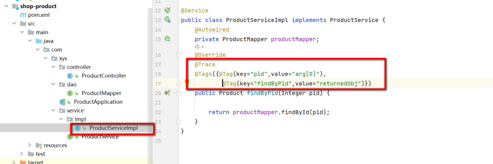

**<font style="color:rgb(51,51,51);">测试</font>**

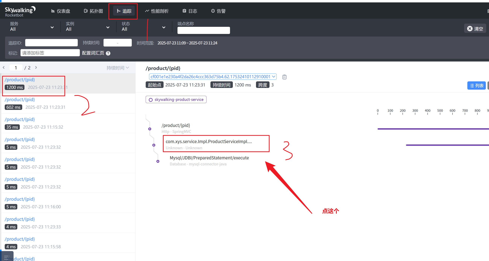

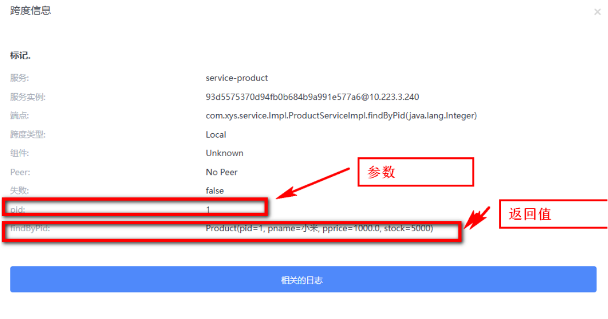

### <font style="color:rgb(51,51,51);">课堂练习：</font>
<font style="color:rgb(51,51,51);background-color:rgb(255,255,255);">在用户微服务上，自定义一个链路追踪，显示</font><font style="color:rgb(0,98,122);background-color:rgb(255,255,255);">findById</font><font style="color:rgb(8,8,8);background-color:rgb(255,255,255);">(</font><font style="color:rgb(0,0,0);background-color:rgb(255,255,255);">Integer </font><font style="color:rgb(8,8,8);background-color:rgb(255,255,255);">uid)</font><font style="color:rgb(8,8,8);background-color:rgb(255,255,255);">的参数和返回值</font>


<font style="color:rgb(51,51,51);"></font>


> 更新: 2025-07-23 13:26:49  
> 原文: <https://www.yuque.com/yayawei-srv9p/pf4se6/gub7gm7xwfznlrp6>